# The Complete Beginner's Guide to Bibliometric Literature Reviews
## From Scopus Data Extraction to Science Mapping with R and Biblioshiny


**Version:** 1.0

**Author:** [Adelaide Bernardelli]([adelaide.bernardelli@iusspavia.it](mailto:adelaide.bernardelli@iusspavia.it))

**License:** [CC BY-NC-SA 4.0](LICENSE.txt) ([Full text](https://creativecommons.org/licenses/by-nc-sa/4.0/))

**Topics:** Search strategy • Data extraction • Performance analysis • Science mapping 
 
**PDF Version:** [Download Full Guide (PDF)](Bibliometrix-Guide.pdf)

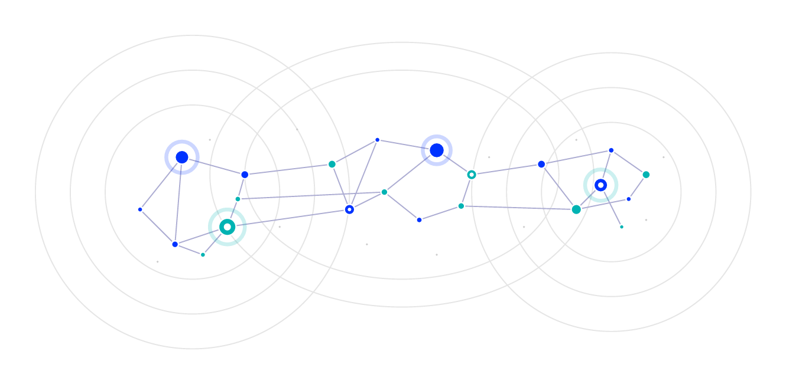

---

> **Who Is This Guide For?**  
> This handbook is designed specifically for **university students** (Bachelor's, Master's, and early-stage PhD students) and researchers who are approaching a **literature review** for the very first time. Whether you are preparing your final thesis, writing the theoretical background for an empirical research paper, or exploring a brand-new academic topic from scratch, this step-by-step manual will walk you through the entire workflow of a **bibliometric review** from formulating a search query on **Scopus** to running advanced visual and statistical analyses in **Biblioshiny** without writing a single line of complex code.

---

## Table of Contents

1. [**Module 1: Introduction to Literature Reviews and Bibliometric Analysis**](#module-1-introduction-to-literature-reviews-and-bibliometric-analysis)
   - 1.1 Why Do We Conduct Literature Reviews at University?
   - 1.2 What Is a Bibliometric Review? (And How It Differs from Classical Narrative Reviews)
   - 1.3 What Does a Bibliometric Review Analyze? The Five Core Dimensions
   - 1.4 Why and When Should You Conduct a Bibliometric Review?
   - 1.5 Our Software Toolkit: R, `bibliometrix`, and the No-Code `Biblioshiny` Interface
2. [**Module 2: Mastering Scopus — Bibliographic Search, Filtering, and Data Export**](#module-2-mastering-scopus--bibliographic-search-filtering-and-data-export)
   - 2.1 What Is Scopus? Key Features, Coverage, and Citation Indexing
   - 2.2 How to Access Scopus via Institutional Credentials
   - 2.3 Navigating the Scopus Search Interface and Metadata Fields
   - 2.4 Formulating a Search Query: The `"sustainability"` AND `"inequality"` Case Study
   - 2.5 Refining Your Search: Mastering the Left Sidebar Filters
   - 2.6 Previewing Your Collection with Scopus *Analyze Results*
   - 2.7 Exporting the Bibliographic Dataset in BibTeX (`.bib`) Format
   - 2.8 Saving Your Search and Ensuring Methodological Reproducibility
3. [**Module 3: Getting Started with R, RStudio, and Launching Biblioshiny**](#module-3-getting-started-with-r-rstudio-and-launching-biblioshiny)
   - 3.1 What Are R and RStudio? A Beginner-Friendly Primer
   - 3.2 How to Download and Install R and RStudio
   - 3.3 Understanding the Four Panes of the RStudio Workspace
   - 3.4 Installing `bibliometrix` and Launching `Biblioshiny` from the Console
4. [**Module 4: Building Your Bibliometric Collection in Biblioshiny (`Data → Import or Load`)**](#module-4-building-your-bibliometric-collection-in-biblioshiny)
   - 4.1 The *Import or Load* Module: Three Flexible Ways to Load Data
   - 4.2 Step-by-Step Walkthrough: Importing Our Raw Scopus `.bib` File
   - 4.3 Post-Import Features, Exporting Collections, and Best Practices
   - 4.4 Auditing Data Quality: The *Completeness of Metadata* (Missing Data) Table
   - 4.5 Mastering Biblioshiny's Universal Action Icons
5. [**Module 5: Descriptive Performance Analysis — Overview of the Collection**](#module-5-descriptive-performance-analysis--overview-of-the-collection)
   - 5.1 Navigating the `Analysis → Overview` Module
   - 5.2 `Main Information`: Deep-Dive Interpretation of All 12 Bibliometric Indicators
   - 5.3 `Annual Scientific Production`: Analyzing Growth Trends Over Time
   - 5.4 `Life Cycle of Scientific Production`: Logistic Growth Modeling, Saturation ($K$), Peak Year ($t_m$), and Forecasting
6. [**Module 6: Analyzing Publication Outlets — Sources and Bradford's Law**](#module-6-analyzing-publication-outlets--sources-and-bradfords-law)
   - 6.1 Navigating `Analysis → Sources` and Identifying the *Most Relevant Sources*
   - 6.2 `Bradford's Law of Scattering`: Identifying Core Journals (Zone 1, Zone 2, Zone 3) and Statistical Fit
7. [**Module 7: Analyzing Scientific Actors — Authors, Lotka's Law, and Countries**](#module-7-analyzing-scientific-actors--authors-lotkas-law-and-countries)
   - 7.1 Navigating `Analysis → Authors` and Identifying the *Most Relevant Authors*
   - 7.2 `Authors' Production over Time`: Interpreting Career Timelines and Citation Intensity
   - 7.3 `Lotka's Law of Scientific Productivity`: Mathematical Foundations and Empirical Interpretation
   - 7.4 `Corresponding Author's Countries`: Domestic (SCP) vs. International (MCP) Collaboration
8. [**Module 8: Analyzing Documents and Keywords — Citation Classics, WordCloud Cleaning, and Trend Topics**](#module-8-analyzing-documents-and-keywords--citation-classics-wordcloud-cleaning-and-trend-topics)
   - 8.1 Navigating `Analysis → Documents` and Finding Seminal Papers (*Most Global Cited Documents*)
   - 8.2 `WordCloud` Fundamentals and the Problem of Raw Uncleaned Data
   - 8.3 Choosing the Right Text Field: *Author's Keywords* vs. *Keywords Plus* and *All Keywords*
   - 8.4 Text Editing Part 1: Removing Noise and Search Terms (*Stop Words*)
   - 8.5 Text Editing Part 2: Grouping Equivalent Concepts (*Synonyms*) and Customizing Visual *Parameters*
   - 8.6 `Trend Topics`: Mapping the Chronological Evolution of Research Themes
9. [**Module 9: Science Mapping I — Conceptual Structure (Co-occurrence Network and Thematic Map)**](#module-9-science-mapping-i--conceptual-structure-co-occurrence-network-and-thematic-map)
   - 9.1 Navigating `Synthesis → Conceptual Structure` and Understanding Co-Word Analysis
   - 9.2 Configuring the *Co-occurrence Network*: Method Parameters, Clustering Algorithms (Louvain), Filtering, and Graphical Settings
   - 9.3 Alternative Network Views: *Density Heatmap* and the Animated *Diachronic Network* (2018–2024)
   - 9.4 `Thematic Map` (Callon's Strategic Diagram): Centrality, Density, and the Four Strategic Quadrants
10. [**Module 10: Science Mapping II — Social Structure (Countries' Collaboration World Map)**](#module-10-science-mapping-ii--social-structure-countries-collaboration-world-map)
    - 10.1 Configuring and Interpreting the *Countries' Collaboration World Map*
11. [**Module 11: Exporting the Cumulative Report, Troubleshooting, and Closing Biblioshiny**](#module-11-exporting-the-cumulative-report-troubleshooting-and-closing-biblioshiny)
    - 11.1 Compiling and Exporting the Cumulative Excel *Report*
    - 11.2 Troubleshooting: What to Do If the Exported Excel Report Does Not Open on Windows
    - 11.3 Properly Stopping Biblioshiny and Closing Your RStudio Session
12. [**Appendix: Quick Reference Workflow Checklist for Your Thesis or Paper**](#appendix-quick-reference-workflow-checklist-for-your-thesis-or-paper)
13. [**References & Bibliography**](#references--bibliography)
    - 13.1 Methodological, Statistical, and Scientometric Foundations
    - 13.2 Empirical Case Study Landmark Papers Cited in the Guide (*Sustainability & Inequality*)
    - 13.3 Software, R Packages, and Bibliographic Databases

---

# Module 1: Introduction to Literature Reviews and Bibliometric Analysis

## 1.1 Why Do We Conduct Literature Reviews at University?

Every academic journey—whether a Bachelor's dissertation, a Master's thesis, a doctoral project, or a peer-reviewed journal article—begins with the same fundamental requirement: **understanding what has already been researched and published on your topic**. In academia, science is cumulative. As Isaac Newton famously wrote, we see further only by *"standing on the shoulders of giants."*

When students approach a new research topic for the first time, however, they often experience **information overload**. Typing a broad topic such as *"sustainability and inequality"* or *"artificial intelligence in healthcare"* into Google Scholar immediately returns tens of thousands—or even millions—of papers. Without a structured method, students face three common pitfalls:

1. **Random Selection Bias**: Reading whichever articles happen to appear on the first page of a search engine, without knowing whether those papers are truly influential, peer-reviewed, or representative of the broader debate.
2. **Missing Seminal "Landmark" Works**: Overlooking the foundational papers that every scholar in that discipline cites and expects to see in a thesis bibliography.
3. **Lack of Big-Picture Structure**: Getting lost in the details of 10 or 15 individual papers without grasping how the field evolved over time, which academic journals lead the conversation, which countries or research groups dominate the output, and what the major thematic clusters and emerging frontiers are.

This is precisely where a **bibliometric review** becomes an indispensable compass.

---

## 1.2 What Is a Bibliometric Review? (And How It Differs from Classical Narrative Reviews)

A **bibliometric review** (or *bibliometric analysis*) is a rigorous quantitative study that applies mathematical, statistical, and network-science methods to analyze large volumes of scientific literature on a given topic.

Instead of reading and summarizing the full text of a few dozen articles one by one—as happens in a traditional **narrative literature review** or a small-scale **systematic literature review (SLR)**—the bibliometric approach processes the **bibliographic metadata** of hundreds or thousands of publications simultaneously in order to **map the intellectual, conceptual, and social structure of an entire research field**.

| Feature | Traditional Narrative Review | Systematic Literature Review (SLR) | Bibliometric Review |
| :--- | :--- | :--- | :--- |
| **Typical Sample Size** | Small (20 to 80 papers) | Medium (30 to 150 papers) | **Large (300 to 5,000+ papers)** |
| **Primary Approach** | Qualitative reading & thematic synthesis | Qualitative/quantitative coding of full texts using strict inclusion protocols (e.g., PRISMA) | **Quantitative, statistical, and network analysis of bibliographic metadata** |
| **Unit of Analysis** | Full text of selected articles | Full text findings of eligible studies | **Metadata (Authors, Titles, Journals, Year, Keywords, Affiliations, Citations, References)** |
| **Level of Subjectivity** | High (author selects and interprets texts) | Low-to-Medium (transparent protocol, manual coding) | **Very Low / Highly Reproducible (algorithmic and statistical mapping)** |
| **Main Goal** | Summarize arguments and theoretical perspectives | Answer a narrow, specific empirical research question | **Map the macro-structure, evolution, key actors, landmark works, and thematic clusters of a field** |

> **Key Takeaway for Students:**  
> A bibliometric review does **not** replace reading papers! Rather, it acts as a **macro-telescope** that shows you the entire landscape of a research domain first, and then zooms in to tell you *which exact 10, 20, or 30 landmark and emerging papers you should read in full* for your narrative or systematic discussion.

---

## 1.3 What Does a Bibliometric Review Analyze? The Five Core Dimensions

In bibliometric methodology (following the classic framework established by Aria & Cuccurullo, 2017, and Donthu et al., 2021), a comprehensive review investigates **five interconnected dimensions**, grouped into **Performance Analysis** (measuring productivity and impact) and **Science Mapping** (visualizing relationships and networks):

1. **Production Statistics and Temporal Evolution**:
   - Tracking the trend of scientific publications across the years. Is scholarly interest in the topic growing exponentially, stagnating, or declining? What stage of its scientific life cycle is the topic currently in?
2. **Main Scientific Actors (Authors, Institutions, and Countries)**:
   - Identifying the most prolific and influential scholars, the leading universities and research centers, and the countries driving global knowledge production. How is productivity distributed across authors (e.g., *Lotka's Law*)?
3. **Publication Sources (Journals)**:
   - Discovering which scientific journals publish the highest volume of research on the topic and generate the greatest citation impact. Which journals form the "core" reading list of the discipline (e.g., *Bradford's Law*)?
4. **Citation Analysis and Landmark Papers**:
   - Identifying the foundational, most-cited works (*citation classics* or *landmark papers*) that shaped the field, as well as how studies cite one another over time.
5. **Collaboration Networks and Keyword Structures (Science Mapping)**:
   - **Co-authorship Analysis (*Social Structure*)**: Who collaborates with whom? How frequently do researchers from different countries co-author papers together?
   - **Co-citation and Bibliographic Coupling (*Intellectual Structure*)**: How do references link papers into schools of thought?
   - **Co-word / Co-occurrence Analysis (*Conceptual Structure*)**: Which keywords frequently appear together in the same articles to form distinct **thematic clusters**? Which themes are foundational ("basic"), well-developed ("motor"), specialized ("niche"), or newly emerging?

---

## 1.4 Why and When Should You Conduct a Bibliometric Review?

For a university student or academic researcher, mastering bibliometric analysis offers concrete advantages across multiple scenarios:

- **Writing a Bachelor's or Master's Thesis**:
  - You can dedicate an entire chapter of your thesis to a bibliometric analysis of your topic (or write a full bibliometric thesis!). Examiners highly value bibliometric chapters because they demonstrate methodological rigor, data analysis skills, and an objective mastery of the literature.
- **Preparing a Publishable Academic Paper**:
  - Bibliometric reviews—or hybrid reviews combining a bibliometric mapping section with a qualitative content analysis of the identified clusters—are among the most widely read and highly cited article formats in international peer-reviewed journals.
- **Building Instant Orientation in a New Field (Without Wasting Weeks on Google Scholar)**:
  - Whenever you start exploring an unfamiliar topic, running a 30-minute bibliometric scan on Scopus and Biblioshiny immediately gives you:
    - The **top 10–15 most cited landmark papers** (with direct DOI links) that you *must* read and cite.
    - The **top 10 core journals** where the best research on your topic is published.
    - The **evolution of keywords and Trend Topics**, showing you which concepts were popular 5 years ago versus which topics are at the cutting edge right now.
- **Identifying Research Gaps and Justifying Your Research Question**:
  - By looking at a **Thematic Map** or **Co-occurrence Network**, you can objectively prove that two concepts have rarely been studied together, or that a specific sub-theme is currently emerging and requires further investigation.
- **Selecting Target Journals or Supervisors/Collaborators**:
  - Looking at *Most Relevant Sources* and *Most Relevant Authors/Affiliations* helps Master's and PhD students identify which journals to submit their work to, or which professors and research labs in Europe and worldwide specialize in their exact topic.

---

## 1.5 Our Software Toolkit: R, `bibliometrix`, and the No-Code `Biblioshiny` Interface

Historically, conducting a bibliometric review required advanced programming skills, complex command-line scripts, or stitching together multiple separate software tools (such as BibExcel, Pajek, Gephi, SciMAT, or VOSviewer) that each performed only a fraction of the workflow.

In this guide, we use the most comprehensive, all-in-one open-source solution available in contemporary academic research:

- **The `bibliometrix` R Package**: Created in 2017 by Professors **Massimo Aria** and **Corrado Cuccurullo** (University of Naples Federico II & University of Campania Luigi Vanvitelli), `bibliometrix` is an open-source package written in the **R** statistical language that automates the entire science-mapping and performance-analysis workflow.
  - **Official Website**: [https://www.bibliometrix.org/](https://www.bibliometrix.org/)
- **`Biblioshiny` (The Web Interface for `bibliometrix`)**: You do **not** need to learn how to write code in R! Built on top of R's `Shiny` framework, **Biblioshiny** provides an intuitive, point-and-click graphical web interface that runs directly in your browser. It gives you full access to every statistical model, network algorithm, and visualization in `bibliometrix` through menus, buttons, and interactive charts.
  - **Official Biblioshiny Page**: [https://www.bibliometrix.org/biblioshiny/](https://www.bibliometrix.org/biblioshiny/)

### Supported Bibliographic Databases
Biblioshiny is compatible with data exported from all major international scientific databases:
- **Scopus** (Elsevier)
- **Web of Science / Clarivate Analytics** (WoS / WoK)
- **OpenAlex** (via file export or direct API integration)
- **Dimensions** (Digital Science)
- **The Lens** (`Lens.org`)
- **PubMed / MEDLINE** (biomedical and life sciences)
- **Cochrane Library** (evidence-based medicine and clinical trials)

In this guide, we will use **Scopus**, as it offers the broadest multidisciplinary coverage of peer-reviewed journals across both the Social Sciences and STEM disciplines, and is standard across Italian and international universities.

---

# Module 2: Mastering Scopus — Bibliographic Search, Filtering, and Data Export

## 2.1 What Is Scopus? Key Features, Coverage, and Citation Indexing

**Scopus** ([https://www.scopus.com](https://www.scopus.com)) is one of the world's largest curated abstract and citation databases of peer-reviewed scientific literature. Launched and managed by the academic publisher **Elsevier** in 2004, it indexes tens of millions of scholarly records from across the globe, serving as a cornerstone tool for academic literature searches and research evaluation.

### Key Characteristics of Scopus
1. **Comprehensive Multidisciplinary Coverage**:
   - Scopus indexes over 27,000 active peer-reviewed journals, hundreds of thousands of academic books, conference proceedings, and international patents. It covers four broad macro-areas: **Physical Sciences**, **Health Sciences**, **Life Sciences**, and **Social Sciences & Humanities** (including Economics, Business, Management, Environmental Studies, and Engineering).
2. **Complete Citation Network**:
   - For every indexed article or author, Scopus tracks both **backward citations** (the bibliography/references cited by the paper) and **forward citations** (all subsequent peer-reviewed papers that have cited that article). This makes it possible to measure the real-world scientific impact of a publication over time.
3. **Automated Bibliometric Indicators**:
   - Scopus automatically calculates quantitative metrics to evaluate the productivity and influence of researchers, journals, and institutions—most famously the **$h$-index** (Hirsch index), CiteScore, SJR (SCImago Journal Rank), and SNIP (Source Normalized Impact per Paper).
4. **Curated Author and Organization Profiles**:
   - Using disambiguation algorithms (Scopus Author ID), Scopus generates dedicated profile pages for individual scholars (listing their publication history, co-authors, citation trends, and $h$-index) as well as for universities and research institutes.
5. **Institutional Access Model**:
   - While basic author previews exist for free, full access to Scopus's search engine, advanced filters, analytics, and bulk data export requires an **institutional subscription** provided by your university or research center.

---

## 2.2 How to Access Scopus via Institutional Credentials

To begin your search, open your web browser and navigate to **[https://www.scopus.com](https://www.scopus.com)**.

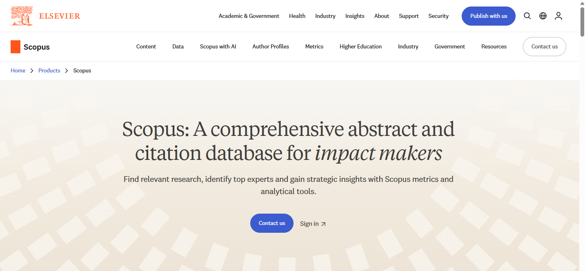

If you are connecting from home or outside your university's Wi-Fi network, you will initially see the public Elsevier Scopus overview page (**Figure 1**). To unlock the full database:

1. Click on the **Sign in** button (located in the top-right corner or next to the blue *Contact us* button).
2. Choose **Sign in via your institution** (or log in directly using your institutional university email address—for example, at the University of Pavia, your `@universitadipavia.it` credentials).
3. Once authenticated through your university's Single Sign-On (IDEM/Garr or Shibboleth), Scopus will recognize your affiliation and open the full search dashboard (**Figure 2**), displaying a banner at the top-left such as *"Brought to you by Università di Pavia"*.

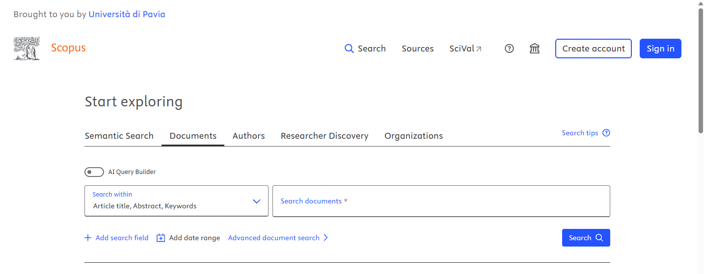

---

## 2.3 Navigating the Scopus Search Interface and Metadata Fields

Once inside the main Scopus interface (**Figure 3**), look at the central **"Start exploring"** panel.

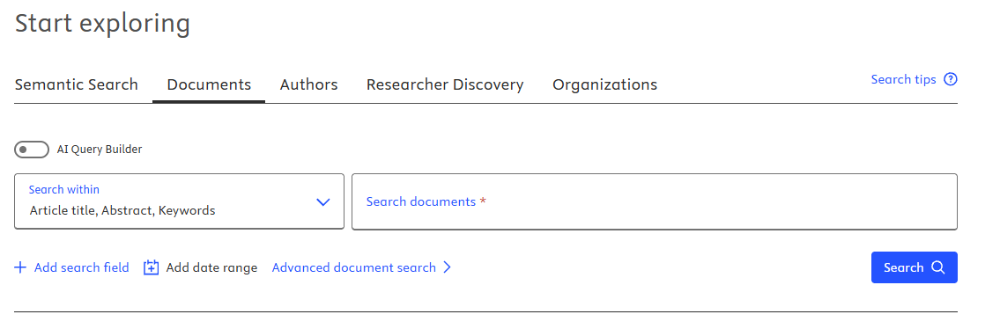

Here you can see several top tabs (*Semantic Search*, *Documents*, *Authors*, *Researcher Discovery*, *Organizations*). Make sure you are on the **Documents** tab (selected by default).

The search bar consists of two primary elements:
- **`Search within` (Left Dropdown)**: Defines *which part of each document's metadata* Scopus will scan for your keywords. By default, it is set to **`Article title, Abstract, Keywords`** (`TITLE-ABS-KEY`).
- **`Search documents` (Right Input Box)**: Where you type your search terms and Boolean operators.
- Below the bar, you can click **`+ Add search field`** to combine multiple rows with `AND`, `OR`, or `AND NOT`, **`Add date range`** to restrict publication years upfront, or **`Advanced document search`** to write raw Boolean query strings directly.

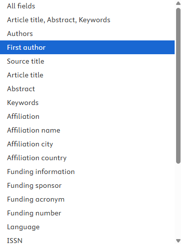

If you click on the **`Search within`** dropdown (**Figure 4**), Scopus displays all available metadata fields you can query:
- **All fields**: Searches everywhere in the record (including affiliations, funding text, and journal names). *Warning: Usually too broad and noisy for a bibliometric review!*
- **Article title, Abstract, Keywords** *(Recommended Default)*: Searches simultaneously in the paper's title, its abstract summary, and its keywords (both author keywords and indexed keywords). This is the **international gold standard** for bibliometric searches because it captures all papers genuinely focused on your topic without pulling in tangential mentions.
- **Article title**: Searches *only* in the title of the paper. Useful only if your topic is extremely vast (e.g., 50,000+ results) and you want to restrict your dataset strictly to papers whose primary headline focus is your exact term.
- **Authors / First author / Source title / Affiliation / Funding sponsor / Language / ISSN**: Specialized filters for targeted searches.

---

## 2.4 Formulating a Search Query: The `"sustainability"` AND `"inequality"` Case Study

Every bibliometric review starts either from a broad thematic intersection or from a specific research question. In our complete walkthrough, we want to investigate how the scientific literature connects **sustainability** and **inequality**.


As shown in **Figure 5**, we keep `Search within` set to **`Article title, Abstract, Keywords`** and type:

```text
"sustainability" "inequality"
```

*(Note: In Scopus's standard search box, placing a space between two quoted terms automatically applies the Boolean **`AND`** operator, meaning Scopus retrieves every document that contains BOTH the word `"sustainability"` AND the word `"inequality"` in its title, abstract, or keywords. You can also explicitly write `"sustainability" AND "inequality"`.)*

> **Pro Tip on Wildcards (`*`) and Boolean Operators in Scopus:**
> - **`AND`**: Narrows the search—both terms must be present (e.g., `"sustainability" AND "inequality"`).
> - **`OR`**: Broadens the search—at least one of the synonyms must be present (e.g., `"inequality" OR "disparity"`).
> - **`AND NOT`**: Excludes unwanted terms.
> - **Quotation Marks (`"..."`)**: Forces an exact word or multi-word phrase match (e.g., `"sustainable development"`).
> - **Asterisk Wildcard (`*`)**: Matches any word ending/suffix. For instance, searching `sustainab*` will simultaneously match *sustainability*, *sustainable*, and *sustainably*, while `inequalit*` matches both singular *inequality* and plural *inequalities*. In our case study, we specifically search `"sustainability" "inequality"` to replicate the exact dataset of 1,686 articles analyzed throughout this guide.

Clicking the blue **Search** button returns an initial total of **8,695 documents found** (**Figure 5**). For a focused bibliometric review—and for a student's thesis—8,695 raw records spanning all decades, languages, book chapters, editorials, and unrelated disciplines is too noisy. We now need to apply systematic **inclusion and exclusion criteria** using Scopus's left sidebar.

---

## 2.5 Refining Your Search: Mastering the Left Sidebar Filters

On the left side of the Scopus results page (**Figures 6, 7, and 8**), you will find the **Refine search / Filters** sidebar. This sidebar allows you to narrow down your collection transparently and systematically.

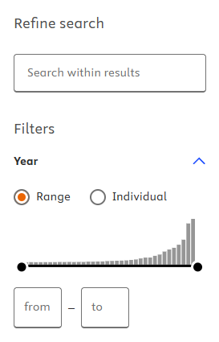

1. **`Search within results` & `Year` Filter (Figure 6)**:
   - You can add extra keywords inside *Search within results* to narrow the scope further, or adjust the publication **Year** range.
   - **Methodological Best Practice — Always Exclude the Current Unfinished Year**: When selecting your time window, it is standard academic practice to exclude the current calendar year if it has not yet ended, because databases continue indexing papers for several months; including a partial year creates an artificial "drop" at the right end of your annual production chart. Focusing on a recent, coherent multi-year window (for example, **2018 to 2024**) ensures complete annual data and manageable volume.

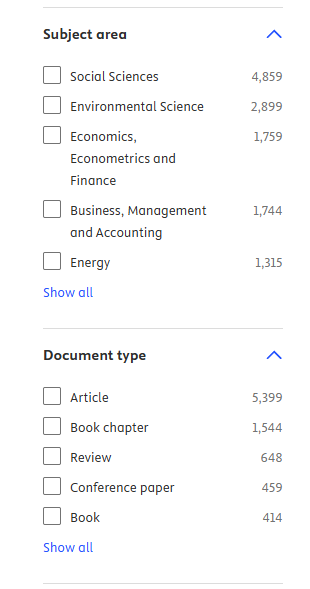

2. **`Subject area` and `Document type` Filters (Figure 7)**:
   - **Subject area**: Shows how your 8,695 documents are distributed across disciplines (*Social Sciences*: 4,859; *Environmental Science*: 2,899; *Economics, Econometrics and Finance*: 1,759; *Business, Management and Accounting*: 1,744; *Energy*: 1,315, etc.). Selecting the subject areas relevant to your degree program or research question prevents papers from unrelated fields (e.g., clinical medicine or pure chemistry) from polluting your keyword networks.
   - **Document type**: Lists the publication formats (*Article*: 5,399; *Book chapter*: 1,544; *Review*: 648; *Conference paper*: 459; *Book*: 414, plus Editorials, Notes, Errata, etc.). In bibliometric reviews, researchers typically select **only `Article`** (or `Article` and `Review`), excluding book chapters, conference abstracts, and editorials because peer-reviewed journal articles undergo rigorous refereeing and carry standardized, complete metadata.

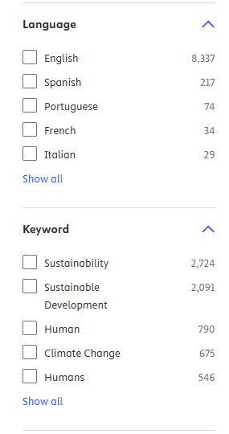

3. **`Language`, `Keyword`, and Other Filters (Figure 8)**:
   - **Language**: The vast majority of international scientific literature is in **English** (8,337 out of 8,695 documents here, followed by Spanish with 217, Portuguese with 74, French with 34, and Italian with 29). Restricting your dataset to **English** is essential for text-mining modules in Biblioshiny (such as *WordCloud*, *Trend Topics*, *Co-occurrence Network*, and *Thematic Map*); mixing multiple languages causes the software to treat English and Spanish/Italian terms as separate keywords.
   - **Keyword / Source title / Source type / Publication stage**: You can also filter by specific indexed keywords, specific journals (*Source title*), or source types (*Journal* vs. *Book series*).

### Applying the Filters in Our Case Study

Let's look at the exact filters we apply to refine our `"sustainability" "inequality"` search (**Figures 9 and 10**):

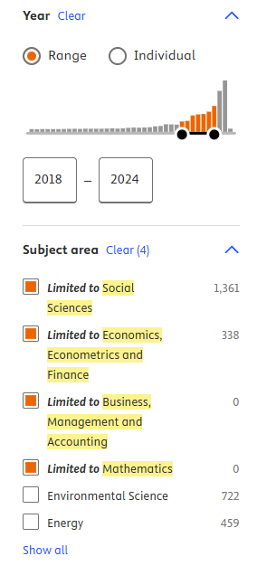

- **Year**: Set to the range **`2018` – `2024`** (**Figure 9**).
- **Subject area**: Limited to four core socio-economic and quantitative areas (**Figure 9**):
  - `Social Sciences`
  - `Economics, Econometrics and Finance`
  - `Business, Management and Accounting`
  - `Mathematics`

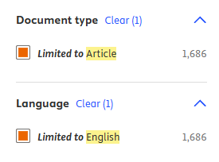

- **Document type**: Limited strictly to **`Article`** (**Figure 10**).
- **Language**: Limited strictly to **`English`** (**Figure 10**).

*(Remember: after checking the boxes in the Scopus sidebar, click the **`Limit to`** button to apply the filter!)*

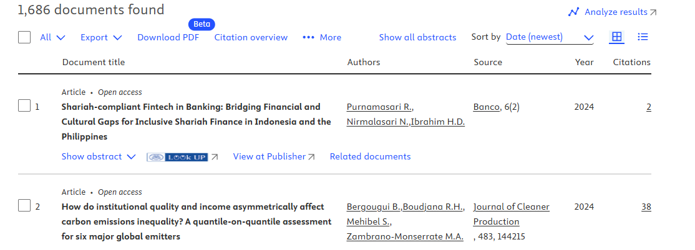

As shown in **Figure 11**, applying these clear, reproducible filters reduces our initial 8,695 documents to a highly coherent, high-quality dataset of **1,686 documents found**.

---

## 2.6 Previewing Your Collection with Scopus *Analyze Results*

Before exporting the data to Biblioshiny, Scopus offers a very handy built-in visual summary. Look at the top-right corner above the document list in **Figure 11** and click on **`Analyze results`**.

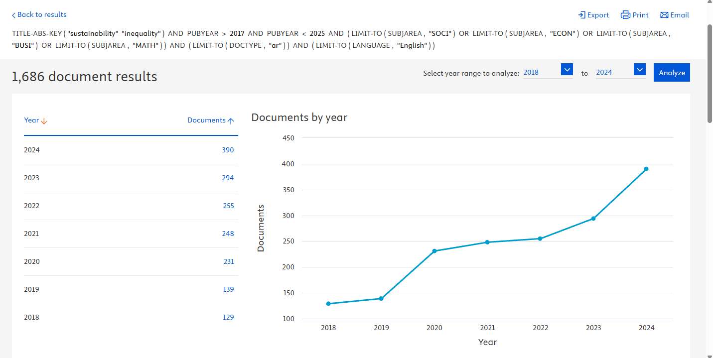

The **Analyze results** dashboard (**Figure 12**) immediately gives you two valuable things:

1. **The Complete Reproducible Search String (Top Box)**:
   At the very top of **Figure 12**, Scopus prints the exact formal query code encompassing your keywords and every single filter you applied:
   ```text
   TITLE-ABS-KEY ( "sustainability" "inequality" ) AND PUBYEAR > 2017 AND PUBYEAR < 2025 AND ( LIMIT-TO ( SUBJAREA , "SOCI" ) OR LIMIT-TO ( SUBJAREA , "ECON" ) OR LIMIT-TO ( SUBJAREA , "BUSI" ) OR LIMIT-TO ( SUBJAREA , "MATH" ) ) AND ( LIMIT-TO ( DOCTYPE , "ar" ) ) AND ( LIMIT-TO ( LANGUAGE , "English" ) )
   ```
   *Tip: Copy and paste this exact string into a Word/text file right away! Putting this string in the "Methodology" section of your thesis guarantees 100% scientific reproducibility.*
2. **Documents by Year Chart**:
   Gives you an immediate preview of the temporal trend from 2018 (129 documents) to 2024 (390 documents)—confirming that the numbers match what we will shortly see inside Biblioshiny.

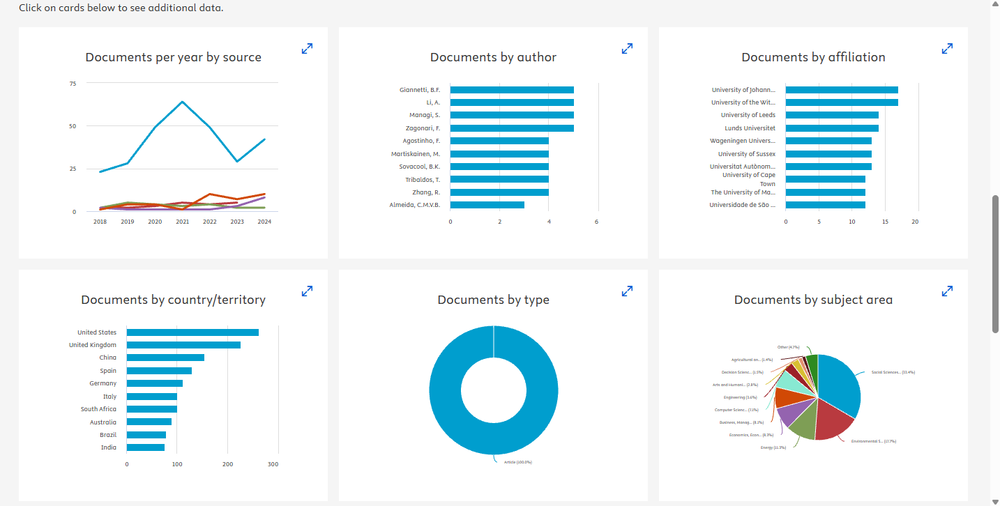

Scrolling down the *Analyze results* page (**Figure 13**) reveals six interactive preview cards:
- *Documents per year by source*
- *Documents by author*
- *Documents by affiliation* (leading universities)
- *Documents by country/territory*
- *Documents by type* (confirming 100% Articles)
- *Documents by subject area*

Once you have verified that the sample looks solid, click **`< Back to results`** at the top-left of the page to export your dataset.

---

## 2.7 Exporting the Bibliographic Dataset in BibTeX (`.bib`) Format

Now we need to download the complete metadata of our 1,686 articles so that Biblioshiny can read and analyze them.

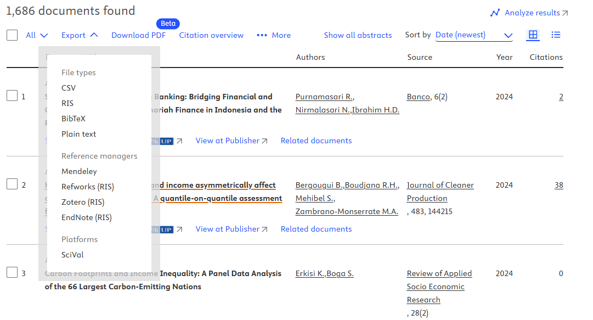

1. **Click `Export` and Choose `BibTeX` (Figure 14)**:
   - On the toolbar directly above the first search result (**Figure 14**), click **`Export`**.
   - A dropdown menu appears listing various file formats (*CSV, RIS, BibTeX, Plain text*) and reference managers (*Mendeley, RefWorks, Zotero, EndNote*).
   - Click on **`BibTeX`**. While Biblioshiny supports both `.bib` (BibTeX) and `.csv` from Scopus, **BibTeX (`.bib`)** is strongly recommended because it structures every metadata tag cleanly and preserves special characters and multi-author lists reliably.

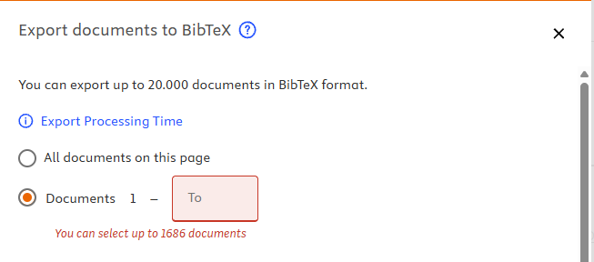

2. **Select All Documents in Your Range (Figure 15)**:
   - When the *Export documents to BibTeX* modal window opens (**Figure 15**), notice that Scopus allows exporting **up to 20,000 documents** at once in BibTeX format.
   - By default, the radio button might be set to *"All documents on this page"* (which would only export 10 or 20 papers!).
   - Click the second radio button: **`Documents 1 — To`** and type **`1686`** (the total number of documents in your filtered query).

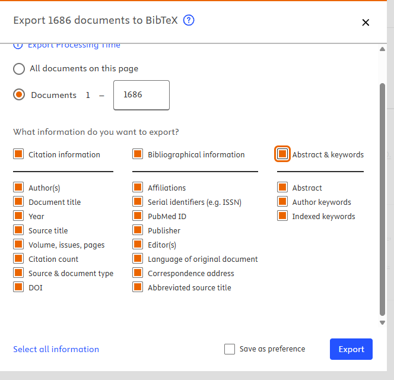

3. **Select All Metadata Information to Export (Figure 16)**:
   - In the lower section of the dialog (*"What information do you want to export?"*, **Figure 16**), you will see columns of checkboxes:
     - **Citation information**: Author(s), Document title, Year, EID, Source title, Volume/issue/pages, Citation count, Source & document type, Publication Stage, DOI, Open Access.
     - **Bibliographical information**: Affiliations, Serial identifiers (ISSN), PubMed ID, Publisher, Editor(s), Language of original document, Correspondence address, Abbreviated source title.
     - **Abstract & keywords**: Abstract, Author keywords, Indexed keywords.
     - **Funding details** & **Other information** (scrolling slightly to the right reveals *Tradenames & manufacturers*, *Accession numbers & chemicals*, *Conference information*, and **`Include references`**).
   - Click **`Select all information`** at the bottom-left (or make sure every category—including *Include references* if you plan to run citation/co-citation network analyses—is checked), so that Biblioshiny has the richest possible metadata to work with.
   - Finally, click the blue **`Export`** button at the bottom-right.

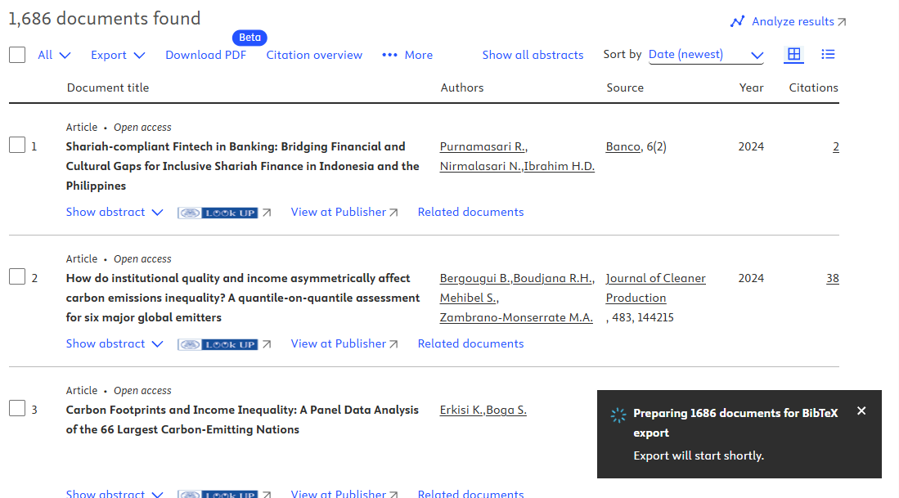

4. **Wait for the Download to Complete (Figures 17 and 18)**:
   - Because exporting 1,686 full records takes a few seconds, Scopus displays a dark progress notification in the bottom-right corner: *"Preparing 1686 documents for BibTeX export. Export will start shortly."* (**Figure 17**).


   - Moments later, the banner turns into a green checkmark: **`BibTeX file downloaded.`** (**Figure 18**), and a file named `scopus.bib` (or similar) is saved in your computer's *Downloads* folder.

---

## 2.8 Saving Your Search and Ensuring Methodological Reproducibility

Before leaving Scopus, there is one final best practice that will save you hours of work if you ever need to revisit or update your thesis dataset months later.

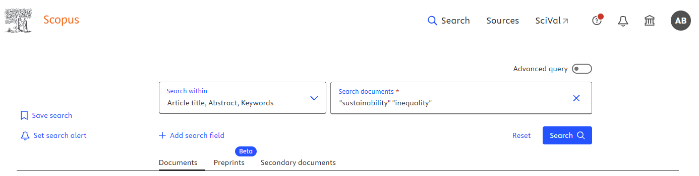

- **Click `Save search` (Figure 19)**:
  - On the far left of the search panel (**Figure 19**), click **`Save search`**. This saves your exact query and all active filters directly inside your personal Scopus account. (Right below it, `Set search alert` even lets you receive automatic email notifications whenever new papers matching your query are indexed!).

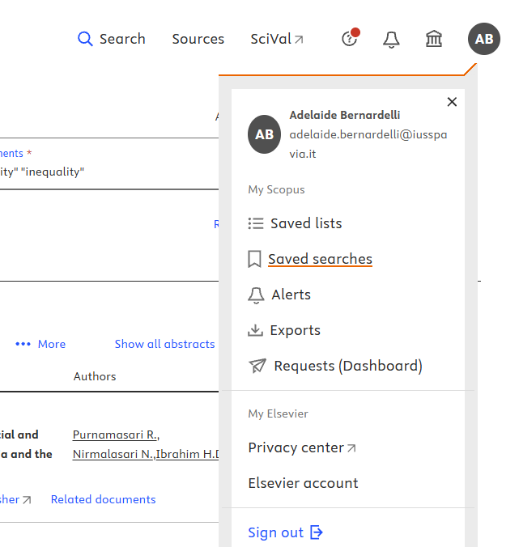

- **Retrieve Your Saved Searches Anytime (Figure 20)**:
  - Whenever you log back into Scopus in the future, simply click on your **Account Initials icon** at the top-right of the screen (**Figure 20**) and select **`Saved searches`** to reload your exact search with a single click.

> **Golden Rule of Scientific Reproducibility (Slide 22):**  
> For any academic thesis, dissertation, or scientific paper, **you must explicitly document and report every single step performed on Scopus**. In your Methodology chapter, always create a summary box or table stating:
> 1. **Database used**: Scopus (Elsevier).
> 2. **Date of data extraction**: e.g., November 5, 2026 (since citation counts and indexed documents change daily!).
> 3. **Search field & exact Boolean query**: `TITLE-ABS-KEY ( "sustainability" AND "inequality" )`.
> 4. **Initial unfiltered hit count**: $N = 8,695$ documents.
> 5. **Inclusion and exclusion criteria applied**: Timeframe (`2018–2024`), Subject Areas (`SOCI`, `ECON`, `BUSI`, `MATH`), Document Type (`Article` only), Language (`English` only).
> 6. **Final analyzed sample size**: $N = 1,686$ documents.  
> Transparency is what separates a rigorous scientific review from an arbitrary collection of papers!

---

# Module 3: Getting Started with R, RStudio, and Launching Biblioshiny

## 3.1 What Are R and RStudio? A Beginner-Friendly Primer

Many students—especially those from the Social Sciences, Humanities, Economics, or Business—feel intimidated when they hear that a tool runs on **R**. Let us dispel that fear immediately: **to use Biblioshiny, you do not need to know how to program in R**. You will only ever need to copy and paste three short lines of text to open the application.

However, understanding what R and RStudio are will make you feel completely comfortable when opening them:

- **What is R?**  
  **R** is a free, open-source programming language and software environment created specifically for statistical computing, data science, and scientific graphics. Think of **R as the engine of a car**: it does all the heavy mathematical calculations, data parsing, and network algorithms behind the scenes.
- **What is RStudio?**  
  **RStudio** (developed by *Posit*) is an **Integrated Development Environment (IDE)**—a clean, user-friendly visual dashboard that sits on top of R. If R is the engine of the car, **RStudio is the cockpit, steering wheel, and dashboard**: it organizes your screen into neat windows so you can interact with R effortlessly.
- **What are R Packages (like `bibliometrix`)?**  
  By default, base R comes with standard statistical functions. Researchers around the world write specialized add-on extensions—called **packages**—that add new superpowers to R. The `bibliometrix` package is an add-on that teaches R how to read bibliographic files (from Scopus, Web of Science, etc.) and includes the **`biblioshiny()`** web app.

---

## 3.2 How to Download and Install R and RStudio

If you do not yet have R and RStudio on your computer, installation is completely free and takes less than 5 minutes on Windows, macOS, or Linux.

> **Crucial Installation Order:**  
> Always download and install **1. Base R first**, and **2. RStudio Desktop second**! RStudio needs to detect Base R already installed on your system.

1. **Step 1 — Download and Install Base R (from CRAN)**:
   - Go to the official Comprehensive R Archive Network (CRAN): **[https://cran.r-project.org/](https://cran.r-project.org/)**
   - Click on your operating system (*Download R for Windows*, *Download R for macOS*, or *Download R for Linux*).
   - *On Windows*: Click **`base`**, then click **`Download R-4.x.x for Windows`** and run the `.exe` installer keeping all default settings.
   - *On macOS*: Download the `.pkg` file matching your Mac processor (Apple Silicon `M1/M2/M3/M4` arm64 or Intel `x86_64`) and run the installer.
2. **Step 2 — Download and Install RStudio Desktop (from Posit)**:
   - Go to the official Posit RStudio download page: **[https://posit.co/download/rstudio-desktop/](https://posit.co/download/rstudio-desktop/)**
   - Scroll down to *"2: Install RStudio"* and click the blue download button for your operating system.
   - Run the installer. Once finished, **always open RStudio** (you never need to open the standalone R icon directly).

---

## 3.3 Understanding the Four Panes of the RStudio Workspace

When you open **RStudio**, the screen is divided into **four rectangular quadrants (panes)**, as illustrated in **Figure 21** and summarized in the 2×2 reference matrix below.

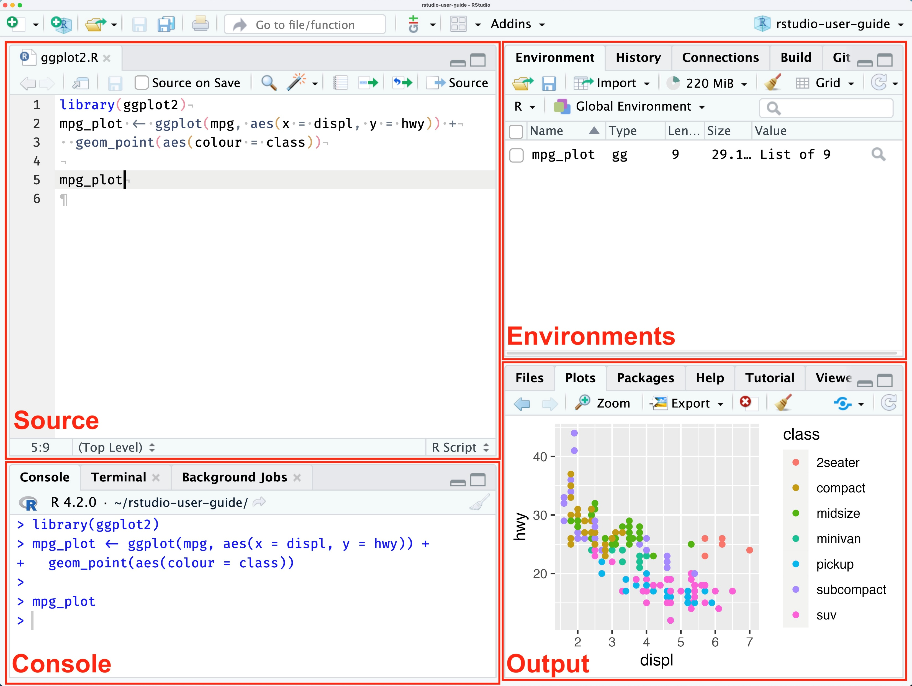

| Top-Left Quadrant: `SOURCE` (Source Editor Pane) | Top-Right Quadrant: `ENVIRONMENT` (Environment & History Pane) |
| :--- | :--- |
| **The Source Pane** in RStudio allows you to view, write, and edit code files such as `.R`, `.Rmd`, `.qmd`, `.py`, and `.css`, as well as plain text files like `.txt` or `.md`. By default, it is located in the top-left quadrant and opens automatically whenever you create or open an editable file. Each opened file is added as a new tab inside the pane. | **`Environment`** — Displays all objects, datasets, and variables saved in R's active memory; allows you to load/save workspaces, import datasets, view RAM usage, and clear the environment.<br>**`History`** — Lists all commands executed during the session; lets you search, save, delete, and re-run previous commands. |
| **Bottom-Left Quadrant: `CONSOLE` (Console & Terminal Pane)** | **Bottom-Right Quadrant: `OUTPUT` (Files, Plots, Packages, Help & Tutorial Pane)** |
| By default, the **Console Pane** sits in the bottom-left of RStudio and allows you to execute R code interactively in real time. Inside this quadrant we also find:<br>- **`Terminal` Tab**: Executes operating-system shell commands and manages multiple integrated terminals.<br>- **`Background Jobs` Tab**: Runs long R scripts in the background (locally or on remote servers), keeping the main session responsive. | **`Files`** — Explores project folders and files, with options to create folders/files, rename, delete, and set the working directory.<br>**`Plots`** — Displays graphs generated during the session; lets you navigate plot history, zoom, export, or delete figures.<br>**`Packages`** — Lists all installed R packages and allows you to search, install new packages, or update existing ones.<br>**`Help`** — Displays package and function documentation (accessible via `?function` or `help(function)`).<br>**`Tutorial`** — Loads interactive guided tutorials (`learnr`) to practice R step by step. |

Here is a detailed breakdown of how you will interact with each of these four RStudio windows in practice:

1. **Top-Left Pane — `SOURCE` (The Script Editor)**:
   - The *Source* pane allows you to view, write, and edit saved code files (such as `.R` scripts, `.Rmd` or `.qmd` notebooks, `.py`, `.css`, or plain text `.txt` and `.md` files).
   - *Note for beginners*: When you launch RStudio for the very first time, you might only see **three panes** (with the left side occupied entirely by the *Console*), because the *Source* pane only opens automatically when you create or open a file. Each open file appears as a tab at the top of this pane.
2. **Top-Right Pane — `ENVIRONMENT / HISTORY` (The Workspace Memory)**:
   - **`Environment` Tab**: Displays all active objects, variables, datasets, and functions currently loaded in R's memory during your session. It also allows you to load/save your workspace or view how much RAM is being used.
   - **`History` Tab**: Keeps a chronological log of every command you have executed during the session, allowing you to search, save, or re-run previous commands.
3. **Bottom-Left Pane — `CONSOLE` (The Interactive Execution Engine)**:
   - **This is the only window we will use to launch Biblioshiny!**
   - The **`Console` Tab** (marked by the `>` prompt symbol) is where you type or paste commands for R to execute immediately in real time, and where R prints text messages and status updates.
   - Next to the Console tab, you also see:
     - **`Terminal` Tab**: Provides direct access to your operating system's command-line shell.
     - **`Background Jobs` Tab**: Allows advanced users to run long R scripts in the background without locking up the main session.
4. **Bottom-Right Pane — `OUTPUT` (`Files / Plots / Packages / Help / Viewer / Tutorial`)**:
   - **`Files` Tab**: A built-in file explorer to browse folders on your computer, create directories, or rename/delete files.
   - **`Plots` Tab**: Displays static charts generated directly inside RStudio (letting you zoom, navigate back/forward through plot history, or export images).
   - **`Packages` Tab**: Lists every R package installed on your computer, with buttons to install new packages from CRAN or update existing ones.
   - **`Help` Tab**: Displays official documentation for any R package or function (which you can also trigger by typing `?function_name` in the Console).
   - **`Tutorial` Tab**: Runs interactive guided tutorials (`learnr`) to practice R step by step.

---

## 3.4 Installing `bibliometrix` and Launching `Biblioshiny` from the Console

To launch Biblioshiny, look exclusively at the **Console** pane (bottom-left of RStudio, or the entire left pane if no script is open), as shown in **Figure 22**.


Click next to the `>` prompt in the **Console** and follow these three simple steps:

### Step 1: Install the `bibliometrix` Package *(Only the Very First Time!)*
If this is the first time you are using `bibliometrix` on your computer, type (or copy-paste) the following command into the Console and press **Enter**:

```r
install.packages("bibliometrix")
```

*(Make sure you use standard straight double quotes `"bibliometrix"` and lowercase letters in `install.packages`—R is case-sensitive! Connected to the internet, R will automatically download and install `bibliometrix` and its supporting graphic/network libraries. This takes 1–3 minutes and only needs to be done once on your computer.)*

### Step 2: Load the `bibliometrix` Library *(Every Time You Open RStudio)*
Once the package is installed, load it into your active session by typing:

```r
library(bibliometrix)
```

Press **Enter**. As shown in **Figure 22**, R prints a welcome box noting that the software is open-source under the MIT license, displaying the core academic references by Aria & Cuccurullo (2017, 2020, 2023), and ending with the helpful prompt:
> *"To start with the Biblioshiny app, please digit: `biblioshiny()`"*

### Step 3: Launch the `Biblioshiny` Web Interface
Now type the final command at the `>` prompt and press **Enter**:

```r
biblioshiny()
```

In the Console, R will print: `Listening on http://127.0.0.1:3838` (or a similar local port number), and **your default web browser (Chrome, Edge, Firefox, or Safari) will automatically open a new tab displaying the Biblioshiny graphical interface** (**Figure 23**)!


> **Good to Know — Does Biblioshiny Require an Internet Connection?**  
> Look at the address bar in **Figure 23**: `127.0.0.1:3838`. The IP address `127.0.0.1` (`localhost`) means that **your own computer (via RStudio) is acting as the local server**. Your browser is simply being used as a graphical window to talk to R on your machine! While Biblioshiny is running in your browser, leave RStudio open in the background (you will see a small red `STOP` sign in the RStudio Console indicating that R is busy powering your web session).

---

# Module 4: Building Your Bibliometric Collection in Biblioshiny

## 4.1 The *Import or Load* Module: Three Flexible Ways to Load Data

The **Import or Load** module is the mandatory starting point for any bibliometric analysis in Biblioshiny. Located under the **`Data`** tab in the dark-blue left navigation sidebar (**Figure 24**), this section allows you to build your bibliographic collection either by importing raw export files from scientific databases, loading pre-processed `bibliometrix` files saved during previous sessions, or exploring built-in sample datasets.

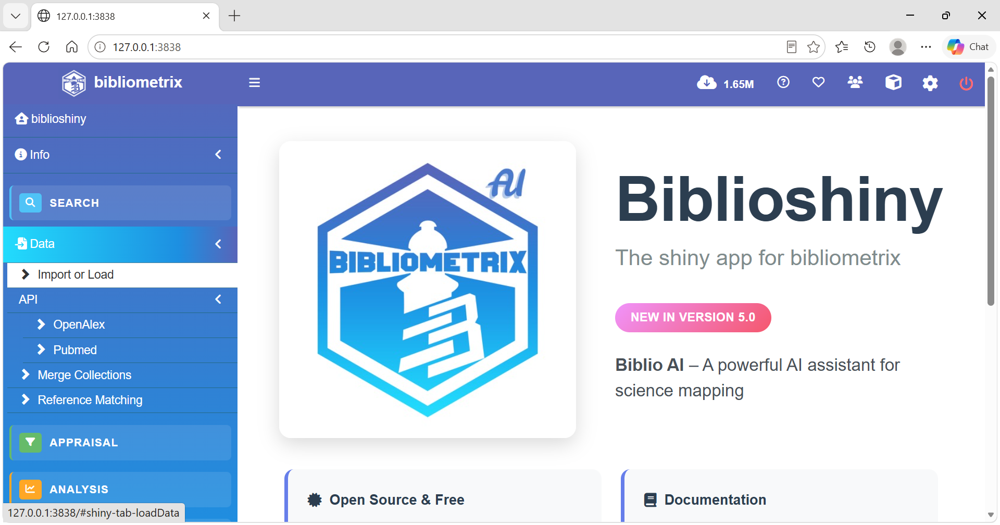

When you click on **`Data → Import or Load`**, Biblioshiny opens the data loading workspace (**Figure 25**) with the **`Import or Load`** control card on the right (**Figure 26**).

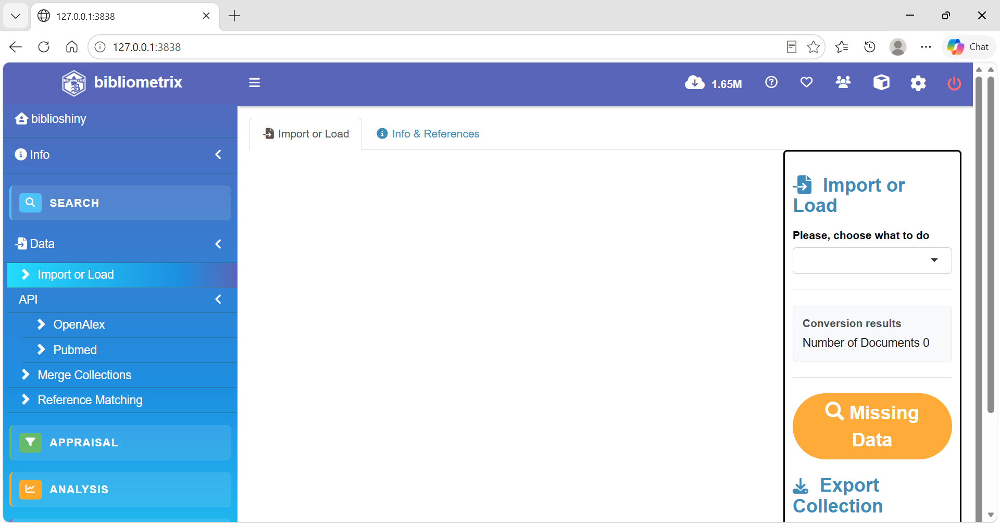

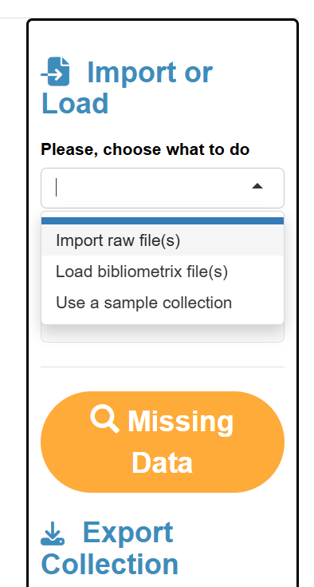

As shown in **Figure 26** (and detailed in the official Biblioshiny documentation), the **`Please, choose what to do`** dropdown offers **three flexible options**:

### Option 1: `Import raw file(s)`
Imports bibliographic metadata directly from external scientific databases in their native export formats.
- **Supported Databases and File Formats** (**Figure 27**):
  - **Web of Science (WoS/WoK)**: `.txt` (Plain Text), `.bib` (BibTeX)
  - **Scopus**: `.bib` (BibTeX), `.csv` (Comma-Separated Values)
  - **Dimensions**: `.csv`, `.xlsx` (Excel)
  - **OpenAlex**: Pre-downloaded files or direct API query integration (`OpenAlex API via openalexR`)
  - **The Lens (`Lens.org`)**: `.csv`
  - **PubMed**: `.txt` (PubMed format) or direct API query
  - **Cochrane Library**: `.txt` (Plain Text)
- **How the Raw Import Process Works**:
  1. You select the source database and click **Browse** to upload one or more raw export files from your computer (or a `.zip` archive containing multiple batches if your query exceeded a database's single-export limit).
  2. Biblioshiny automatically parses the database-specific metadata tags and converts the raw records into a standardized **Bibliometrix data frame** (where every variable is assigned a universal two-letter tag, such as `TI` for Title, `AU` for Authors, `PY` for Publication Year, `SO` for Source/Journal, `DE` for Author Keywords, `TC` for Total Citations, etc.).
  3. A **Conversion Results** summary and a **Completeness of Metadata** audit popup confirm the exact number of documents imported and evaluate metadata quality.
  4. A sortable, filterable preview table displays your entire collection on screen.

### Option 2: `Load bibliometrix file(s)`
Allows you to resume work immediately on a collection that was already imported, converted, and exported in a previous Biblioshiny session (or pre-processed in R using `bibliometrix`).
- **Supported Formats**:
  - **`.rdata` / `.rds`**: R Data Serialization format *(Highly Recommended: preserves 100% of internal R data structures and metadata without loss)*.
  - **`.xlsx`**: Excel format generated by Biblioshiny's *Export Collection* button.
- **Key Use Cases**: Continuing your thesis analysis across multiple days without re-converting raw `.bib` files; sharing a cleaned and filtered dataset with co-authors or your thesis supervisor; or working with datasets that you already filtered inside Biblioshiny.

### Option 3: `Use a sample collection`
Loads pre-packaged benchmark datasets included with Biblioshiny. Ideal for testing features and practicing without uploading your own file.

---

## 4.2 Step-by-Step Walkthrough: Importing Our Raw Scopus `.bib` File

Let's import the `.bib` file of 1,686 documents that we just downloaded from Scopus (**Figures 27, 28, and 29**):

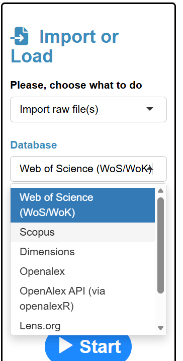

1. **`Please, choose what to do`**: Select **`Import raw file(s)`** (**Figure 27**).
2. **`Database`**: Click the dropdown (which defaults to *Web of Science*) and select **`Scopus`** (**Figure 27**).

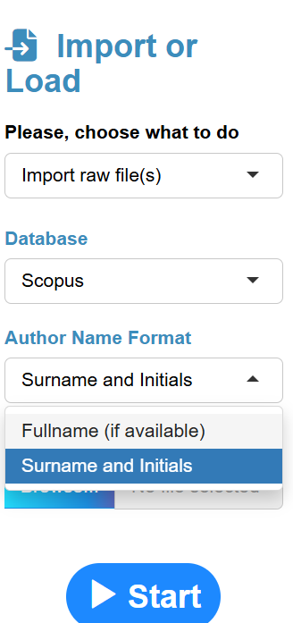

3. **`Author Name Format`**: When you choose *Scopus*, an extra dropdown appears: **`Author Name Format`** (**Figure 28**), offering two choices:
   - **`Surname and Initials`** *(Default & Recommended)*: Formats all author names consistently as `SURNAME I` (e.g., `MORENO C`, `HICKEL J`). This prevents the same scholar from being split into two separate entries if one journal indexed them as *"Jane Doe"* and another as *"J. Doe"*.
   - **`Fullname (if available)`**: Extracts full given names when present in the Scopus record.
   - Leave this set to the default **`Surname and Initials`**.


4. **`Choose a file` and Click `Start` (Figure 29)**:
   - Click **`Browse...`** and select your downloaded Scopus `.bib` file from your computer.
   - Wait until the blue progress bar reaches 100% and reads **`Upload complete`** (**Figure 29**).
   - Click the blue **`Start`** button to begin conversion!

---

## 4.3 Post-Import Features, Exporting Collections, and Best Practices

Once conversion finishes (and after closing the data completeness modal that we will examine in Section 4.4), the main **Import or Load** screen gives you several useful post-import features:

- **View Collection Metadata**: Preview every imported article in an interactive, sortable, and searchable table showing DOI, Authors, Title, Journal, Year, Abstract, and Keywords.
- **Add Brief Description**: At the top of the screen (*Brief description about your collection*), you can write notes about your query, filters, and extraction date for documentation purposes.
- **Export Collection (`Export Collection` button)**: Located on the right panel beneath the orange *Missing Data* button (**Figure 25**), this lets you save your standardized collection in `.rdata`, `.xlsx`, or `.csv` format.

> **Best Practices from Official Biblioshiny Documentation:**
> 1. **Save Your Processed Collection Immediately**: Right after importing and converting a raw `.bib` file, export and save a backup copy as an **`.rdata`** (or `.xlsx`) file using a descriptive filename (e.g., `sustainability_inequality_scopus_2018-2024.rdata`). Next time you open Biblioshiny, loading the `.rdata` file via *Load bibliometrix file(s)* takes just 1 second!
> 2. **Verify Document Counts**: Always check that the total number of converted documents reported by Biblioshiny (here, **1,686 docs**) matches the exact number of records you saw on Scopus before exporting.
> 3. **Merging Multiple Databases**: If your thesis requires combining records from both Scopus and Web of Science, import or convert them and use the **`Data → Merge Collections`** module, which automatically removes duplicate articles across databases.
> 4. **Early Filtering for Very Large Collections**: If your dataset exceeds 5,000 documents, consider using the **`Appraisal → Filters`** module early on to keep network computations fast and responsive.

---

## 4.4 Auditing Data Quality: The *Completeness of Metadata* (Missing Data) Table

As soon as you click **`Start`**, Biblioshiny automatically opens a diagnostic pop-up window titled **`Completeness of metadata — 1686 docs from Scopus`** (**Figures 30, 31, and 32**). You can also reopen this window at any time by clicking the orange **`Missing Data`** button.

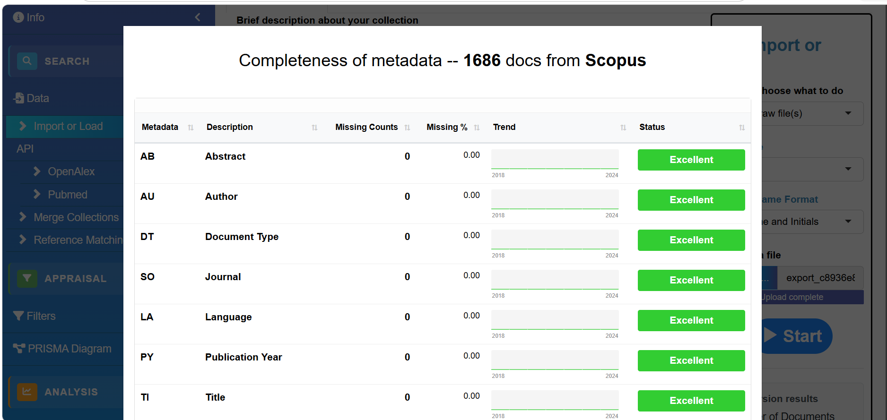

Why does Biblioshiny show this table? Because every statistical or network analysis in bibliometrics depends on specific metadata fields. If a field has 0% missing values, any analysis built on that field will cover 100% of your sample. Conversely, if a field is 50% or 100% missing, you immediately know which analyses are fully reliable and which ones cannot be run on that specific export.

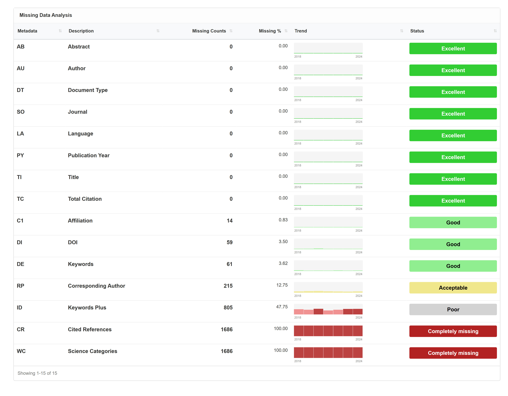

Let's examine every column and all **15 standardized Bibliometrix two-letter metadata tags** shown in **Figure 31**:

- **Columns Explained**:
  - **`Metadata`**: The official two-letter Bibliometrix field code (`AB`, `AU`, `DT`, etc.).
  - **`Description`**: Plain-English name of the metadata variable.
  - **`Missing Counts`**: How many articles out of 1,686 lack information in that field.
  - **`Missing %`**: Percentage of articles missing that attribute ($\frac{\text{Missing Counts}}{1686} \times 100$).
  - **`Trend`**: A mini sparkline showing missingness across publication years (`2018`–`2024`).
  - **`Status`**: Color-coded quality rating:
    - **`Excellent`** ($0.00\%$ missing)
    - **`Good`** ($0.01\%$ to $10.00\%$ missing)
    - **`Acceptable`** ($10.01\%$ to $20.00\%$ missing)
    - **`Poor`** ($20.01\%$ to $50.00\%$ missing)
    - **`Completely missing`** ($>50\%$ or $100\%$ missing)

### Complete Breakdown of the 15 Metadata Fields in Our Dataset (**Figure 31**)

| Tag | Description | Missing Counts | Missing % | Status | What Analyses Depend on This Field? |
| :--- | :--- | :---: | :---: | :---: | :--- |
| **`AB`** | **Abstract** | 0 | 0.00% | **Excellent** | Content analysis, abstract text mining, N-grams |
| **`AU`** | **Author** | 0 | 0.00% | **Excellent** | Most relevant authors, Lotka's Law, co-authorship |
| **`DT`** | **Document Type** | 0 | 0.00% | **Excellent** | Overview document breakdown (1,686 Articles) |
| **`SO`** | **Journal (Source)** | 0 | 0.00% | **Excellent** | Most relevant sources, Bradford's Law, source impact |
| **`LA`** | **Language** | 0 | 0.00% | **Excellent** | Language filtering check (100% English) |
| **`PY`** | **Publication Year** | 0 | 0.00% | **Excellent** | Annual production, Life Cycle, Trend Topics, diachronic plots |
| **`TI`** | **Title** | 0 | 0.00% | **Excellent** | Document identification, title word clouds & networks |
| **`TC`** | **Total Citation** | 0 | 0.00% | **Excellent** | Most global cited documents, author/source citation impact |
| **`C1`** | **Affiliation** | 14 | 0.83% | **Good** | Most relevant affiliations (universities), country production |
| **`DI`** | **DOI** | 59 | 3.50% | **Good** | Direct clickable links to full-text papers |
| **`DE`** | **Author Keywords** | 61 | 3.62% | **Good** | **WordCloud, Trend Topics, Co-occurrence Network, Thematic Map** |
| **`RP`** | **Corresponding Author** | 215 | 12.75% | **Acceptable** | Corresponding Author's Countries (SCP vs. MCP) |
| **`ID`** | **Keywords Plus** | 805 | 47.75% | **Poor** | Database-indexed keywords (often sparse in Social Sciences on Scopus) |
| **`CR`** | **Cited References** | 1686 | 100.00% | **Completely missing** | Local citations, co-citation networks, bibliographic coupling |
| **`WC`** | **Science Categories** | 1686 | 100.00% | **Completely missing** | Web of Science Subject Categories (always missing in Scopus files!) |

> **Why Are the Last Few Rows (`ID`, `CR`, `WC`) Poor or Missing—and Why Is That Not a Problem Here?**  
> Look closely at the bottom three rows of **Figures 31 and 32**:
> 1. **`WC` (Science Categories — 100% missing)**: `WC` is an internal tag exclusive to Clarivate's *Web of Science*. Whenever you import a **Scopus** file, `WC` is *always* 100% empty—which is completely normal and expected.
> 2. **`CR` (Cited References — 100% missing in this export)**: Indicates whether the bibliography at the end of each article was included in the `.bib` file. Since our guided tour focuses on **Performance Analysis** (Overview, Sources, Bradford's Law, Authors, Lotka's Law, Countries, Most Global Cited Documents), **Conceptual Structure** (WordCloud, Trend Topics, Co-occurrence Network, Thematic Map), and **Social Structure** (Country Collaboration Map), `CR` is not required. *(Note: If you ever want to run Co-Citation or Bibliographic Coupling networks in your own thesis, simply make sure the **`Include references`** box under "Other information" is checked when exporting from Scopus!)*
> 3. **`ID` (Keywords Plus — 47.75% missing) vs. `DE` (Author Keywords — only 3.62% missing!)**: Notice that nearly half of the articles lack database-assigned *Keywords Plus (`ID`)*, whereas **96.38% of the articles have complete *Author Keywords (`DE`)* (**Good** status)**. This gives us an additional empirical reason—which we will apply in Modules 8 and 9—to always switch our keyword analyses from *Keywords Plus / All Keywords* to **Author's Keywords (`DE`)**!


As shown at the bottom of **Figure 32**, if you want to save this data-quality table for the methodology appendix of your thesis, you can click **`Report`** (to add it to your Excel report) or **`Save`** (to download the table image as a JPG/PNG), and then click **`Close`** to proceed to the analyses.

---

## 4.5 Mastering Biblioshiny's Universal Action Icons

Before opening our first analytical module, take a careful look at the circular blue buttons Shown in **Figures 33 and 34**. These icons appear in the top-right corner of **every single section** of Biblioshiny. Knowing what each button does gives you complete control over the interface:


1. **Play / Run / Refresh Button (First Icon)**:
   - Generates the chart/table for the first time, or **updates and recalculates** it whenever you change a parameter, filter, or text-editing option in the side panel. *(Tip: After changing any setting in the options menu, always remember to click the first icon to apply your changes!)*
2. **Add to Report Button (Second Icon)**:
   - Adds the current visualization and its underlying data table to your cumulative **Biblioshiny Report**. At the very end of your work session (Module 11), you will be able to download a single multi-sheet **Excel workbook (`.xlsx`)** containing every table and high-resolution chart you clicked the second icon on!
3. **Download / Save Plot Button (Third Icon)**:
   - Downloads the current graphic directly to your computer as a high-resolution **PNG** (or JPG/HTML depending on the plot) ready to be inserted straight into your Word thesis or PowerPoint presentation.
4. **` sliders ` Options / Parameters Drawer Button (Fourth Icon — Figure 34)**:
   - Appears on all analytical modules that support customization (such as *WordCloud*, *Trend Topics*, *Co-occurrence Network*, *Thematic Map*, and *Collaboration World Map*). Clicking this button slides open a vertical configuration drawer on the right side of the screen where you can modify the analyzed field, upload stopwords/synonyms, change clustering algorithms, and tweak visual styling.

---

# Module 5: Descriptive Performance Analysis — Overview of the Collection

## 5.1 Navigating the `Analysis → Overview` Module

With our 1,686 Scopus articles loaded and verified, we now move to the **`ANALYSIS`** section in the left navigation bar and click on **`Overview`** (**Figure 35**).

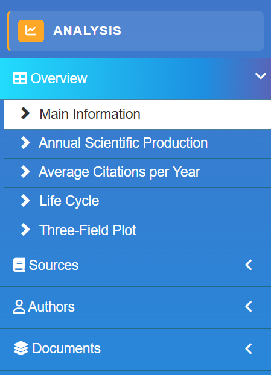

The **Overview** menu contains five descriptive tools that provide a high-level bird's-eye view of your entire research field:
- **`Main Information`**
- **`Annual Scientific Production`**
- **`Average Citations per Year`**
- **`Life Cycle`** *(New in Biblioshiny 5.0!)*
- **`Three-Field Plot`**

In our walkthrough, we focus on the three most informative modules for setting the stage in the opening section of your literature review chapter: **Main Information**, **Annual Scientific Production**, and **Life Cycle of Scientific Production**.

---

## 5.2 `Main Information`: Deep-Dive Interpretation of All 12 Bibliometric Indicators

Clicking on **`Main Information`** opens a dashboard of **12 summary KPI cards** (**Figure 36**). You can also switch from the **`Plot`** tab to the **`Table`** tab (**Figure 37**) to view and export the exact numbers directly to Excel (via the green **`Excel`** button).

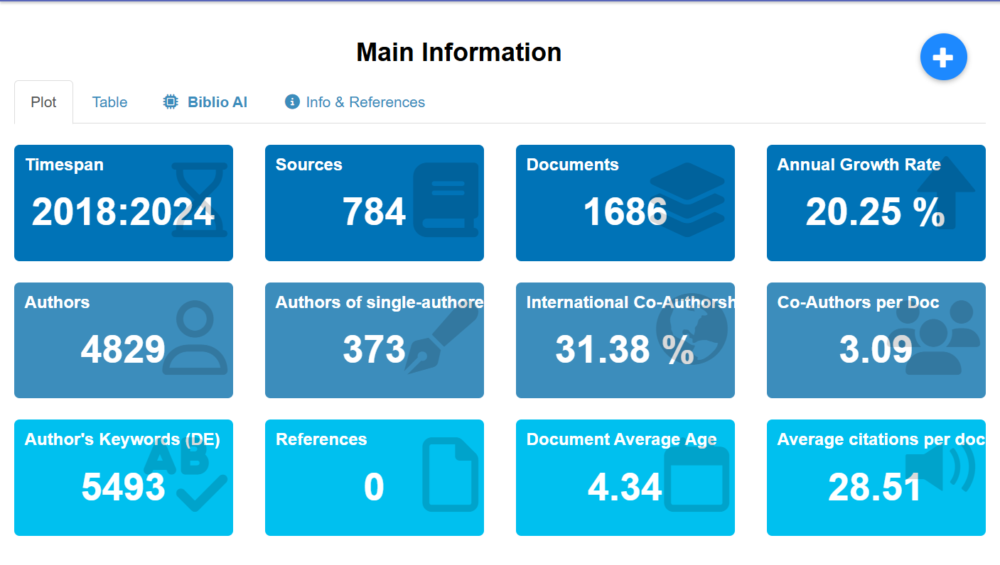

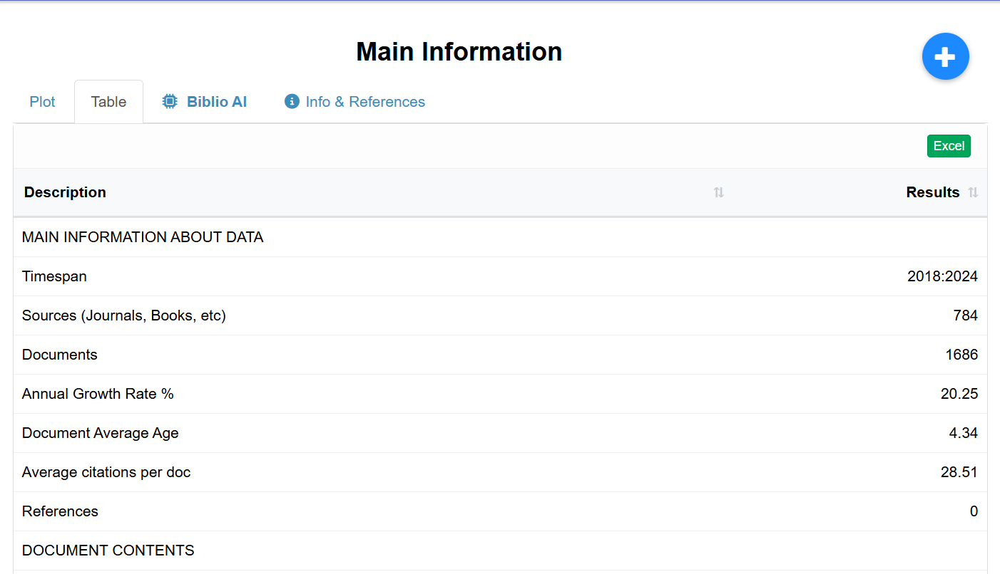

Students often paste the *Main Information* table into their thesis without explaining what the numbers actually mean. Let's analyze **each of the 12 indicators** in **Figure 36** and **Figure 37** so you know exactly how to interpret and comment on them in an academic text:

### 1. General Collection & Growth Metrics (Top Row of Figure 36)
- **`Timespan` (`2018:2024`)**:
  - The chronological window covered by the analyzed publications (7 full calendar years from 2018 through 2024).
- **`Sources (Journals, Books, etc.)` (`784`)**:
  - The total number of distinct peer-reviewed academic journals in which the 1,686 articles were published. Dividing 1,686 articles by 784 sources yields an average of roughly $2.15$ articles per journal—indicating that while a core group of sustainability journals publishes frequently on this topic, interest is also dispersed across a wide variety of socio-economic outlets (a phenomenon we will formalize with *Bradford's Law* in Module 6).
- **`Documents` (`1686`)**:
  - The total size ($N$) of our validated corpus (100% peer-reviewed journal articles).
- **`Annual Growth Rate %` (`20.25%`)**:
  - **What It Means**: The **Compound Annual Growth Rate (CAGR)** of scientific publications across the selected timespan. Mathematically, if $N_{t_0}$ is the number of articles in the first year (129 in 2018) and $N_{t_n}$ is the number of articles in the final year (390 in 2024) over $n = 2024 - 2018 = 6$ annual intervals:
    $$\text{Annual Growth Rate} = \left( \left( \frac{N_{2024}}{N_{2018}} \right)^{\frac{1}{6}} - 1 \right) \times 100 = \left( \left( \frac{390}{129} \right)^{\frac{1}{6}} - 1 \right) \times 100 \approx 20.25\%$$
  - **How to Comment on It**: In scientometrics, global scientific output grows on average at roughly 4%–5% per year. An **Annual Growth Rate of 20.25%** is extraordinarily high—more than four times the global scientific average! It provides robust quantitative proof that the intersection of *sustainability* and *inequality* is experiencing an **explosive surge in scholarly attention**.

### 2. Authorship & Scientific Collaboration Metrics (Middle Row of Figure 36)
- **`Authors` (`4829`)**:
  - The total number of distinct researchers who authored or co-authored at least one paper in the collection.
- **`Authors of single-authored docs` (`373`)** & **`Single-authored docs` (`387`, visible in the Table view)**:
  - Out of 1,686 articles, only 387 papers ($22.95\%$) were written by a lone researcher (373 distinct solo authors), whereas **1,299 articles ($77.05\%$) are multi-authored collaborative works**.
- **`Co-Authors per Doc` (`3.09`)**:
  - The average number of authors listed on each paper. An average of ~3.1 authors per article reflects the increasingly interdisciplinary and team-based nature of contemporary social-science and sustainability research, which frequently combines economists, environmental scientists, sociologists, and statisticians.
- **`International Co-Authorship %` (`31.38%`)**:
  - **What It Means**: Nearly **one out of every three articles ($31.38\%$)** in our dataset was co-authored by researchers affiliated with institutions in **two or more different countries**.
  - **How to Comment on It**: A $31.38\%$ international co-authorship rate demonstrates that sustainability and inequality are not studied in national isolation; rather, they foster strong transnational research networks and cross-country comparative studies.

### 3. Document Content, Age & Citation Impact Metrics (Bottom Row of Figure 36)
- **`Author's Keywords (DE)` (`5493`)** & **`Keywords Plus (ID)` (`3404`, visible in the Table view)**:
  - **`Author's Keywords (DE = 5,493)`**: The total number of unique conceptual terms explicitly chosen by the authors of the 1,686 articles to describe their research focus.
  - **`Keywords Plus (ID = 3,404)`**: Standardized index terms automatically assigned by database algorithms based on words appearing frequently in the titles of an article's cited references.
- **`References` (`0`)**:
  - Reflects that cited reference lists (`CR`) were not included in this specific BibTeX export file.
- **`Document Average Age` (`4.34` years)**:
  - The average age of the articles in the collection relative to the analysis year. An average age of just **4.34 years** confirms that the literature is very recent, with the bulk of production concentrated in the last few years (2021–2024).
- **`Average citations per doc` (`28.51`)**:
  - On average, each of the 1,686 articles has already accumulated **28.51 citations** in Scopus! Considering that the average paper in the sample is only ~4.3 years old, an average of nearly 29 citations per article indicates **exceptionally high citation velocity and cross-disciplinary impact**.

---

## 5.3 `Annual Scientific Production`: Analyzing Growth Trends Over Time

Next, click on **`Overview → Annual Scientific Production`** in the left sidebar (**Figure 38**). Remember that you can save this chart directly to your computer using the blue download button or add it to your cumulative report with the plus button (**Figure 39**).

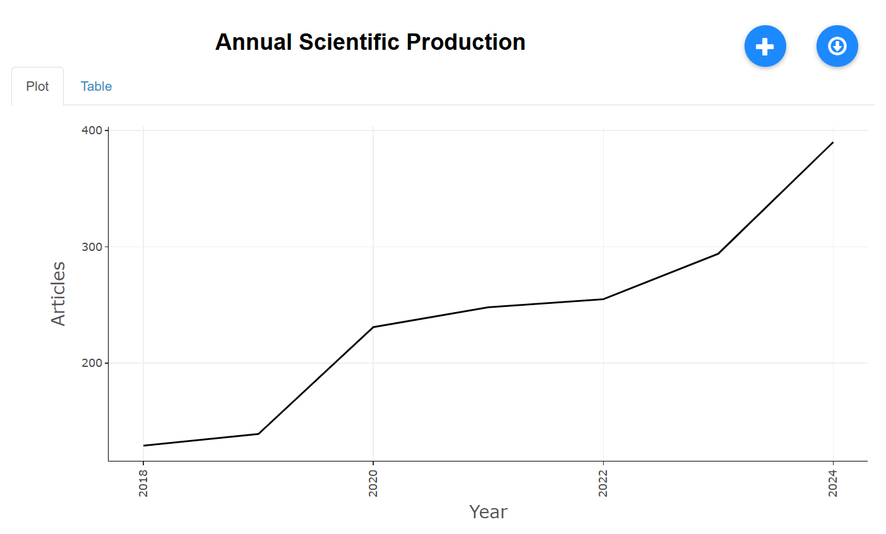

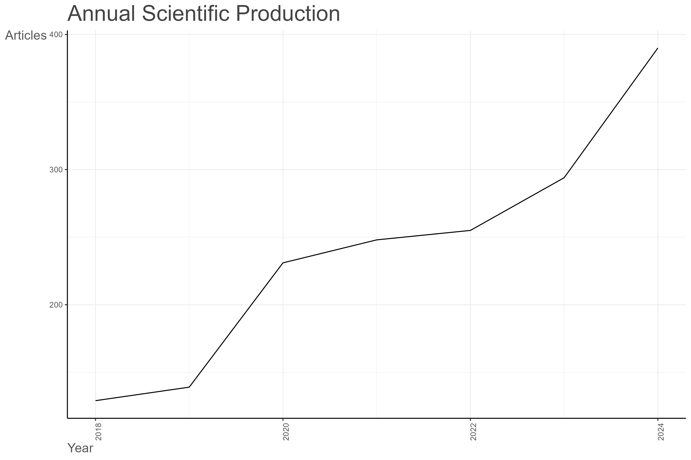

### How to Read and Comment on the Annual Production Curve (**Figure 39**)
Looking at the exact annual figures (which you can also inspect in the `Table` tab or the `AnnualSciProd` sheet of the Excel report):
- **2018**: 129 articles
- **2019**: 139 articles *(+7.8% year-over-year)*
- **2020**: 231 articles *(+66.2% year-over-year — a massive structural jump!)*
- **2021**: 248 articles *(+7.4%)*
- **2022**: 255 articles *(+2.8%)*
- **2023**: 294 articles *(+15.3%)*
- **2024**: 390 articles *(+32.7% — highest peak on record!)*

**How to Write About This**:  
When discussing **Figure 39** in a literature review, do not merely list the numbers—connect the curve to real-world historical and policy milestones! Here, we observe **three distinct phases**:
1. **2018–2019 (Baseline Consolidation)**: Following the adoption of the United Nations 2030 Agenda and the 17 Sustainable Development Goals (SDGs, including SDG 10 *Reduced Inequalities*), annual production hovered around 130–140 papers per year.
2. **2020 (The COVID-19 Structural Inflection)**: In 2020, annual output surged by **+66%** in a single year (jumping from 139 to 231 papers). The outbreak of the COVID-19 pandemic acted as a massive catalyst, exposing how environmental crises, public health shocks, and sustainability policies disproportionately affect vulnerable socio-economic groups.
3. **2021–2024 (Sustained Acceleration)**: Rather than fading after the pandemic, scholarly production plateaued at a higher baseline in 2021–2022 (~250 papers/year) and then accelerated sharply again in 2023 (294 papers) and **2024 (390 papers)**—driven by new research on the **just energy transition**, **climate justice**, and **ESG (Environmental, Social, and Governance)** frameworks. Thus, over the 7-year window, annual production **more than tripled ($3.02\times$)**.

---

## 5.4 `Life Cycle of Scientific Production`: Logistic Growth Modeling, Saturation ($K$), Peak Year ($t_m$), and Forecasting

Clicking on **`Overview → Life Cycle`** opens one of the most innovative and insightful analytical tools introduced in **Biblioshiny 5.0**: the **Life Cycle of Scientific Production** (**Figures 40, 41, 42, and 43**).

### What Is the Scientific Life Cycle Model?
First theorized by **Derek J. de Solla Price (1963)** in *Little Science, Big Science*, scientific research topics do not grow exponentially forever. Instead, over several decades, the cumulative volume of literature on any scientific paradigm follows an **S-shaped logistic growth curve (Sigmoid curve)**, much like the diffusion of technological innovations or biological population growth:

$$N(t) = \frac{K}{1 + \exp\left( -\frac{\ln(81)}{\Delta t} (t - t_m) \right)}$$

By fitting a non-linear logistic regression model to your observed annual publication counts (`2018–2024`), Biblioshiny estimates where your research topic currently stands in its historical evolution and forecasts its future trajectory!

Let's examine the **`Summary`** tab (**Figures 40 and 41**) and the **`Plot`** tab (**Figures 42 and 43**) in detail:

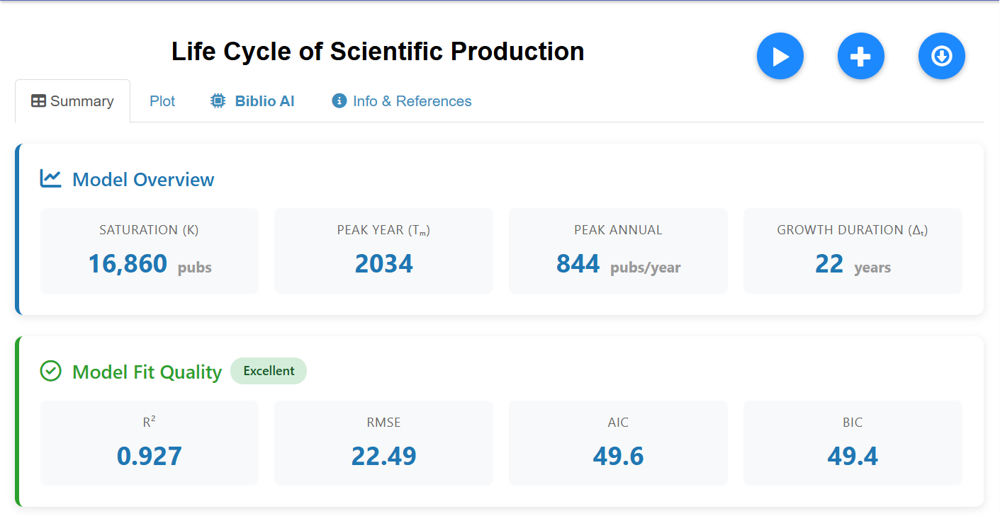

### 1. Understanding the *Model Overview* Metrics (**Figure 40, Top Box**)
- **`SATURATION (K)` (`16,860 pubs`)**:
  - The theoretical **carrying capacity (asymptotic ceiling)** of the research topic—that is, the estimated total cumulative number of articles that will eventually be published on this specific paradigm before it reaches full maturity and saturation.
- **`PEAK YEAR (tm)` (`2034`, specifically `2033.7`)**:
  - The **inflection point** of the S-curve. This is the projected calendar year in which **annual scientific production will reach its all-time maximum velocity** (and cumulative production will cross exactly $50\%$ of its total potential $K$). After 2034, articles will continue to be published in large numbers every year, but the *rate of annual growth* will gradually begin to decelerate as the field matures.
- **`PEAK ANNUAL` (`844 pubs/year`)**:
  - The projected maximum annual output at the peak year 2034 (more than double the 390 articles published in 2024!).
- **`GROWTH DURATION (Δt)` (`22 years`, specifically `21.96 years`)**:
  - The characteristic time span required for the research field to grow from **$10\%$ of saturation ($K$)** to **$90\%$ of saturation ($K$)**. A growth duration of ~22 years (spanning roughly from 2023 to 2045) indicates a major, long-lasting structural research domain rather than a brief academic fad.

### 2. Understanding the *Model Fit Quality* Metrics (**Figure 40, Bottom Box**)
Notice the green badge **`Excellent`** next to *Model Fit Quality*:
- **`R²` (Coefficient of Determination = `0.927`)**:
  - Ranges from $0$ to $1$. An **$R^2 = 0.927$** means that the logistic S-curve model successfully explains **$92.7\%$ of the variance** in observed annual publications from 2018 to 2024—an exceptionally strong statistical fit!
- **`RMSE` (Root Mean Square Error = `22.49`)**:
  - Measures the average deviation (in number of articles per year) between the model's fitted curve and the actual historical counts. Compared to annual volumes of 130–390 papers, an error of ~22 articles is remarkably small.
- **`AIC` (Akaike Information Criterion = `49.6`) & `BIC` (Bayesian Information Criterion = `49.4`)**:
  - Information-theoretic metrics that evaluate model goodness-of-fit while penalizing excessive complexity (lower values indicate a more parsimonious, well-fitted model).

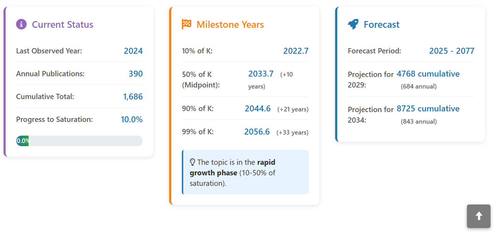

### 3. Interpreting *Current Status*, *Milestone Years*, and *Forecast* (**Figure 41**)
Looking at the three lower cards in **Figure 41**:

1. **`Current Status` (Left Card)**:
   - As of the **Last Observed Year (`2024`)**, annual production stands at **`390`** articles and the cumulative total is **`1,686`** articles—which corresponds to exactly **`10.0%` of the estimated saturation ceiling ($1,686 / 16,860 = 10.0\%$)**.
2. **`Milestone Years` & The Four Phases of a Research Topic (Middle Card)**:
   - In bibliometric life-cycle theory, every scientific topic passes through four stages based on its % of saturation $K$:
     - **Stage 1 — Emergence / Incubation ($0\%$ to $10\%$ of $K$)**: Pioneer scholars introduce the core concepts (for our topic, up to **`10% of K = 2022.7`**).
     - **Stage 2 — Rapid Growth / Expansion ($10\%$ to $50\%$ of $K$)**: The topic gains mainstream traction and accelerates rapidly toward its peak velocity (**`50% of K (Midpoint) = 2033.7`**, i.e., +10 years from 2024).
     - **Stage 3 — Maturity / Consolidation ($50\%$ to $90\%$ of $K$)**: The field is well-established; annual publications remain high but gradually taper off toward **`90% of K = 2044.6`** (+21 years).
     - **Stage 4 — Saturation / Senescence ($>90\%$ of $K$)**: Approaching **`99% of K = 2056.6`** (+33 years), when the paradigm is fully exhausted or absorbed into newer fields.
   - Look at the blue diagnostic box at the bottom of the middle card in **Figure 41**:
     > *"The topic is in the **rapid growth phase** (10–50% of saturation)."*
   - **Why This Is Crucial for Your Thesis**: Choosing a thesis or PhD topic that has just crossed the $10\%$ threshold into the **Rapid Growth Phase** is the sweet spot of academic research: the foundational concepts already exist (so you have solid literature to build upon), yet $90\%$ of the field's potential discoveries remain ahead of you!
3. **`Forecast` (Right Card)**:
   - Over the forecast horizon (`2025 – 2077`), Biblioshiny projects:
     - **By 2029 (5-year horizon)**: **4,768 cumulative articles** (with **684 articles/year**).
     - **By 2034 (10-year horizon / Peak Year)**: **8,725 cumulative articles** (with **843 articles/year**).

### 4. Interpreting the Two Life Cycle Charts (**Figures 42 and 43**)
When you switch from the *Summary* tab to the **`Plot`** tab in the *Life Cycle* module, Biblioshiny displays two complementary graphs (**Figures 42 and 43**):

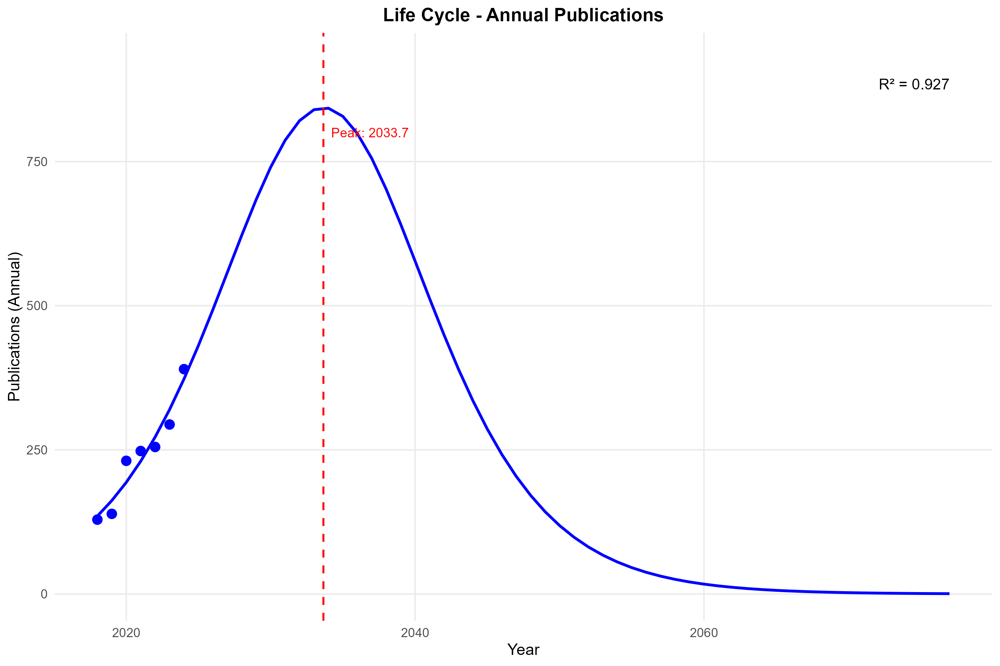

- **`Life Cycle – Annual Publications` (Figure 42 — The Bell-Shaped Rate Curve)**:
  - Plots the **number of new publications per year** on the vertical axis against the calendar year on the horizontal axis (`2020` to `2070`).
  - The **blue dots** on the far left (`2018–2024`) show our actual observed data climbing steeply up the left slope of the curve.
  - The **solid blue curve** represents the fitted logistic growth rate (the first derivative of the S-curve), and the **vertical red dashed line** marks the projected inflection peak at **`Peak: 2033.7`** (~844 articles/year). This visually proves that the research field is still in its ascending acceleration phase, roughly a decade away from its peak annual velocity.

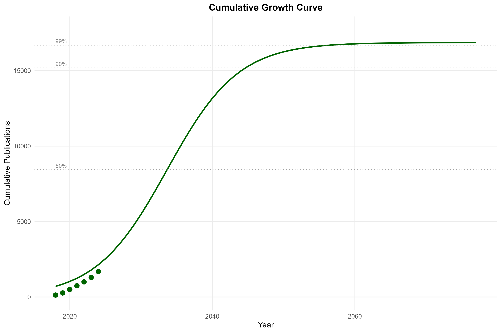

- **`Cumulative Growth Curve` (Figure 43 — The S-Shaped Logistic Curve)**:
  - Plots the **total cumulative number of publications** on the vertical axis (from $0$ up to $K = 16,860$) against time on the horizontal axis.
  - The **green dots** at the bottom-left represent our observed cumulative total (reaching 1,686 articles in 2024, or $10\%$ of the curve's height).
  - The **solid green S-curve** traces the projected cumulative accumulation of knowledge, with horizontal dashed grey reference lines marking the **50% midpoint** (reached in 2033.7 at 8,430 papers), the **90% maturity threshold** (reached in 2044.6 at 15,174 papers), and the **99% saturation asymptote** (reached in 2056.6).

---

# Module 6: Analyzing Publication Outlets — Sources and Bradford's Law

## 6.1 Navigating `Analysis → Sources` and Identifying the *Most Relevant Sources*

After exploring the general overview of the collection, the next logical question in a bibliometric review is: **Where is this research being published?** Identifying the leading academic journals (*sources*) helps students understand which disciplinary communities host the debate and which journals they should monitor or target for future submissions.

In the left navigation sidebar, click on **`ANALYSIS → Sources`** (**Figure 44**).

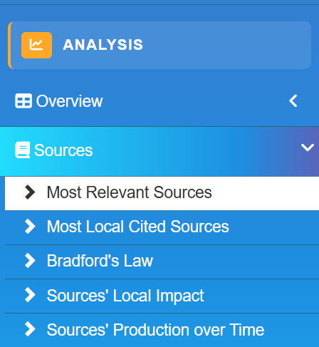

The **Sources** submenu offers five analytical options:
- **`Most Relevant Sources`**
- **`Most Local Cited Sources`**
- **`Bradford's Law`**
- **`Sources' Local Impact`**
- **`Sources' Production over Time`**

Click first on **`Most Relevant Sources`** (**Figure 45**).

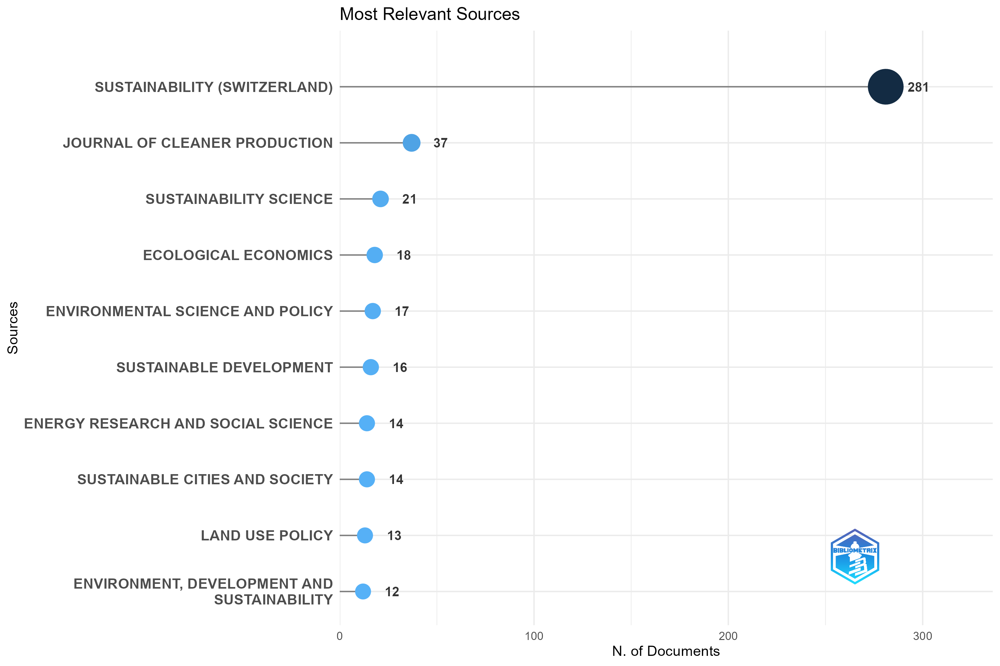

### How to Interpret *Most Relevant Sources* (**Figure 45**)
**Figure 45** ranks the top 10 peer-reviewed journals that published the highest number of articles on *sustainability* and *inequality* during our 2018–2024 window (out of 784 total journals in the dataset):

| Rank | Journal Title (*Source*) | N. of Articles | % of Total Collection (1,686) | Primary Disciplinary Focus |
| :---: | :--- | :---: | :---: | :--- |
| **1** | *Sustainability (Switzerland)* (MDPI) | **281** | 16.67% | Multidisciplinary sustainability studies |
| **2** | *Journal of Cleaner Production* (Elsevier) | **37** | 2.19% | Environmental sustainability, industrial ecology & circular economy |
| **3** | *Sustainability Science* (Springer) | **21** | 1.25% | Transdisciplinary sustainability transitions |
| **4** | *Ecological Economics* (Elsevier) | **18** | 1.07% | Interdependence of human economies and natural ecosystems |
| **5** | *Environmental Science and Policy* (Elsevier) | **17** | 1.01% | Environmental governance and policy-making |
| **6** | *Sustainable Development* (Wiley) | **16** | 0.95% | UN SDGs, socio-economic development & policy |
| **7** | *Energy Research and Social Science* (Elsevier) | **14** | 0.83% | Social dimensions of energy systems & energy justice |
| **8** | *Sustainable Cities and Society* (Elsevier) | **14** | 0.83% | Urban sustainability, smart cities & spatial equity |
| **9** | *Land Use Policy* (Elsevier) | **13** | 0.77% | Spatial planning, rural/urban land governance & inequality |
| **10** | *Environment, Development and Sustainability* (Springer) | **12** | 0.71% | Socio-environmental development in global contexts |

**How to Comment on This Chart**:
1. **Dominance of Open-Access Mega-Journals vs. Specialized Flagship Outlets**: *Sustainability (Switzerland)* ranks first by a wide margin with **281 articles** ($16.7\%$ of the entire corpus), reflecting its status as a high-volume, open-access multidisciplinary outlet dedicated specifically to sustainability themes.
2. **Rich Interdisciplinary Diversity**: Looking at Ranks 2 through 10 reveals the core intellectual pillars of the field: **ecological and environmental economics** (*Ecological Economics*, *Journal of Cleaner Production*), **policy and governance** (*Environmental Science and Policy*, *Sustainable Development*), **energy transitions** (*Energy Research and Social Science*), and **urban/spatial planning** (*Sustainable Cities and Society*, *Land Use Policy*).

---

## 6.2 `Bradford's Law of Scattering`: Identifying Core Journals (Zone 1, Zone 2, Zone 3) and Statistical Fit

Next, click on **`Sources → Bradford's Law`** in the left sidebar. This module generates both a visual scattering plot (**Figure 46**) and a detailed statistical **`Summary`** tab (**Figures 47 and 48**).

### What Is Bradford's Law? (Theoretical Background)
Formulated by the British mathematician and librarian **Samuel Clement Bradford in 1934**, **Bradford's Law of Scattering** is one of the three classical mathematical laws of bibliometrics (alongside *Lotka's Law* and *Zipf's Law*). It describes how scientific literature on any specialized subject is distributed ("scattered") across academic journals.

Bradford observed that if you sort all journals publishing on a topic in decreasing order of productivity (from the journal with the most articles down to those with only 1 article) and divide the total list of journals into **three zones (Zone 1, Zone 2, and Zone 3)** such that **each zone contains approximately one-third ($33.3\%$) of the total articles**, then the number of journals required to fill each successive zone grows exponentially according to the geometric ratio:

$$1 : k : k^2$$

where $k$ ($k > 1$) is a constant known as the **Bradford Multiplier**:
- **Zone 1 (*Core Sources / Nuclear Zone*)**: A very small elite group of highly specialized journals that publish heavily on the topic and together account for the **first third ($\sim 33.3\%$) of all articles**.
- **Zone 2 (*Intermediate Zone*)**: A moderately large group of related disciplinary journals ($k$ times larger than Zone 1) that publish occasionally on the topic and account for the **second third ($\sim 33.3\%$) of all articles**.
- **Zone 3 (*Peripheral / Dispersed Zone*)**: A vast tail of distant journals ($k^2$ times larger than Zone 1) that each publish only 1 or 2 tangential papers on the topic and together account for the **final third ($\sim 33.3\%$) of all articles**.

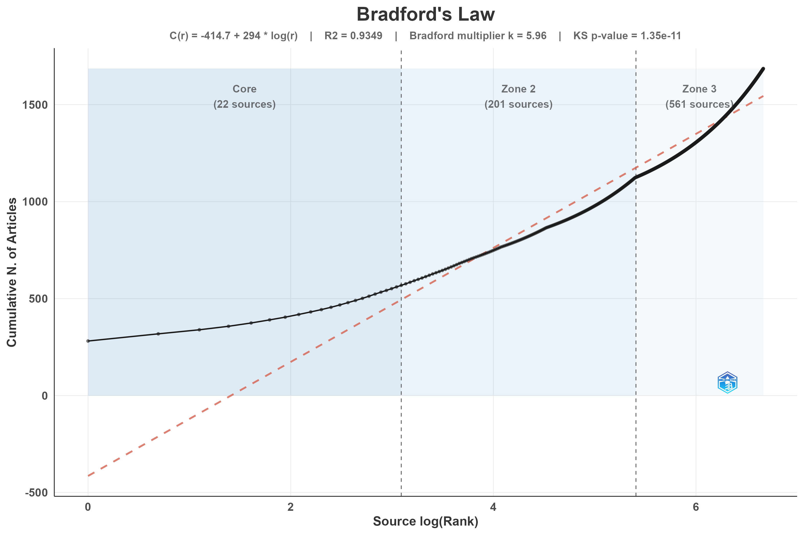

### How to Read the Bradford's Law Plot (**Figure 46**)
In **Figure 46**:
- **Horizontal Axis ($x$-axis — `Source log(Rank)`)**: Plots the natural logarithm of the journal's productivity rank, $\ln(r)$ or $\log(r)$, from Rank 1 ($\log(1) = 0$) on the left to Rank 784 ($\log(784) \approx 6.66$) on the right.
- **Vertical Axis ($y$-axis — `Cumulative N. of Articles`)**: Plots the running cumulative total of articles contributed by the top $r$ journals (from 281 at Rank 1 up to 1,686 at Rank 784).
- **The Shaded Blue Box (`Core — 22 sources`)**: Highlights **Zone 1**, the core nucleus of the discipline. Notice how just **22 journals** out of 784 reach a cumulative height of **568 articles** (one-third of the entire 1,686-article database!).
- **Vertical Dashed Lines**: Separate **Zone 1 (22 sources)** from **Zone 2 (201 sources)** and **Zone 3 (561 sources)**.
- **Red Dashed Line**: Represents the theoretical logarithmic regression fit $C(r) = a + b \cdot \log(r)$.

### Interpreting the Bradford's Law `Summary` Tab (**Figures 47 and 48**)
Clicking on the **`Summary`** tab next to *Plot* and *Table* reveals the mathematical model parameters (**Figure 47**) and the statistical goodness-of-fit test and zone summary table (**Figure 48**):

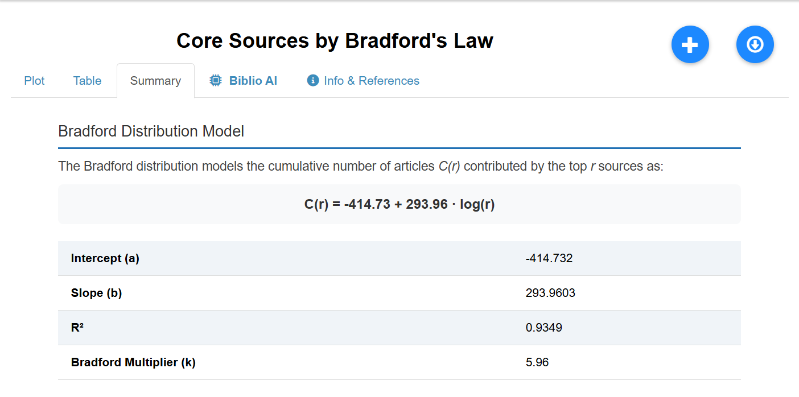

1. **The Bradford Distribution Model (**Figure 47**)**:
   Biblioshiny fits Leimkuhler's logarithmic formulation of Bradford's Law, which models the cumulative number of articles $C(r)$ contributed by the top $r$ journals as a linear function of $\log(r)$:
   $$C(r) = a + b \cdot \log(r) = -414.73 + 293.96 \cdot \log(r)$$
   - **`Intercept (a)` (`-414.732`)** and **`Slope (b)` (`293.9603`)**: The regression coefficients of the straight red dashed line on the semi-logarithmic plot.
   - **`R²` (`0.9349`)**: Indicates that the logarithmic curve accounts for **$93.49\%$ of the variance** in cumulative article distribution across journals.
   - **`Bradford Multiplier (k)` (`5.96`)**: The average geometric expansion factor of journal counts from one zone to the next.

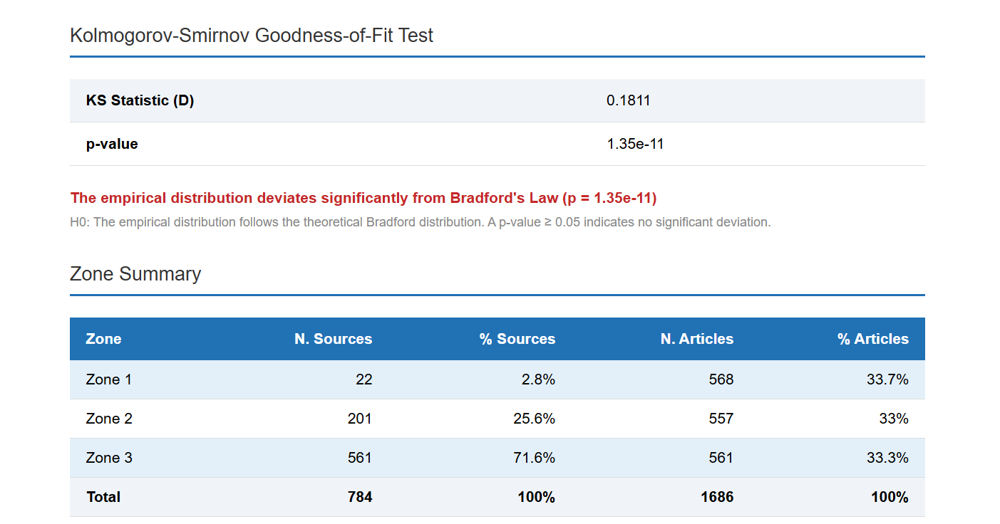

2. **Kolmogorov-Smirnov (KS) Goodness-of-Fit Test (**Figure 48, Top Table**)**:
   - **`KS Statistic (D)` (`0.1811`)** and **`p-value` (`1.35e-11`, i.e., $1.35 \times 10^{-11} < 0.05$)**:
   - Notice the red diagnostic message: *"The empirical distribution deviates significantly from Bradford's Law ($p = 1.35\text{e-}11$)."*
   - **How to Explain This**: Why does the KS test detect a statistically significant deviation even though $R^2 = 0.9349$ is very high? Look back at **Figure 46**: at the very beginning of the curve ($r = 1$), a single mega-journal—*Sustainability (Switzerland)*—contributes **281 articles** ($16.7\%$ of the entire field!) all by itself, causing the black empirical curve to jump well above the theoretical red line in Zone 1. This "hyper-concentration" at Rank 1 is a well-documented modern phenomenon caused by multidisciplinary open-access mega-journals.

3. **Zone Summary Table (**Figure 48, Bottom Table**)**:
   This table is one of the most useful tables to include in your thesis:

| Zone | N. Sources (Journals) | % Sources | N. Articles | % Articles | Average Articles per Journal |
| :--- | :---: | :---: | :---: | :---: | :---: |
| **Zone 1 (Core)** | **22** | **2.8%** | **568** | **33.7%** | **25.82 articles/journal** |
| **Zone 2 (Intermediate)** | **201** | **25.6%** | **557** | **33.0%** | **2.77 articles/journal** |
| **Zone 3 (Peripheral)** | **561** | **71.6%** | **561** | **33.3%** | **1.00 article/journal** |
| **Total** | **784** | **100.0%** | **1,686** | **100.0%** | **2.15 articles/journal** |

> **Practical Takeaway for Students:**  
> Look at the numbers in the **Zone Summary Table**: just **2.8% of the journals (the 22 Core Journals in Zone 1) publish 33.7% (more than one-third!) of the entire scientific literature**, whereas the 561 peripheral journals in Zone 3 ($71.6\%$ of all journals) published **exactly 1 article each** ($561 / 561 = 1.00$). When building the reading list for your thesis, focusing on the **22 Core Sources of Zone 1** guarantees that you are consulting the primary scientific forums where the scholarly conversation takes place.

---

# Module 7: Analyzing Scientific Actors — Authors, Lotka's Law, and Countries

## 7.1 Navigating `Analysis → Authors` and Identifying the *Most Relevant Authors*

Having examined the publication outlets, we now investigate **who** is producing the research. Clicking on **`ANALYSIS → Authors`** in the left navigation bar expands a rich submenu divided into three sub-categories (**Figure 49**):
1. **Authors**: *Author Profile*, *Most Relevant Authors*, *Most Local Cited Authors*, *Authors' Production over Time*, *Lotka's Law*, *Authors' Local Impact*.
2. **Affiliations**: *Most Relevant Affiliations* (universities/institutes), *Affiliations' Production over Time*.
3. **Countries**: *Corresponding Author's Countries*, *Countries' Scientific Production*, *Countries' Production over Time*, *Most Cited Countries*.

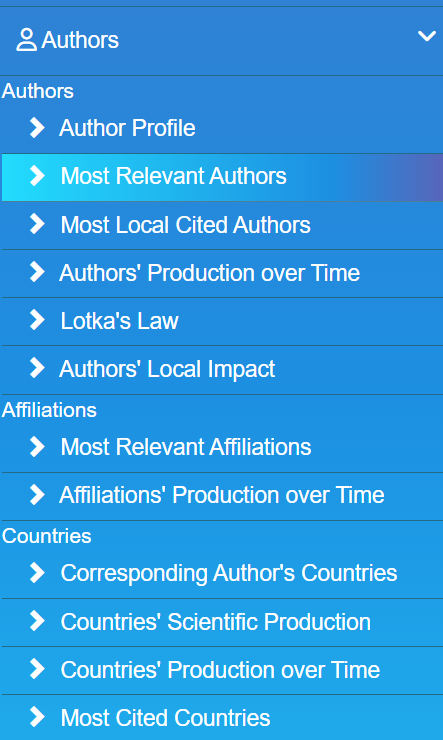

Click first on **`Most Relevant Authors`** (**Figure 50**).

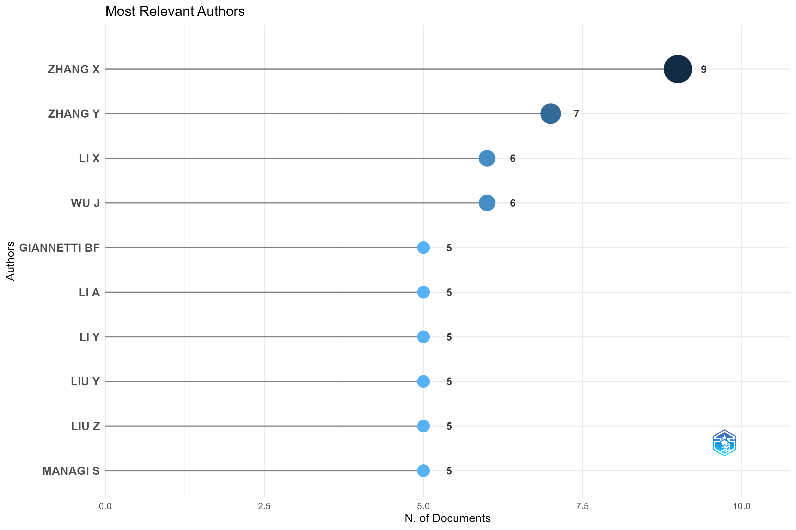

### How to Interpret *Most Relevant Authors* — Full vs. Fractional Counting & Name Disambiguation (**Figure 50**)
**Figure 50** displays the top 10 author labels by number of published documents (`ZHANG X` with 9 articles, `ZHANG Y` with 7, `LI X` and `WU J` with 6 each, and `GIANNETTI BF`, `LI A`, `LI Y`, `LIU Y`, `LIU Z`, and `MANAGI S` with 5 articles each).

When discussing this chart (and its corresponding data table in the Excel report sheet `MostRelAuthors`), you should highlight **two critical methodological points**:

1. **Full Counting (*Articles*) vs. Fractionalized Counting (*Articles Fractionalized*)**:
   - In the chart (**Figure 50**), authors are ranked by **Full Counting**: every co-author of a paper receives 1 full credit for that publication.
   - In the **`Table`** tab (and in the exported Excel report), Biblioshiny also calculates **`Articles Fractionalized`**, which divides each paper's credit equally among its $n$ co-authors ($\frac{1}{n}$ each). For example, if an author co-writes 3 papers that each have 3 authors, their *Full Count* is $3$, while their *Fractionalized Count* is $\frac{1}{3} + \frac{1}{3} + \frac{1}{3} = 1.00$. Comparing Full vs. Fractionalized counts reveals whether a scholar primarily publishes in small teams/solo or within large multi-author consortia (for instance, in our dataset, `ZHANG X` has 9 articles and a fractionalized score of $3.11$, while `MANAGI S` [Shunsuke Managi, Kyushu University] and `GIANNETTI BF` [Biagio F. Giannetti, Paulista University] are prominent international sustainability scholars who lead collaborative research groups).
2. **Methodological Caveat on Author Name Homonymy (Abbreviated Initials)**:
   - Remember that during import (Section 4.2), we used the standard `Surname and Initials` format (`SURNAME I`). While this format performs admirably for Western surnames (such as `GIANNETTI BF` or `MANAGI S`), very common East Asian surnames paired with a single first-name initial—such as **`ZHANG X`**, **`ZHANG Y`**, or **`LI X`**—can sometimes aggregate publications written by two or more distinct researchers who share the same surname and first initial (e.g., *Xin Zhang* and *Xiaolin Zhang* both abbreviate to `ZHANG X`).
   - **Pro Tip**: Whenever an abbreviated name like `ZHANG X` or `LI X` appears at the top of your *Most Relevant Authors* chart, click on the **`Table`** tab in *Authors' Production over Time* (or check the raw dataset / switches to `Fullname (if available)` during import) to verify the exact titles and affiliations, and explicitly mention the **homonymy effect of abbreviated East Asian names** in your thesis text—examiners and peer reviewers love seeing this level of methodological awareness!

---

## 7.2 `Authors' Production over Time`: Interpreting Career Timelines and Citation Intensity

Next, click on **`Authors → Authors' Production over Time`** (**Figure 51**).

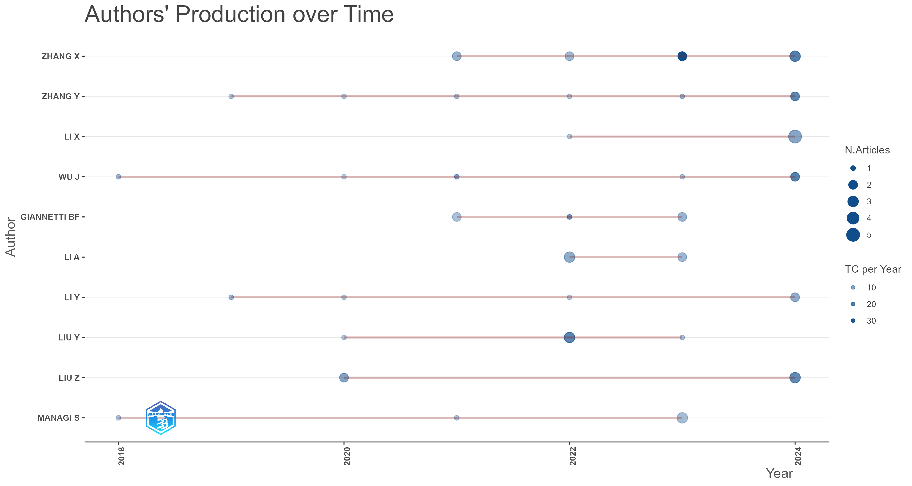

### How to Decode the Visual Elements of *Authors' Production over Time* (**Figure 51**)
This single chart packs **four dimensions of information** simultaneously for the top 10 most prolific authors:

1. **Horizontal Red Timeline Line**:
   - Connects the year of an author's **first publication** in the dataset to the year of their **most recent publication**. A long line spanning from `2018` to `2024` (such as `GIANNETTI BF` or `LIU Y`) identifies a **long-term, continuous contributor** to the field, whereas a line starting in `2021` or `2022` and running through `2024` (such as `ZHANG X` or `LI A`) indicates a **recent, high-output entrant**.
2. **Horizontal Position of Each Bubble ($x$-axis = `Year`)**:
   - Marks the specific calendar year in which the author published one or more articles.
3. **Bubble Size (`N.Articles`)**:
   - The diameter of each circle is proportional to the **number of articles published by that author in that specific year** (ranging from $1$ article for the smallest dots up to $4$ articles in a single year for the largest circle on `ZHANG X` in 2023).
4. **Bubble Color Shading (`TC per Year`)**:
   - The shade of blue (from pale sky-blue to deep navy blue) encodes the **Total Citations per Year (`TCpY`)** accumulated by the articles published by that author in that year ($10$, $20$, $30+$ citations/year).
   - For instance, look at **`ZHANG X` in 2023** (**Figure 51**): the bubble is both **large** (4 articles published in 2023) and **dark blue** (high annual citation velocity—specifically driven by a 2023 *Resources Policy* article on natural resources, urbanization, income inequality, and ecological footprints that has already accumulated 111 citations, or $27.75$ citations/year!). Similarly, **`LI A` in 2020** displays a dark navy-blue bubble indicating high annual citation impact.

---

## 7.3 `Lotka's Law of Scientific Productivity`: Mathematical Foundations and Empirical Interpretation

Now click on **`Authors → Lotka's Law`** in the left sidebar (**Figure 52**).

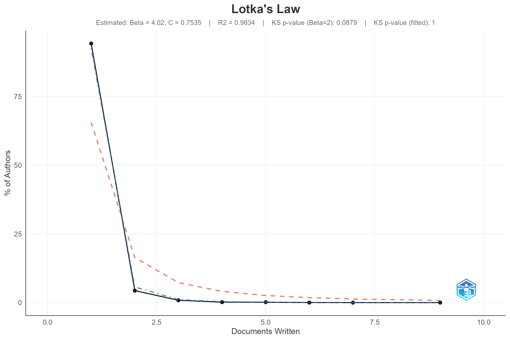

### What Is Lotka's Law? (Theoretical Background)
Published in **1926 by Alfred J. Lotka** (*"The Frequency Distribution of Scientific Productivity"*), **Lotka's Law** is the foundational bibliometric law describing the **inequality of scientific productivity among researchers**.

Lotka discovered that in almost any academic field, scientific output is heavily skewed: **the vast majority of authors publish only a single paper on a given topic, while a tiny fraction of prolific "core" scholars publish many papers**. Mathematically, Lotka formulated this as an **inverse-square power law**:

$$Y_x = \frac{C}{x^\beta}$$

where:
- **$x$ (`Documents Written`)**: The number of articles published by an author ($x = 1, 2, 3, \dots$).
- **$Y_x$ (`% of Authors` / Proportion of Authors)**: The relative frequency (proportion) of authors who have published exactly $x$ articles.
- **$C$ (`Constant`)**: The theoretical proportion of authors who publish exactly $1$ article ($x = 1$, since $Y_1 = \frac{C}{1^\beta} = C$).
- **$\beta$ (`Beta Exponent`)**: The slope parameter governing how rapidly the number of authors drops off as publication count $x$ increases. In Lotka's original 1926 study of chemistry and physics, $\beta \approx 2$ (the classic "inverse-square" rule, meaning that for every 100 authors who write $1$ paper, roughly $\frac{100}{2^2} = 25$ write $2$ papers, $\frac{100}{3^2} \approx 11$ write $3$ papers, and $\frac{100}{10^2} = 1$ writes $10$ papers). Across different disciplines and time windows, empirical $\beta$ typically ranges between $1.8$ and $4.5$.

### Interpreting Our Empirical Data and Chart Parameters (**Figure 52**)
Let's look first at the exact empirical numbers from our dataset (accessible via the **`Table`** tab of *Lotka's Law* or the `LotkaLaw` sheet in the exported Excel report):

| Documents Written ($x$) | N. of Authors | Empirical Proportion of Authors ($Y_x$) | Empirical % of Authors |
| :---: | :---: | :---: | :---: |
| **1 article** | **4,554** | 0.94305 | **94.31%** |
| **2 articles** | **212** | 0.04390 | **4.39%** |
| **3 articles** | **42** | 0.00870 | **0.87%** |
| **4 articles** | **9** | 0.00186 | **0.19%** |
| **5 articles** | **8** | 0.00166 | **0.17%** |
| **6 articles** | **2** | 0.00041 | **0.04%** |
| **7 articles** | **1** | 0.00021 | **0.02%** |
| **9 articles** | **1** | 0.00021 | **0.02%** |
| **Total** | **4,829 authors** | **1.00000** | **100.00%** |

Now look at the curve and the statistical subtitle at the top of **Figure 52**:
```text
Estimated: Beta = 4.02, C = 0.7535 | R2 = 0.9934 | KS p-value (Beta=2): 0.0879 | KS p-value (fitted): 1
```

Here is what every single parameter in **Figure 52** means and how to explain it in your thesis:
1. **Visual Comparison of the Two Curves**:
   - The **solid dark curve** plots our empirical distribution (starting at **$94.31\%$ of authors writing 1 document**, dropping steeply to **$4.39\%$ writing 2 documents**, and flattening near zero from 3 to 9 documents).
   - The **dashed grey curve** plots the theoretical Lotka reference curve.
2. **`Estimated: Beta = 4.02, C = 0.7535`**:
   - When Biblioshiny estimates the best-fitting power-law exponent directly from our data (via log-linear regression $\log(Y_x) = \log(C) - \beta \log(x)$), it finds an estimated exponent **$\beta = 4.02$** (much steeper than the classical $\beta = 2$).
   - **Why is $\beta = 4.02$ so high?** Because *sustainability and inequality* (2018–2024) is a young, rapidly expanding, highly interdisciplinary topic! Rather than being restricted to a small closed circle of lifetime specialists, it attracts thousands of "occasional" or transient researchers (**4,554 authors, or 94.3% of the community**) from economics, sociology, environmental science, and urban planning who contribute **one single article** touching on the intersection of sustainability and inequality, while fewer than $1.3\%$ of authors ($63$ scholars) have published 3 or more articles.
3. **`R2 = 0.9934`**:
   - The power-law regression achieves an extraordinary **$R^2 = 99.34\%$** goodness-of-fit!
4. **`KS p-value (Beta=2): 0.0879` and `KS p-value (fitted): 1`**:
   - Biblioshiny runs two two-sample **Kolmogorov-Smirnov (KS) non-parametric tests** comparing our empirical author distribution against the theoretical Lotka distribution.
   - In the KS goodness-of-fit test, the null hypothesis ($H_0$) states that *there is no significant difference between the empirical distribution and Lotka's theoretical distribution*. When **$p\text{-value} > 0.05$**, we accept $H_0$ (meaning Lotka's Law holds!).
   - Here, both **`KS p-value (Beta=2) = 0.0879` ($> 0.05$)** and **`KS p-value (fitted) = 1.00` ($> 0.05$)** are greater than the $0.05$ significance threshold—confirming statistically that **author productivity in our collection conforms to Lotka's Law**!

---

## 7.4 `Corresponding Author's Countries`: Domestic (SCP) vs. International (MCP) Collaboration

Scrolling down the **`Authors`** menu in the left sidebar to the *Countries* sub-group, click on **`Corresponding Author's Countries`** (**Figure 53**).

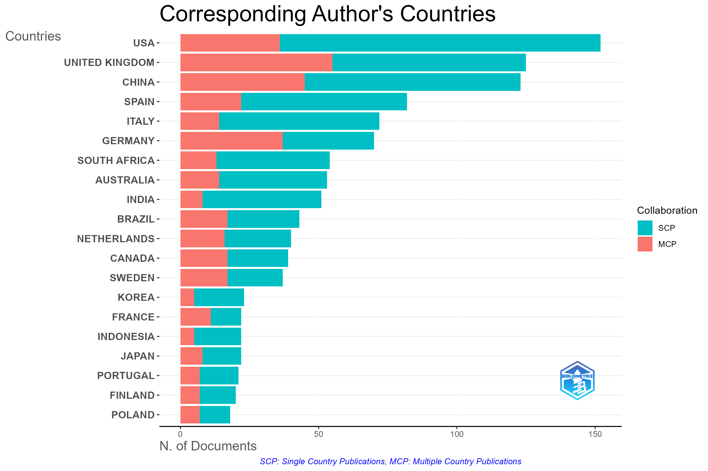

### How to Interpret *Corresponding Author's Countries* (**Figure 53**)
In academic publishing, every multi-authored article designates one **Corresponding Author** (stored in the `RP` metadata field)—typically the project leader or senior/lead researcher responsible for communicating with the journal editors and readers. Biblioshiny extracts the country of the corresponding author's institution to assign each paper's primary country of origin, and then inspects the affiliations of all co-authors on that paper to classify every article into one of two categories:

- **`SCP` (Single Country Publications — Intra-National Collaboration, Turquoise Bar)**:
  - Articles in which **all authors belong to institutions located in the same country** (either a solo-authored paper or a domestic collaboration among universities within that nation).
- **`MCP` (Multiple Country Publications — International Collaboration, Coral-Red Bar)**:
  - Articles in which the corresponding author is based in that country, but **at least one co-author is affiliated with an institution in a foreign country**.
- **`MCP %` (or MCP Ratio)**:
  - The percentage of a country's total led publications that involve international collaboration ($\frac{\text{MCP}}{\text{SCP} + \text{MCP}} \times 100$).

### Top 10 Countries in Our Dataset (from **Figure 53** and `CorrAuthCountries` Report Table)

| Rank | Country | Total Articles | % of Global Output | SCP (Domestic) | MCP (International) | MCP % (International Ratio) |
| :---: | :--- | :---: | :---: | :---: | :---: | :---: |
| **1** | **USA** | **152** | 9.02% | 116 | 36 | 23.68% |
| **2** | **United Kingdom** | **125** | 7.41% | 70 | 55 | **44.00%** |
| **3** | **China** | **123** | 7.30% | 78 | 45 | 36.59% |
| **4** | **Spain** | **82** | 4.86% | 60 | 22 | 26.83% |
| **5** | **Italy** | **79** | 4.69% | 59 | 20 | 25.32% |
| **6** | **Germany** | **76** | 4.51% | 47 | 29 | **38.16%** |
| **7** | **South Africa** | **56** | 3.32% | 41 | 15 | 26.79% |
| **8** | **Australia** | **55** | 3.26% | 34 | 21 | **38.18%** |
| **9** | **India** | **51** | 3.02% | 39 | 12 | 23.53% |
| **10** | **Brazil** | **45** | 2.67% | 35 | 10 | 22.22% |

*(Followed in **Figure 53** by Netherlands [45], Canada, Sweden, Korea, France, Indonesia, Japan, Portugal, Finland, and Poland.)*

**How to Comment on This Chart**:
1. **Tripolar Global Leadership**: The **United States (152 articles)**, the **United Kingdom (125 articles)**, and **China (123 articles)** form the top tier of knowledge production, together accounting for nearly a quarter ($23.73\%$) of all papers in the collection, followed closely by a strong European cluster (**Spain [82], Italy [79], Germany [76], and the Netherlands [45]**).
2. **Presence of Major Emerging & Global South Economies**: Because socioeconomic inequality and sustainable development are acute challenges in emerging nations, **South Africa (Rank 7, 56 articles)**, **India (Rank 9, 51 articles)**, and **Brazil (Rank 10, 45 articles)**—along with Indonesia—feature prominently in the top 20.
3. **Contrasting Collaboration Patterns (`SCP` vs. `MCP %`)**: While the **USA** produces the highest total volume, over three-quarters of its output is domestic (`MCP % = 23.7%`), reflecting the vast number of American universities that can collaborate internally. By contrast, the **United Kingdom (`MCP % = 44.0%`)**, **Australia (`38.2%`)**, **Germany (`38.2%`)**, and **China (`36.6%`)** exhibit much stronger international co-authorship orientation, acting as global bridges in transnational research teams.

> **Note on Other Country Metrics in the Sidebar:**  
> As seen in **Figure 49**, the *Countries* menu also offers *Countries' Scientific Production* (which counts every country appearing on a paper, not just the corresponding author), *Countries' Production over Time*, and *Most Cited Countries* (which ranks nations by the total citations accumulated by their papers).

---

# Module 8: Analyzing Documents and Keywords — Citation Classics, WordCloud Cleaning, and Trend Topics

## 8.1 Navigating `Analysis → Documents` and Finding Seminal Papers (*Most Global Cited Documents*)

Now we reach one of the most practically valuable sections for any university student writing a literature review: **`ANALYSIS → Documents`** (**Figure 54**).

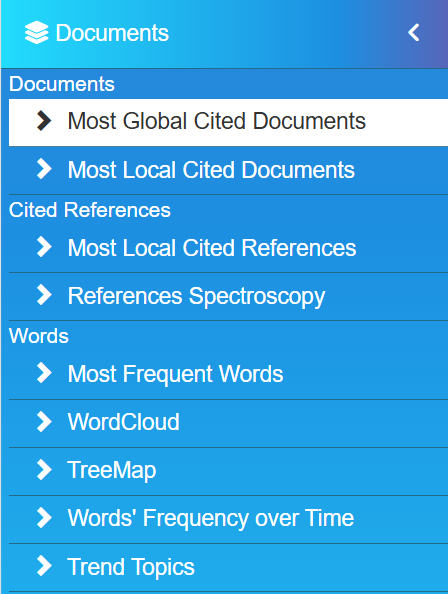

When you start studying a new topic, you need to know: **Which exact 5 or 10 articles are the foundational "landmark papers" that everyone in this field cites?** Clicking on **`Documents → Most Global Cited Documents`** answers this question instantaneously, offering both an interactive **`Table`** view (**Figure 55**) and a visual **`Plot`** view (**Figure 56**).

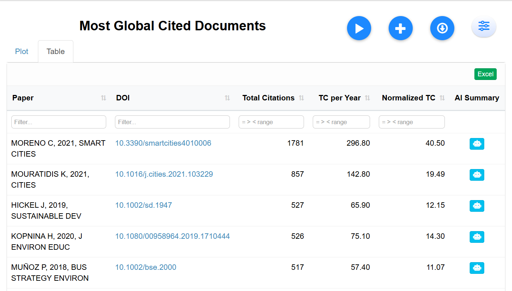

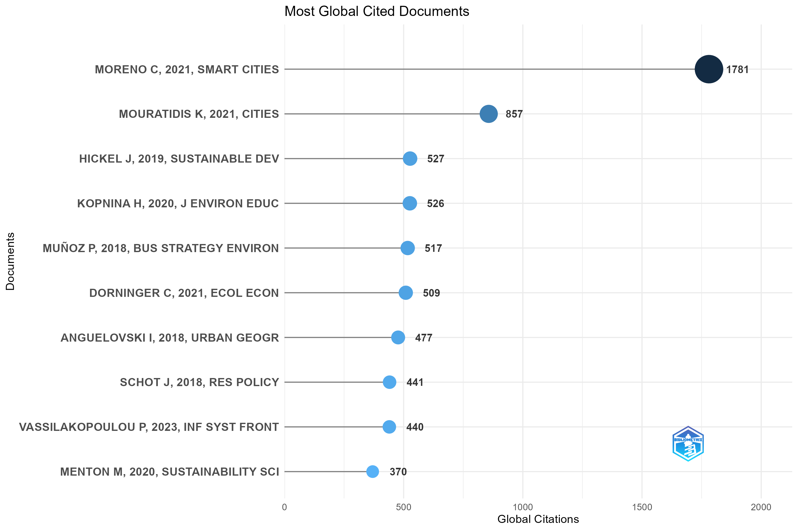

### Understanding the Citation Metrics in **Figure 55**
Before examining the top papers, make sure you understand the exact meaning of the columns shown in **Figure 55**:

1. **`Global Citations (Total Citations / TC)` vs. `Local Citations (LC)`**:
   - **`Total Citations (TC)` (Global Citations)**: The total number of times a paper has been cited by *any* peer-reviewed document indexed across the **entire Scopus database** worldwide, regardless of discipline. High Global Citations identify articles with massive cross-disciplinary visibility and broad academic impact.
   - **`Local Citations (LC)`**: The number of times a paper has been cited specifically *by other articles inside your 1,686-document collection* (requires exporting cited references `CR`).
2. **`TC per Year` (Annual Citation Velocity)**:
   - Older papers naturally have had more years to accumulate citations than recent papers. **`TC per Year`** divides a paper's *Total Citations* by the number of years elapsed since its publication ($\frac{\text{TC}}{\text{Current Year} - \text{Publication Year} + 1}$), measuring how fast the article is being cited each year.
3. **`Normalized TC (NTC)` (Age-Normalized Citation Impact)**:
   - **What It Means**: Divides a paper's total citations (`TC`) by the **average citations received by all articles published in that exact same calendar year within your dataset**.
   - **How to Interpret It**: An $\text{NTC} = 1.00$ means the paper performs exactly at the average of its publication cohort. In **Figure 55**, the #1 paper (`MORENO C, 2021`) has a **`Normalized TC = 40.50`**—meaning it has received **40.5 times more citations than the average 2021 article in our dataset**!
4. **Clickable `DOI` Links & `AI Summary`**:
   - In the **`Table`** view (**Figure 55**), the **`DOI`** column provides direct clickable links (`10.3390/smartcities4010006`, etc.). Clicking any DOI opens the full original paper in your browser so you can download the PDF, read it in depth, and cite it in your thesis!

### Top 10 Landmark Papers in Our Dataset (**Figures 55 and 56**)

| Rank | Paper Label (First Author, Year, Journal) | DOI | Total Citations (`TC`) | `TC per Year` | `Normalized TC` | Core Theme of the Landmark Paper |
| :---: | :--- | :--- | :---: | :---: | :---: | :--- |
| **1** | **MORENO C, 2021, *SMART CITIES*** | `10.3390/smartcities4010006` | **1,781** | **296.80** | **40.50** | Introducing the *"15-Minute City"* paradigm for post-pandemic urban sustainability, proximity, and spatial equity |
| **2** | **MOURATIDIS K, 2021, *CITIES*** | `10.1016/j.cities.2021.103229` | **857** | **142.80** | **19.49** | Comprehensive review linking urban planning, the built environment, social equity, and subjective well-being |
| **3** | **HICKEL J, 2019, *SUSTAINABLE DEV*** | `10.1002/sd.1947` | **527** | **65.90** | **12.15** | Critical ecological-economic analysis of the contradiction within the UN SDGs between economic growth and planetary ecological boundaries |
| **4** | **KOPNINA H, 2020, *J ENVIRON EDUC*** | `10.1080/00958964.2019.1710444` | **526** | **75.10** | **14.30** | Critical evaluation of Education for Sustainable Development Goals (ESDG), planetary ethics, and social inequality |
| **5** | **MUÑOZ P, 2018, *BUS STRATEGY ENVIRON*** | `10.1002/bse.2000` | **517** | **57.40** | **11.07** | Sustainable entrepreneurship: how business ventures address ecological sustainability and socio-economic inequality |
| **6** | **DORNINGER C, 2021, *ECOL ECON*** | `10.1016/j.ecolecon.2020.106824` | **509** | **84.83** | **11.57** | Global ecologically unequal exchange: how high-income nations appropriate resources and labor from the Global South |
| **7** | **ANGUELOVSKI I, 2018, *URBAN GEOGR*** | `10.1080/02723638.2017.1349987` | **477** | **53.00** | **10.22** | *"Green gentrification"*: assessing how urban greening initiatives can inadvertently deepen spatial and housing inequalities |
| **8** | **SCHOT J, 2018, *RES POLICY*** | `10.1016/j.respol.2018.08.011` | **441** | **49.00** | **9.45** | Three frames for innovation policy: transformative innovation policy for socio-technical sustainability transitions |
| **9** | **VASSILAKOPOULOU P, 2023, *INF SYST FRONT*** | `10.1007/s10796-021-10221-8` | **440** | **110.00** | **18.06** | Bridging the digital divide during crises to advance inclusive social and sustainable development |
| **10** | **MENTON M, 2020, *SUSTAINABILITY SCI*** | `10.1007/s11625-020-00789-8` | **370** | **52.86** | **10.06** | Environmental justice and intersectionality within the Sustainable Development Goals (SDGs) |

> **Study Strategy:**  
> Look at how much clarity this table gives you in just 5 minutes! Simply reading the top 5–10 papers listed in **Figures 55 and 56** immediately introduces you to the major intellectual debates at the intersection of sustainability and inequality: **urban equity & the 15-minute city** (Moreno, 2021; Mouratidis, 2021; Anguelovski, 2018), **ecological economics, degrowth & the SDGs** (Hickel, 2019; Dorninger, 2021), **environmental justice** (Menton, 2020), **education** (Kopnina, 2020), and **sustainable entrepreneurship & transformative innovation** (Muñoz, 2018; Schot, 2018).

---

## 8.2 `WordCloud` Fundamentals and the Problem of Raw Uncleaned Data

Still under **`ANALYSIS → Documents`**, look at the bottom sub-group titled **`Words`** (**Figure 54**) and click on **`WordCloud`**.

A **WordCloud** (tag cloud) is a visual representation of lexical frequency: the font size of each word is directly proportional to how many times that concept appears across your 1,686 articles. When you open *WordCloud* for the very first time using Biblioshiny's default settings, however, you will see the result shown in **Figures 57 and 58**:

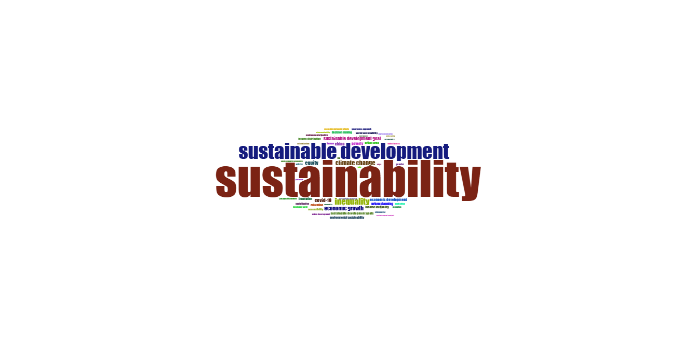


Why does the default WordCloud in **Figures 57 and 58** look relatively uninformative, with a massive word **`sustainability`** crushing everything else into tiny, unreadable text? For two reasons:
1. By default, Biblioshiny may use **`Keywords Plus`** or **`All Keywords`**, which include generic database-assigned index terms.
2. More importantly, **it still contains the exact search terms we typed into Scopus (`sustainability` and `inequality`)!** Because every single paper in our 1,686-article collection had to contain `"sustainability"` and `"inequality"` to be retrieved by Scopus in the first place, plotting those words in our WordCloud adds zero analytical insight and visually dwarfs all the specific sub-themes.

Fortunately, using the **Options menu** on the right (opened by clicking the **fourth blue sliders button** at the top right of **Figure 58**), we can clean and transform this WordCloud into a publication-grade visualization in three simple steps!

---

## 8.3 Choosing the Right Text Field: *Author's Keywords* vs. *Keywords Plus* and *All Keywords*

When you open the right-hand **`Options:`** drawer (**Figure 59**), the very first section is **`Main Configuration → Field`**, accompanied by **`Number of Words`** (default `50`, meaning the cloud plots the top 50 most frequent terms).


Clicking on the **`Field`** dropdown (**Figure 60**) displays six text sources:
- **`Keywords Plus`** (`ID`): Algorithmically generated by the database from words appearing in the titles of cited references. *Drawback*: Often too generic (e.g., *"human"*, *"article"*, *"female"*, *"controlled study"*).
- **`Author's keywords`** (`DE`) *(Strongly Recommended!)*: The 3 to 6 keywords deliberately chosen by the authors themselves when submitting their manuscript to express the exact theoretical and empirical focus of their study. Moreover, as we discovered in our *Missing Data* audit (**Figure 31**), $96.4\%$ of our Scopus articles have complete *Author's keywords*, whereas nearly $48\%$ lack *Keywords Plus*!
- **`All Keywords`**: Merges *Keywords Plus* and *Author's keywords* together (which re-introduces the generic noise of *Keywords Plus*).
- **`Titles`** / **`Abstracts`**: Extracts N-grams (single words, bigrams, or trigrams) from paper titles or abstracts. While titles can occasionally be useful if a database export lacks keywords, **Author's keywords** remain far cleaner and more conceptually intentional.
- **`Subject Categories (WoS)`**: Exclusive to Web of Science exports.

**Action**: Select **`Author's keywords`** from the **`Field`** dropdown (**Figure 60**).

---

## 8.4 Text Editing Part 1: Removing Noise and Search Terms (*Stop Words*)

Below *Main Configuration* in the Options drawer (**Figure 59**), click the `+` icon next to **`Text Editing`** to expand it (**Figure 61**).


The **Text Editing** panel (**Figure 61**) contains two essential text-cleaning tools that work across **all** keyword-based modules in Biblioshiny (*WordCloud*, *Trend Topics*, *Co-occurrence Network*, and *Thematic Map*):
1. **`Stop Words` (*Load a list of terms to remove*)**: Excludes noisy, generic, or redundant words (especially the initial Scopus search query words!).
2. **`Synonyms` (*Load a list of synonyms*)**: Merges different spelling variants, plurals, or acronyms into a single unified concept.

### How to Create and Upload a *Stop Words* File (**Figures 62, 63, 64, and 65**)


1. **Change `Load a list of terms to remove` from `No` to `Yes` (Figure 62)**.
2. **Prepare a Simple `.txt` or `.csv` File on Your Computer (Figure 63)**:
   - Open Notepad (Windows), TextEdit in plain-text mode (Mac), or Excel, and create a simple plain-text file (e.g., `stopwords.txt`) listing the words you want to exclude—starting with the words used in your initial Scopus search query (`sustainability` and `inequality`).
   - As explained in the on-screen instructions in **Figure 63**: *"Upload a TXT or CSV file containing a list of terms you want to remove from the analysis. Terms have to be separated by a standard separator (comma, semicolon or tabulator)."*
   - For example, inside `stopwords.txt`, you can simply write:
     ```text
     sustainability, inequality
     ```
     *(or place them on separate lines / separated by commas or semicolons; case does not matter because Biblioshiny converts all terms to lowercase automatically).*


3. **Upload the File and Confirm in the Modal Window (Figures 63 and 64)**:
   - Click **`Browse...`** (**Figure 63**), select your `.txt` file, and ensure the **`File Separator`** dropdown matches the separator you used (e.g., `Comma ","`).
   - A confirmation pop-up titled **`Stopword list`** immediately appears on screen (**Figure 64**), showing the parsed words (`sustainability`, `inequality`, *"Showing 1-2 of 2"*).
   - Click the blue **`OK`** button (**Figure 64**), and then click the blue **Play** button at the top right of the WordCloud workspace to regenerate the plot!


### Look at the Transformation in the Cleaned WordCloud (**Figure 65**)!
Compare **Figure 65** (after switching to *Author's Keywords* and removing `sustainability` and `inequality`) with **Figure 57** (the raw default plot). The improvement is night and day! With the giant search terms removed, the true thematic architecture of our 1,686 articles becomes vividly legible (ranked by exact frequency in the `WordCloud` report table):
- **`sustainable development`** ($128$ occurrences)
- **`covid-19`** ($63$ occurrences)
- **`sustainable development goals`** ($55$ occurrences) & **`sdgs`** ($37$ occurrences)
- **`climate change`** ($54$ occurrences)
- **`income inequality`** ($47$ occurrences)
- **`poverty`** ($37$ occurrences)
- **`gender`** ($34$ occurrences) & **`gender inequality`** ($31$ occurrences)
- **`social sustainability`** ($32$ occurrences) & **`environmental sustainability`** ($22$ occurrences)
- **`economic growth`** ($28$ occurrences), **`environmental justice`** ($27$ occurrences), **`equity`** ($27$ occurrences), **`urban sustainability`** ($19$ occurrences), **`circular economy`** ($19$ occurrences), **`education`** ($18$ occurrences), **`energy transition`** ($17$ occurrences), and **`gini index`** ($15$ occurrences).

---

## 8.5 Text Editing Part 2: Grouping Equivalent Concepts (*Synonyms*) and Customizing Visual *Parameters*

Looking closely at the cleaned WordCloud in **Figure 65** (and the frequencies listed above), you will notice one remaining linguistic issue common to all bibliographic databases: **different authors write the exact same concept in slightly different ways!**

For example, in our collection, authors refer to the UN Sustainable Development Goals as:
- `sustainable development goals` ($55$ times)
- `sdgs` ($37$ times)
- `sdg` ($16$ times)
- `sustainable development goals (sdgs)` ($11$ times)

If left separate, Biblioshiny treats them as four distinct keywords ($55$, $37$, $16$, and $11$). If we merge them as **synonyms**, their frequencies combine ($55 + 37 + 16 + 11 = 119$ occurrences!), revealing that the UN SDGs are actually the second most dominant concept in the entire literature!

### How to Create and Upload a *Synonyms* File (**Figures 66 and 67**)


1. Under **`Text Editing → Synonyms`**, switch **`Load a list of synonyms`** from **`No`** to **`Yes`** (**Figure 66**).
2. As explained in the panel instructions (**Figure 67**): *"Upload a TXT or CSV file containing, in each row, a list of synonyms that will be merged into a single term. Terms have to be separated by a standard separator. Rows have to be separated by return separator."*
3. **How to Format Each Row of Your `synonyms.txt` File**:
   - In each line (row), the **very first term** on the left is the **target unified label** that will appear on your charts, followed by all its synonyms/variants separated by commas (or semicolons):
   ```text
   sustainable development goals, sdgs, sdg, sustainable development goals (sdgs)
   covid-19, covid 19, sars-cov-2, coronavirus, pandemic
   gender inequality, gender equity, gender disparities
   ```
4. Click **`Browse...`** (**Figure 67**), select your `synonyms.txt` file, choose the matching **`File Separator`** (`Comma ","` or `Semicolon ";"`), confirm the modal table with **OK**, and click **Play** to update the plot!

### Customizing Visual Appearance with `Parameters` (**Figure 68**)
Finally, expanding the **`Parameters`** box at the bottom of the right-hand Options drawer (**Figure 68**) lets you fine-tune the graphic design of your WordCloud before exporting it for your thesis or presentation:


- **`Word occurrence by`**: Choose whether font size scales linearly with raw **`Frequency`**, or via dampened transformations (`Sqrt` square root, or `Log` logarithm—useful if one word is much larger than the rest).
- **`Shape`**: Change the geometric silhouette of the cloud (`Circle`, `Cardioid`, `Diamond`, `Triangle`, `Pentagon`, `Star`).
- **`Font type`** & **`Text colors`**: Select the typography (`Impact`, `Arial`, `Times New Roman`, etc.) and color scheme (`Random Dark`, `Random Light`, etc.).
- **`Font size`** (`0.5`), **`Ellipticity`** (`0.65` — flatness/aspect ratio of the oval), **`Padding`** (`1` — spacing between words), and **`Rotate`** (`0` — keeps all words horizontal and easy to read, or adds angled words).

---

## 8.6 `Trend Topics`: Mapping the Chronological Evolution of Research Themes

The final module under **`ANALYSIS → Documents → Words`** is **`Trend Topics`** (**Figure 69**). Just like in the WordCloud, always open the right-hand **Options** drawer first, set **`Field`** to **`Author's keywords`**, and apply your **Stop Words** and **Synonyms** lists so the timeline is clean and meaningful!


### How to Read and Interpret a *Trend Topics* Chart (**Figure 69**)
The **Trend Topics** plot is a powerful longitudinal visualization that shows **when** specific concepts entered the debate, **when** they peaked, and **which new topics are emerging right now**:

1. **Vertical Axis ($y$-axis — `Term`)**: Lists the top keywords ordered chronologically from the oldest median publication year at the bottom to the most recent median publication year at the top.
2. **Horizontal Axis ($x$-axis — `Year`)**: Spans our publication timeline from `2018` to `2024`.
3. **Horizontal Blue Segment (Interquartile Lifespan: $Q_1 \longrightarrow Q_3$)**:
   - For every keyword, Biblioshiny collects the publication years of all articles containing that keyword and computes the quartiles of its temporal distribution:
     - **Left endpoint of the line = 1st Quartile Year ($Q_1$, 25th percentile)**: The year by which the first $25\%$ of papers using that keyword had been published.
     - **Right endpoint of the line = 3rd Quartile Year ($Q_3$, 75th percentile)**: The year by which $75\%$ of papers using that keyword had been published.
   - A **long horizontal bar** (e.g., `sustainable development` or `poverty` spanning from `2020` to `2023/2024`) indicates an **enduring structural theme** discussed continuously across many years. A **short bar** indicates a topic concentrated within a specific 1- or 2-year burst.
4. **Blue Circle Position (`Year (Median)` = $Q_2$, 50th percentile)**:
   - The circle sits at the **Median Year ($Q_2$)** of that keyword's publications—marking the chronological center of gravity of scholarly interest in that topic.
5. **Blue Circle Size (`Term frequency`)**:
   - The diameter of the circle reflects the total number of articles in which the keyword appears.

### The Three Evolutionary Waves in Our Case Study (**Figure 69**)
Reading **Figure 69** from bottom-left (`2018–2019`) to top-right (`2023–2024`) tells a crystal-clear historical story of how research on *sustainability and inequality* evolved:

- **Wave 1: Early Theoretical & Macroeconomic Foundations (2018–2020, Bottom-Left)**:
  - In the earlier years of our window, the debate centered on formal economic modeling and macro-indicators: **`game theory`** ($Q_1 = 2018$, $\text{Median} = 2019$, $Q_3 = 2019$), **`international inequality`** ($\text{Median} = 2019$), **`growth`** ($\text{Median} = 2019$), **`oecd`** ($\text{Median} = 2019$), and **`socioeconomic conditions`** ($\text{Median} = 2020$).
- **Wave 2: Social, Urban & Pandemic Consolidation (2021–2022, Middle Diagonal)**:
  - Between 2021 and 2022, the literature expanded massively into multidimensional social and spatial inequalities, catalyzed by the pandemic and the UN 2030 Agenda: **`employment`**, **`human development`**, **`urban planning`**, **`poverty`**, **`gender`**, **`inequality`**, **`covid-19`**, **`sustainable development`**, **`sustainability`**, **`gender inequality`**, **`accessibility`**, and **`sustainable development goals`** ($\text{Median} = 2021\text{--}2022$, with $Q_3$ extending to `2023–2024`).
- **Wave 3: Cutting-Edge Emerging Frontiers (2023–2024, Top-Right Corner!)**:
  - Look at the top three rows in the upper-right corner of **Figure 69**, where the median circles sit at **`2023` and `2024`**:
    1. **`esg`** (*Environmental, Social, and Governance* corporate sustainability metrics and inequality)
    2. **`energy transition`** (the distributional impacts and social justice of decarbonization)
    3. **`renewable energy`** (green energy access, energy poverty, and sustainable transitions)

> **How Students Can Use *Trend Topics* to Pick a Winning Thesis Angle:**  
> Whenever a student asks, *"What specific angle should I focus my thesis or research paper on?"*, point straight to the **upper-right corner of the Trend Topics chart**! In our case study, demonstrating that the literature has evolved from general macroeconomic growth (`2019`) and COVID-19 impacts (`2021–2022`) toward **ESG frameworks and the social inequalities of the renewable energy transition (`2023–2024`)** gives you an empirically grounded justification for choosing your exact research gap.

---

# Module 9: Science Mapping I — Conceptual Structure (Co-occurrence Network and Thematic Map)

## 9.1 Navigating `Synthesis → Conceptual Structure` and Understanding Co-Word Analysis

While the **`ANALYSIS`** modules we explored in Modules 5 through 8 focus on **Performance Analysis** (counting publications, citations, journals, authors, and keyword frequencies individually), the **`SYNTHESIS`** section in the left navigation bar introduces **Science Mapping**—the relational heart of a bibliometric review.

Clicking on **`SYNTHESIS → Conceptual Structure`** in the left sidebar expands two methodological approaches (**Figure 70**):
1. **Network Approach**:
   - **`Co-occurrence Network`**
   - **`Thematic Map`**
   - **`Thematic Evolution`**
2. **Factorial Approach**:
   - **`Factorial Analysis`** (Multiple Correspondence Analysis / MCA, Correspondence Analysis / CA, and Multidimensional Scaling / MDS)


### What Is a Co-occurrence Network (Co-Word Analysis)?
Introduced by **Michel Callon et al. (1983)**, **Co-Word Analysis** (*Co-occurrence Network*) maps the conceptual structure of a scientific domain by analyzing which keywords repeatedly appear **together in the same articles**. The underlying principle is simple yet profound: *if two concepts are frequently studied together by researchers in the same papers, they are conceptually and theoretically linked*.

In a **Co-occurrence Network** (**Figure 71**):
- **Nodes (Circles)**: Each circle represents a keyword. The **size of the circle** is proportional to how frequently that keyword occurs (or its centrality in the network).
- **Edges (Connecting Lines)**: A line connects two keywords whenever they co-occur in the same article(s). The **thickness of the line** is proportional to the strength of their co-occurrence (how often they appear together).
- **Colors (Thematic Clusters / Communities)**: An automated **clustering algorithm** partitions the network into distinct color-coded groups (*clusters*). Keywords sharing the same color belong to the same **thematic cluster**—meaning they co-occur tightly with one another and represent a coherent sub-topic or research stream within the literature!


Just as we saw with the *WordCloud*, when you first open **`Co-occurrence Network`** (**Figure 71**), it defaults to **`Keywords Plus`** and still includes the uncleaned search terms (`sustainability`). Therefore, our first step is to click the **fourth blue sliders button** at the top right to open the **`Options:`** drawer (**Figure 72**):
1. Under **`Main Configuration → Field`**, switch from `Keywords Plus` to **`Author's Keywords`** (**Figure 72**).
2. Keep the **`Avoid Label Overlap`** toggle turned **ON** (blue) so keyword labels never obscure one another.
3. Expand **`Text Editing`** and apply your **Stop Words** (removing `sustainability` and `inequality`) and **Synonyms** lists, exactly as we did in Sections 8.4 and 8.5.

---

## 9.2 Configuring the *Co-occurrence Network*: Method Parameters, Clustering Algorithms (Louvain), Filtering, and Graphical Settings

Below *Main Configuration* and *Text Editing* in the right-hand Options drawer, you will find two crucial configuration menus: **`Method Parameters`** (**Figures 73 and 74**) and **`Graphical Parameters`** (**Figures 75 and 76**). Understanding what every setting in these two menus does allows you to build rigorous, crystal-clear network maps and justify your methodological choices in your thesis.


### 1. Deep-Dive Explanation of `Method Parameters` (**Figure 73**)

- **`Network Layout` (`Automatic layout`)**:
  - Controls the spatial positioning algorithm (from the `igraph` R library) that calculates the $(x, y)$ coordinates of every node on the screen.
  - **`Automatic layout`** (or **`Fruchterman-Reingold`** / **`Kamada-Kawai`**): Uses a **force-directed ("spring-electrical") physical simulation**. Imagine that every pair of nodes repels each other like magnets of the same polarity, while every connecting link (co-occurrence edge) acts like an elastic spring pulling connected keywords together. When the simulation reaches equilibrium, keywords that frequently co-occur end up clustered close together, while unrelated topics are pushed to opposite corners of the plot! (Other available geometric layouts include *Circle*, *Star*, *Sphere*, and *MDS*).

- **`Normalization Method` (`Association`)**:
  - Why do we need to normalize raw co-occurrence counts? Because if two keywords are both extremely frequent overall, they will occasionally appear in the same paper purely by chance.
  - **`Association` (Association Strength — Default & Recommended)**: Proposed by van Eck & Waltman (2009, the creators of VOSviewer), the **Association Strength** index normalizes the number of co-occurrences $c_{ij}$ between keyword $i$ and keyword $j$ by dividing it by the product of their individual total occurrences $c_i$ and $c_j$:
    $$AS_{ij} = \frac{c_{ij}}{c_i \cdot c_j}$$
    This ensures that connections reflect genuine conceptual affinity rather than sheer word frequency. (Alternative similarity metrics in the dropdown include *Inclusion*, *Jaccard*, *Salton's Cosine*, and *Equivalence Index*).

- **`Clustering Algorithm` (`Louvain`) — How Does Biblioshiny Group Keywords into Colored Clusters?**:
  - Once the normalized network of links is built, Biblioshiny applies a **graph community detection algorithm** to identify tightly knit groups of nodes (*clusters*). Every cluster receives a distinct color.
  - Biblioshiny offers several famous algorithms from network science. Here is what they mean and why **`Louvain`** is the gold standard:

| Clustering Algorithm | How It Works (Intuitive Mechanism) | When to Use It |
| :--- | :--- | :--- |
| **`Louvain`** *(Default & Most Popular)* | Introduced by **Blondel et al. (2008)**, the **Louvain algorithm** is a hierarchical, greedy optimization method that maximizes a network metric called **Modularity ($Q \in [-0.5, 1]$)**. Modularity measures the density of links *inside* clusters compared to links *between* different clusters. The algorithm works in two iterative phases: (1) it initially assigns each node to its own community and moves nodes into neighboring communities whenever doing so increases Modularity $Q$; (2) it aggregates the discovered communities into "super-nodes" and repeats the process until maximum modularity is achieved. | **Best all-around choice** for medium-to-large bibliometric networks (30 to 250+ keywords). Produces clean, well-balanced, non-overlapping thematic clusters. |
| **`Walktrap`** | Proposed by **Pons & Latapy (2005)**, it relies on **short random walks** (typically 3–5 steps) across the network, based on the principle that a random walker moving from node to node tends to get "trapped" inside densely connected thematic communities. | Excellent alternative for small-to-medium co-word and co-citation networks; often produces slightly more granular sub-clusters. |
| **`Leiden`** | An enhanced refinement of the Louvain algorithm (Traag et al., 2019) that guarantees all detected clusters are internally well-connected. | Great for very large or complex networks. |
| **`Fast Greedy` / `Leading Eigenvector`** | Classic modularity-maximization algorithms by Clauset, Newman, & Moore (2004) and Newman (2006) using hierarchical agglomeration or the spectral eigenvector of the modularity matrix. | Useful for checking the robustness of broad macro-clusters. |
| **`Infomap`** | Uses information theory (Rosvall & Bergstrom, 2008) to compress the description length of a random walk across the graph. | Effective when flow/navigation structure dominates. |
| **`Edge Betweenness` (Girvan-Newman)** | Divisive algorithm that iteratively removes the "bridge" edges with the highest betweenness centrality until the network splits into communities. | Best only for very small networks ($<40$ nodes). |

- **`Node Color by Year` (`No` / `Yes`)**:
  - When set to **`No`** (default), node colors represent their **thematic cluster membership** (e.g., Red = Cluster 1, Blue = Cluster 2, Green = Cluster 3). If switched to **`Yes`**, nodes are colored along a continuous gradient according to the **average publication year** of the papers containing each keyword.
- **`Network Size`: `Number of Nodes` (`50`) & `Repulsion Force` (`0.5`)**:
  - **`Number of Nodes`**: Selects how many top keywords (by frequency) are included in the network. Starting with **`50`** (or testing `30` to `40` for an even cleaner thesis figure) is ideal: too few nodes ($<15$) miss important sub-themes, while too many nodes ($>100$) turn the graph into an unreadable "hairball."
  - **`Repulsion Force`** (`0.5`, adjustable from `0` to `1`): Controls how strongly nodes push apart from one another in the layout. If nodes look too crowded in the center, slightly increasing the repulsion force spreads them out cleanly.


### 2. Deep-Dive Explanation of `Filtering Options` (**Figure 74**)
Directly below *Network Size* inside *Method Parameters* sits the orange **`Filtering Options`** card (**Figure 74**):
- **`Remove Isolated Nodes` (`Yes`)**:
  - If a keyword among the top 50 terms does not co-occur with any other top keyword above the minimum edge threshold, setting this to **`Yes`** hides the disconnected floating dot so your map shows only connected components.
- **`Minimum Number of Edges` (`2`)**:
  - Sets the minimum co-occurrence frequency required to draw a visible link between two keywords. At the default value of **`2`**, two keywords must appear together in at least 2 articles to be connected.
  - *Practical Tuning Tip*: If your network has too many crisscrossing grey lines, try increasing `Minimum Number of Edges` to **`3`**, **`4`**, or **`5`** and click **Play**. This prunes weak, accidental co-occurrences and reveals the structural backbone of the thematic clusters!


### 3. Deep-Dive Explanation of `Graphical Parameters` (**Figures 75 and 76**)
Expanding **`Graphical Parameters`** lets you polish the visual aesthetics of your network map:
- **`Opacity` (`0.7`)**: Controls the transparency of the colored node circles ($0 = \text{invisible}$, $1 = \text{solid opaque}$). A value around `0.7` allows you to see overlapping edges and neighboring bubbles clearly through the circle.
- **`Number of Labels` (`1000`)**: Sets the maximum number of nodes that display their text label (setting this above your *Number of Nodes*, e.g., `1000`, ensures every node in your 50-node network is labeled).
- **`Label Scaling (cex)` (`Yes`) & `Label Size` (`3`)**: When `Label Scaling (cex)` is set to **`Yes`**, popular hubs have larger text labels and smaller peripheral nodes have proportionally smaller font sizes; `Label Size` adjusts the overall font multiplier.
- **`Node Shape` (`Dot`)**: Choose the geometric shape of the nodes (`Dot` circle, `Square`, `Triangle`, `Star`, or `Text` only).
- **`Edge Size` (`5`)**: Multiplier for the thickness of the connecting lines between nodes.
- **`Node Shadow` (`Yes`)**: Adds a subtle drop shadow behind nodes for visual depth.
- **`Edit Nodes` (`No` / `Yes`)**: Switching this to **`Yes`** unlocks interactive drag-and-drop editing right inside the browser, allowing you to click and drag individual nodes slightly if two labels are too close before taking your screenshot!
- **`Export Network` (`Pajek` / `HTML`)**: Lets you export the underlying graph structure either as a `.net` **Pajek** file (which can be opened directly in external network software such as **VOSviewer** or **Gephi**) or as a standalone interactive **`HTML`** web page!

### 4. Bonus Insight: Reading the Network Centrality Metrics (`Table` & `Documents` Tabs)
Look at the top tab bar of the Co-occurrence Network workspace in **Figure 71**: alongside `Network`, `Diachronic Network`, and `Density`, you will see **`Table`** and **`Documents`** (which are also exported into the `CoWordNet` sheets of your Excel report!).
- In the **`Table`** tab, Biblioshiny lists every keyword (`Node`), its assigned **`Cluster`** number (`1, 2, 3, ...`), and three graph-theoretical centrality indicators:
  1. **`Betweenness Centrality`**: Measures how frequently a keyword lies on the **shortest path ("bridge")** between other pairs of keywords in the network. High-betweenness keywords (such as `sustainable development` [432.43] and `sustainable development goals` [154.94] in our dataset) act as **interdisciplinary conceptual bridges** connecting different clusters!
  2. **`Closeness Centrality`**: Measures the inverse of the average shortest distance from a keyword to all other keywords in the network (indicating how quickly a concept connects to the rest of the field).
  3. **`PageRank`**: Adapted from Google's famous web-ranking algorithm, PageRank measures the **structural prestige** of a keyword based not only on how many links it has, but on whether it is linked to other central, highly connected concepts.
- Even better, in the **`Documents`** tab (and the second table of the `CoWordNet` Excel sheet!), Biblioshiny automatically **assigns every single one of our 1,686 articles to its primary thematic cluster (`Assigned_cluster`)** and computes each article's affinity percentage for Cluster 1, Cluster 2, Cluster 3, etc.! This means that once you identify 4 or 5 thematic clusters on the map, you can open the **`Documents`** tab, filter by `Assigned_cluster = 1`, sort by `TotalCitation` or `pagerank`, and immediately get the exact list of top articles belonging to Cluster 1 to read and summarize in your thesis!

---

## 9.3 Alternative Network Views: *Density Heatmap* and the Animated *Diachronic Network* (2018–2024)

Looking again at the top tabs of the *Co-occurrence Network* module (**Figure 71**), right next to the standard `Network` tab are two extraordinary visual perspectives: **`Density`** (**Figure 77**) and **`Diachronic Network`** (**Figures 78, 79, 80, and 81**).

### 1. The `Density` View (Conceptual Heatmap — **Figure 77**)


When you click on the **`Density`** tab (**Figure 77**), Biblioshiny transforms the node-and-link network into a **continuous kernel-density heatmap** (inspired by van Eck & Waltman's density visualization):
- The deeper and warmer the **glowing red-orange color** around a region of the map, the higher the local density of keywords and the stronger the co-occurrence weights among the neighboring terms in that neighborhood.
- Pale orange and white areas represent more peripheral or less densely interconnected zones.
- In **Figure 77**, the density map immediately reveals **two intense red-hot conceptual cores** joined by a bridge: a left/central core anchored around **`sustainable development`**, **`poverty`**, **`income distribution`**, **`economic growth`**, and **`developing world`**, and a right core anchored around **`covid-19`**, **`urbanization`**, **`public health`**, **`social justice`**, **`vulnerability`**, and **`accessibility`**, surmounted by an upper ridge around **`human`** / **`environmental sustainability`** / **`sustainable development goals`**.

### 2. The `Diachronic Network` View (Animated Temporal Evolution: 2018 $\rightarrow$ 2020 $\rightarrow$ 2022 $\rightarrow$ 2024 — **Figures 78–81**)

Clicking on the **`Diachronic Network`** tab opens an interactive **time-lapse player** with **`Start`**, **`Pause / Resume`**, **`Reset`**, an animation **`Speed (ms)`** selector (`500 ms`), and a **`Year` timeline slider** running from **`2018`** to **`2024`**.

Instead of showing the static cumulative network all at once, the **Diachronic Network** reconstructs how the conceptual structure of the field **grew, branched out, and differentiated into thematic clusters year by year**! Let's examine the four chronological snapshots captured from our animation (**Figures 78, 79, 80, and 81**, ordered chronologically from **2018** to **2024**):


- **Snapshot 1 — `Year 2018` (Figure 78)**:
  - At the beginning of our time window in 2018, the conceptual network is still compact and embryonic, consisting of a single primary cluster centered on **`sustainable development`**, surrounded by foundational environmental-economic concepts (`environmental sustainability`, `decision making`, `income`, `stakeholder`, `questionnaire survey`).


- **Snapshot 2 — `Year 2020` (Figure 79)**:
  - By 2020, the surge in publications causes the network to expand and **bifurcate into two distinct colored communities**:
    1. A **red cluster (left)** focused on macroeconomic and environmental policy (`sustainable development`, `income distribution`, `poverty`, `economic growth`, `environmental economics`, `environmental impact`, `China`, `developing world`).
    2. A **purple cluster (right)** linking global governance, urban systems, and social vulnerability (`climate change`, `policy making`, `governance approach`, `social justice`, `urbanization`, `urban area`, `equity`, `vulnerability`).


- **Snapshot 3 — `Year 2022` (Figure 80)**:
  - By 2022, following the pandemic shock, the right-hand community blossoms into a large, densely interconnected **green cluster** integrating **`covid-19`**, **`public health`**, **`sustainable development goals`**, **`urban planning`**, **`accessibility`**, and **`environmental justice`**, while an upper purple branch (`human`, `female`, `adult`) differentiates at the top.


- **Snapshot 4 — `Year 2024` (Figure 81)**:
  - By 2024, the network reaches its full structural complexity across all 1,686 documents, showing dense cross-cluster bridges between the macroeconomic inequality cluster (red), the SDG/urban/pandemic justice cluster (green), and the human/social demographic cluster (purple).
  - **Why Including Diachronic Snapshots in a Thesis Is So Effective**: Placing these four chronological frames (**2018 $\rightarrow$ 2020 $\rightarrow$ 2022 $\rightarrow$ 2024**) side-by-side visually demonstrates to your thesis committee that you have not just taken a static snapshot of the literature, but traced its **structural morphogenesis over time**!

---

## 9.4 `Thematic Map` (Callon's Strategic Diagram): Centrality, Density, and the Four Strategic Quadrants

Next, in the left sidebar under **`SYNTHESIS → Conceptual Structure`**, click on **`Thematic Map`** (**Figures 82 and 83**).

If you only have space to include *one* science-mapping figure in a short paper or presentation, the **Thematic Map** (also known in scientometrics as **Callon's Strategic Diagram**, introduced by Callon et al., 1991, and popularized by Cobo et al., 2011) is arguably the single most powerful analytical chart in bibliometrics.


### 1. How Are the Clusters and the Two Axes Calculated?
To build the Thematic Map (**Figure 82**), Biblioshiny first constructs the co-occurrence network of your chosen text field (here, **`Author's Keywords`**, selected in the *Options* drawer in **Figure 83**) and runs the community-detection clustering algorithm (e.g., *Louvain*) to partition the keywords into **thematic clusters** (each represented as a colored bubble on the chart, labeled with its top 3 most frequent keywords, and sized proportionally to the total occurrences of the words in that cluster).

Then, for every cluster, Biblioshiny computes **two mathematical network metrics** proposed by Michel Callon et al. (1991) and plots each cluster along two perpendicular axes divided at their median/mean dotted crosshairs:

1. **Horizontal Axis ($x$-axis) — `Relevance degree (Centrality)` (Callon's Centrality)**:
   - **Mathematical Definition**:
     $$C = 10 \times \sum_{k \in \text{Cluster}, \, h \notin \text{Cluster}} e_{kh}$$
     where $e_{kh}$ is the Association Strength of the co-occurrence link between a keyword $k$ belonging to the cluster and a keyword $h$ belonging to *other external clusters*.
   - **Intuitive Meaning**: **Centrality measures the degree of *external interaction* of a theme with the rest of the scientific field**. The further to the **right** a bubble sits on the horizontal axis, the more heavily that theme is connected to other topics across the entire literature—meaning it is a **central, foundational, and highly relevant pillar** of the discipline. Conversely, bubbles on the **left** have few external links to other clusters and operate in relative isolation.

2. **Vertical Axis ($y$-axis) — `Development degree (Density)` (Callon's Density)**:
   - **Mathematical Definition**:
     $$D = 100 \times \frac{\sum_{i, j \in \text{Cluster}} e_{ij}}{w}$$
     where $e_{ij}$ is the Association Strength of the co-occurrence links between keywords $i$ and $j$ *both inside the same cluster*, and $w$ is the total number of keywords in that cluster.
   - **Intuitive Meaning**: **Density measures the *internal cohesion and maturity* of a theme**. The higher up (**top**) a bubble sits on the vertical axis, the more strongly and repeatedly its internal keywords co-occur with one another—indicating a **well-developed, mature, and methodologically cohesive body of research**. Bubbles near the **bottom** have looser internal bonds and are either broad/transversal building blocks or nascent/fading topics.

---

### 2. Interpreting the Four Quadrants and the 7 Clusters in Our Dataset (**Figure 82**)

The dotted vertical and horizontal lines divide the Thematic Map (**Figure 82**) into **four strategic quadrants**, each with a clear diagnostic meaning:

#### Quadrant 1: Upper-Right — `Motor Themes` (*High Centrality, High Density*)
- **What They Are**: **Motor Themes** are both **internally well-developed** (high density) and **externally central** to the rest of the network (high centrality). They represent the **mainstream driving engines** of the research field—topics that structure the contemporary debate and connect strongly to multiple sub-fields.
- **In Our Case Study (Figure 82)**:
  - **`sustainability / sustainable development goals / sdgs`** (Pink bubble on the far right, lying just above the horizontal density midline at the maximum centrality end): This confirms that the **UN Sustainable Development Goals (SDGs)** framework acts as the primary driving motor that binds together environmental sustainability and socio-economic inequality research.
  - **`covid-19 / gender / inequalities`** (Purple bubble in the upper-center, just to the right of the vertical centrality midline and high in density): Shows that research examining the intersection of the **COVID-19 pandemic, gender disparities, and multidimensional inequalities** developed intense internal cohesion while connecting strongly to the wider sustainability literature.

#### Quadrant 2: Upper-Left — `Niche Themes` (*Low Centrality, High Density*)
- **What They Are**: **Niche Themes** (or *Ivory-Tower / Specialized Themes*) possess **strong internal cohesion** (high density—meaning a dedicated community of specialists consistently studies those exact keywords together), but **low external centrality** (fewer links to the rest of the general network). They represent **highly specialized, self-contained sub-disciplines**.
- **In Our Case Study (Figure 82)**:
  - **`inequality / poverty / environment`** (Blue bubble at the top-left, highest internal density on the map): Represents the classical quantitative poverty–environment nexus studied by development economists.
  - **`sustainability transitions / global south / energy justice`** (Grey-brown bubble in the middle-left): Represents the specialized, rapidly maturing socio-technical literature on **just energy transitions and energy justice in the Global South**.

#### Quadrant 3: Lower-Right — `Basic Themes` (*High Centrality, Low Density*)
- **What They Are**: **Basic and Transversal Themes** exhibit **high external centrality** (they connect to almost everything else in the field) but **lower internal density** (because they cover broad, general umbrella concepts shared across many diverse papers rather than a single narrow niche). They are the **foundational building blocks** that every researcher in the domain must engage with.
- **In Our Case Study (Figure 82)**:
  - **`sustainable development / income inequality / social sustainability`** (Green bubble in the lower-right): The overarching socio-economic backbone of the entire literature.
  - **`equity / environmental sustainability / accessibility`** (Light-blue bubble at the bottom-right): Transversal concepts of distributional equity, environmental quality, and service/spatial accessibility that cut across urban, economic, and environmental studies.

#### Quadrant 4: Lower-Left — `Emerging or Declining Themes` (*Low Centrality, Low Density*)
- **What They Are**: Themes located in the lower-left quadrant have **both low internal density and low external centrality**. In Callon's theory, this quadrant hosts two opposite types of topics: either **newly emerging themes** that are just beginning to coalesce and have not yet accumulated dense links, or **declining/marginal themes** that are fading out of the debate.
- **How Do You Tell Whether a Lower-Left Cluster Is *Emerging* or *Declining*?**
  - **Cross-check it with the *Trend Topics* chart (Figure 69) or the `Clusters / Documents` publication years!**
- **In Our Case Study (Figure 82)**:
  - **`climate change / urban sustainability / environmental justice`** (Orange bubble in the lower-left, positioned close to the central crosshairs): Cross-referencing these keywords with our *WordCloud* (**Figure 65**) and *Trend Topics* (**Figure 69**) shows that urban climate justice and environmental justice are **actively growing, ascending themes** moving upward and rightward toward the center of the strategic diagram!

---

### 3. Understanding and Tuning the Thematic Map `Parameters` (**Figures 84 and 85**)

When you expand **`Parameters`** at the bottom of the right-hand Options drawer in the *Thematic Map* module (**Figures 84 and 85**), you can customize several key parameters and experiment with different configurations:


- **`Number of Words` (`250` — Figure 84)**:
  - Defines how many of the top most frequent keywords are included in the co-occurrence matrix used to build the Thematic Map (default `250`). Including 200–300 words allows the clustering algorithm to detect both major Basic/Motor themes and smaller specialized Niche/Emerging themes.
- **`Min Cluster Frequency (per thousand docs)` (`5` — Figure 84)**:
  - Sets the minimum relative frequency threshold required for words/clusters to appear on the map, expressed **per 1,000 documents ($\text{‰}$)**.
  - *How It Works*: In our dataset of $1,686$ documents, setting `Min Cluster Frequency = 5` means a keyword must appear in at least $\frac{5}{1000} \times 1686 \approx 8.4$ (i.e., $9$) articles to be retained in a cluster.
  - *Tuning Tip*: If your Thematic Map only displays 2 or 3 large bubbles, try **lowering** `Min Cluster Frequency` slightly (e.g., from `5` to `3` or `4`) to reveal more granular niche and emerging clusters. Conversely, if the map looks cluttered with 12+ tiny bubbles, **increase** it (e.g., to `7` or `10`) to focus only on the dominant macro-themes!
- **`α Parameter (Balancing Occurrence vs. Centrality)` (`0.5` — Figure 84)**:
  - Ranges from `0` to `1`. Controls how keywords inside each cluster are ranked and how bubble sizes/positions balance raw **word occurrence frequency** versus **network centrality**. Leaving `α = 0.5` weights both dimensions equally.
- **`Number of Labels` (`3`) & `Label Size` (`0.3` — Figure 84)**:
  - `Number of Labels = 3` prints the top 3 most frequent keywords inside each colored bubble (as seen in **Figure 82**). You can increase this to `4` or `5` if you want more words displayed on each bubble, or switch to the **`Clusters`** tab at the top of the screen (**Figure 83**) to see the complete list of all keywords belonging to every cluster!
- **`Community Repulsion` (`0.5`) & `Clustering Algorithm` (`Louvain` — Figure 85)**:
  - If two cluster bubbles happen to sit at very similar $(x, y)$ coordinates and overlap visually on the plot, increasing **`Community Repulsion`** (e.g., from `0.5` to `0.7` or `0.8`) gently pushes overlapping bubbles apart so every label remains 100% readable!
  - And just like in the Co-occurrence Network, **`Documents`** in the top tab bar of **Figure 83** lists the specific articles associated with each quadrant and cluster so you can cite concrete papers when discussing each Motor, Niche, Basic, and Emerging theme in your thesis!

---

# Module 10: Science Mapping II — Social Structure (Countries' Collaboration World Map)

## 10.1 Configuring and Interpreting the *Countries' Collaboration World Map*

The final analytical dimension of our tour examines the **Social Structure** of the scientific community—specifically how researchers collaborate across national borders.

In the left navigation sidebar, under **`SYNTHESIS`**, click on **`Social Structure`** (located directly below *Conceptual Structure* in **Figure 70**) and select **`Countries' Collaboration World Map`** (**Figures 86 and 87**).


### 1. How to Read the *Countries' Collaboration World Map* (**Figure 87**)
The **Countries' Collaboration World Map** is a high-impact geographic visualization that combines two layers of bibliometric data on a single world projection:

1. **Country Fill Color (Blue Gradient Shading)**:
   - Countries are shaded along a blue color scale proportional to their **total scientific production** on the topic:
     - **Dark Navy Blue**: Top-producing nations (led by the **USA**, **United Kingdom**, **China**, **Spain**, **Italy**, **Germany**, **Australia**, and **South Africa**).
     - **Medium / Light Blue**: Moderately active nations (such as Brazil, India, Canada, France, Sweden, Netherlands, Mexico, Chile, Japan, Indonesia).
     - **Light Grey**: Countries with zero indexed publications in the dataset.
2. **Connecting Arcs (Red / Coral Lines Across Continents)**:
   - Every red/pink line connecting two countries represents **bilateral international co-authorship**—articles co-written by researchers affiliated with institutions in both nations.
   - The **thickness and color intensity of each arc** reflects the **frequency of collaboration** (number of jointly authored papers) between that pair of countries.

### 2. Understanding the Options: `Min Edges` and `Edge Size` (**Figure 86**)
When you click the **fourth blue sliders button** at the top right to open the **`Options:`** drawer (**Figure 86**), you can customize two straightforward controls:
- **`Method Parameters → Filtering Options: Min Edges` (`2`)**:
  - Sets the **minimum number of co-authored papers** that two countries must share in order for a red connecting line to be drawn between them on the map.
  - *Why This Setting Matters*: Across 1,686 articles, there are **637 distinct bilateral country pairs** (visible in the `CollabWorldMap` sheet of our Excel report), many of which only co-authored a single paper (`Frequency = 1`). If you set `Min Edges = 1`, the world map becomes covered by hundreds of thin red lines. Setting **`Min Edges = 2`** (or increasing it to `3` or `5` for an even cleaner map) filters out one-off collaborations and highlights structural, recurring international partnerships!
- **`Graphical Parameters → Edge Settings: Edge Size` (`5`)**:
  - Controls the visual thickness of the red collaboration lines on the map.

### 3. Empirical Insights from Our Dataset (**Figure 87** and `CollabWorldMap` Report Sheet)
Looking at **Figure 87** (and the exact pair counts in the `Table` tab / `CollabWorldMap` Excel sheet), several clear geopolitical patterns emerge:
- **Dense Trans-Atlantic and Intra-European Hub**: The thickest red bundles connect the **United Kingdom**, the **United States**, and continental Western Europe (**Germany, Italy, Spain, the Netherlands, France, and Sweden**). The UK and the USA act as the two primary global hubs bridging North America, Europe, and Asia.
- **Strong Asia-Pacific Axis**: **China** and **Australia** maintain thick collaboration corridors with the **USA**, the **UK**, and Western Europe, as well as regional partnerships with Japan, South Korea, Singapore, and Malaysia.
- **North–South Research Bridges**: Significant collaboration arcs link European and North American universities with **South Africa**, **Brazil**, **India**, **Chile**, and **Ghana**, reflecting international joint projects on sustainable development and global inequality—while large parts of Central Africa and Central Asia remain underrepresented, pointing to a geographical gap in global research participation.

---

# Module 11: Exporting the Cumulative Report, Troubleshooting, and Closing Biblioshiny

## 11.1 Compiling and Exporting the Cumulative Excel *Report*

Throughout our entire tour of Biblioshiny (Modules 4 through 10), whenever we generated an interesting chart or table, we clicked the circular blue **Plus button** (**Figures 33 and 34**) in the top-right corner of the workspace.

Now it is time to harvest all of our work in a single click! In the left navigation sidebar of Biblioshiny, scroll down to the **`Report`** tab (**Figure 88**).


### How the *Report* Module Works (**Figure 88**)
As shown in **Figure 88**, the **`Select results to include in the Report`** checklist displays every single analysis you added via the `+` button during your session:
- `Main Information`
- `Annual Scientific Production`
- `Life Cycle of Publications` & `Life Cycle of Publications(2)` *( whenever you click `+` twice on a module after testing different parameters, Biblioshiny automatically numbers the second snapshot `(2)`, `(3)`, etc., so neither version is overwritten!)*
- `Most Relevant Sources` & `Bradfords Law`
- `Most Relevant Authors`, `Authors Production over Time`, `Lotkas Law`, & `Lotkas Law(2)`
- `Corresponding Authors Countries`
- `Most Global Cited Documents`
- `WordCloud` & `Trend Topics`
- `Co-Word Network`, `Co-Word Network(2)`, & `Co-Word Network(3)`
- `Collaboration World Map`

To the right of the checklist, four action buttons give you full control:
1. **`Select All`**: Checks all saved analyses in the list.
2. **`Deselect All`**: Unchecks all items so you can hand-pick only specific sheets.
3. **`Export Report` (Green Button)**: Compiles all checked items into a single, comprehensive **Microsoft Excel workbook** named `BiblioshinyReport-YYYY-MM-DD.xlsx` (for example, `BiblioshinyReport-2026-11-05.xlsx`), where **each analysis gets its own dedicated Excel worksheet containing BOTH the complete structured data table(s) AND the embedded high-resolution PNG chart(s)**!
4. **`Delete Report` (Red Button)**: Clears the report queue if you want to start fresh.

---

## 11.2 Troubleshooting: What to Do If the Exported Excel Report Does Not Open on Windows

> **Essential Troubleshooting Tip for Windows Users:**  
> When you click **`Export Report`** in Biblioshiny and double-click the downloaded `BiblioshinyReport-YYYY-MM-DD.xlsx` file on **Windows**, you might occasionally find that **Microsoft Excel refuses to open the file** (displaying either a blank grey window or an error message stating that the file format/extension is invalid or corrupted).  
> **Do not panic—your data and charts are 100% intact inside the file!**

### Why Does This Happen?
It is caused by the interaction of two technical factors:
1. **Windows "Mark of the Web" (`Zone.Identifier`) & Excel Protected View**: Because Biblioshiny runs inside your web browser (`http://127.0.0.1:3838`), Windows tags any file downloaded from the browser with an invisible security attribute (`ZoneId=3`), forcing Microsoft Excel to open the file inside a restricted sandbox called **Protected View** (*Visualizzazione protetta*).
2. **Orphan XML Drawing References from R's `openxlsx` Package**: When R's `openxlsx` library constructs the multi-sheet workbook, the first worksheet (`MainInfo`) contains only a table and no chart (`drawing1.xml`), yet `openxlsx` leaves a reference to `drawing1.xml` and `vmlDrawing*.vml` in the internal XML relationship index. When Excel opens a file normally, it silently ignores or auto-repairs minor unused XML references; however, inside **Protected View**, Excel disables its auto-repair engine and blocks the file from opening!

### How to Open Your Exported Report in 10 Seconds (Two Easy Solutions)

- **Solution A — Unblock the File in Windows Properties (No Software Needed)**:
  1. Locate `BiblioshinyReport-YYYY-MM-DD.xlsx` in your folder (or *Downloads*).
  2. **Right-click** the Excel file and select **`Properties`**.
  3. At the bottom of the **`General`** tab, next to *Security: This file came from another computer and might be blocked to help protect this computer*, check the box **`Unblock`** and click **`Apply`** $\rightarrow$ **`OK`**.
  4. Double-click the file to open it in Excel (if Excel asks *"We found a problem with some content in BiblioshinyReport... Do you want us to try to recover as much as we can?"*, simply click **`Yes`**, and all 18 sheets with every table and embedded chart will open immediately!).
- **Solution B — Open in LibreOffice Calc / Google Sheets or Clean the XML**:
  - Opening the `.xlsx` file in Google Sheets or LibreOffice Calc bypasses Excel's Protected View sandbox completely, or a simple script can strip the orphan `drawing1.xml` / `vmlDrawing` XML tags so Excel opens it directly without any prompt. *(Note: In the `file-elaborati` folder alongside this guide, you will also find `BiblioshinyReport-2026-11-05-Repaired.xlsx`, which has already been cleaned and opens directly in Excel without any warning!)*

---

## 11.3 Properly Stopping Biblioshiny and Closing Your RStudio Session

When you have finished saving your charts, exporting your `.rdata` collection backup, and downloading your Excel report, **always close Biblioshiny properly** rather than just force-closing RStudio:


1. Look at the top-right corner of the purple Biblioshiny header bar (**Figure 89**) and click the **red Power button** on the far right.


2. A confirmation dialog titled **`Stop Biblioshiny`** will appear asking: *"Are you sure you want to stop the application?"* (**Figure 90**).
3. Click the blue **`Stop`** button.
4. The browser tab will automatically disconnect and close, and if you switch back to **RStudio**, you will see that the local web server has cleanly stopped in the **Console**, returning the standard `>` prompt ready for your next command or safe exit!

---

# Appendix: Quick Reference Workflow Checklist for Your Thesis or Paper

Whenever you need to explore a new research topic or write a bibliometric review chapter, use this 10-step checklist to make sure you never miss a step:

1. **[ ] Define Your Research Question & Keywords**: Choose 2 or 3 core concepts and combine them with Boolean operators (`AND`, `OR`) and quotation marks (`"..."`) on **Scopus** (`Search within: Article title, Abstract, Keywords`).
2. **[ ] Apply & Document Inclusion/Exclusion Filters**: Filter by **Year** (excluding the current unfinished calendar year), relevant **Subject Areas**, **Document Type** (`Article` or `Article` + `Review`), and **Language** (`English`). Record the initial count, every filter applied, the final count, the exact Boolean query string (from *Analyze results*), and the extraction date.
3. **[ ] Export Full Metadata in BibTeX (`.bib`)**: Select all documents (`1 to N`), check **`Select all information`** (including *Abstract & keywords* and *Include references*), export as **BibTeX (`.bib`)**, and click **`Save search`** on Scopus.
4. **[ ] Launch Biblioshiny from RStudio**: Open **RStudio**, go to the **Console**, and run `library(bibliometrix)` followed by `biblioshiny()`.
5. **[ ] Import & Audit Data Quality**: Go to **`Data → Import or Load`**, choose `Import raw file(s)` $\rightarrow$ `Database: Scopus` $\rightarrow$ upload your `.bib` file $\rightarrow$ click `Start`. Inspect the **Completeness of Metadata** table and export an `.rdata` backup of your processed collection.
6. **[ ] Run Overview & Life Cycle Analysis**: Under **`Analysis → Overview`**, save and comment on **`Main Information`** (12 KPIs, CAGR %, International Co-Authorship %), **`Annual Scientific Production`**, and **`Life Cycle`** (Saturation $K$, Peak Year $t_m$, growth phase %).
7. **[ ] Analyze Sources & Bradford's Law**: Under **`Analysis → Sources`**, examine **`Most Relevant Sources`** and **`Bradford's Law`** (Zone 1 Core Journals vs. Zone 2 and Zone 3).
8. **[ ] Analyze Authors, Lotka's Law & Countries**: Under **`Analysis → Authors`**, analyze **`Most Relevant Authors`** (noting Full vs. Fractional counts and potential name homonymy), **`Authors' Production over Time`**, **`Lotka's Law`** ($\beta$, $C$, $R^2$, KS $p$-value), and **`Corresponding Author's Countries`** (domestic `SCP` vs. international `MCP %`).
9. **[ ] Identify Landmark Papers & Clean Keywords**: Under **`Analysis → Documents`**, extract the top 10 **`Most Global Cited Documents`** (using their DOIs to read the foundational papers). Then open **`WordCloud`** and **`Trend Topics`**, switch `Field` to **`Author's Keywords`**, upload your **Stop Words** (removing your initial Scopus search terms!) and **Synonyms** files, and identify the newest emerging frontiers in the top-right corner of *Trend Topics*.
10. **[ ] Map Conceptual & Social Structures and Export Report**: Under **`Synthesis → Conceptual Structure`**, generate the **`Co-occurrence Network`** (using *Author's Keywords*, *Louvain* clustering, *Association* normalization, plus the *Density* and *Diachronic Network* views) and the **`Thematic Map`** (interpreting *Motor*, *Niche*, *Basic*, and *Emerging/Declining* quadrants). Under **`Social Structure`**, map the **`Countries' Collaboration World Map`** (`Min Edges = 2`). Finally, export your cumulative Excel workbook from **`Report`** and click the red **`Stop`** button to close Biblioshiny!

---

# References & Bibliography

This bibliography collects all methodological, statistical, and scientometric sources cited throughout this handbook, followed by the landmark empirical studies from our *Sustainability & Inequality* (2018–2024) case study and the official software and database references. You can use the methodological references below directly in the **"Methodology"** chapter of your thesis or academic paper to justify your bibliometric workflow.

## 13.1 Methodological, Statistical, and Scientometric Foundations

- **Aria, M., & Cuccurullo, C. (2017)**. *bibliometrix*: An R-tool for comprehensive science mapping analysis. *Journal of Informetrics*, 11(4), 959–975. https://doi.org/10.1016/j.joi.2017.08.007
- **Aria, M., & Cuccurullo, C. (2020)**. *Science Mapping Analysis — A primer with Biblioshiny*. McGraw-Hill. (ISBN: 978-88-386-1297-7).
- **Aria, M., Cuccurullo, C., D'Aniello, L., Misuraca, M., & Spano, M. (2024)**. Biblioshiny and the SAAS workflow: An integrated framework for transparent and reproducible science mapping. A demonstration through the replication of a study. *Journal of Informetrics*, 18(3), 101543. https://doi.org/10.1016/j.joi.2024.101543
- **Blondel, V. D., Guillaume, J.-L., Lambiotte, R., & Lefebvre, E. (2008)**. Fast unfolding of communities in large networks [The Louvain community detection algorithm]. *Journal of Statistical Mechanics: Theory and Experiment*, 2008(10), P10008. https://doi.org/10.1088/1742-5468/2008/10/P10008
- **Bradford, S. C. (1934)**. Sources of information on specific subjects [Bradford's Law of Scattering]. *Engineering*, 137, 85–86. (Reprinted in *Journal of Information Science*, 10(4), 173–180, 1985).
- **Callon, M., Courtial, J.-P., Turner, W. A., & Bauin, S. (1983)**. From translations to problematic networks: An introduction to co-word analysis. *Social Science Information*, 22(2), 191–235. https://doi.org/10.1177/053901883022002003
- **Callon, M., Courtial, J.-P., & Laville, F. (1991)**. Co-word analysis as a tool for describing the network of interactions between basic and technological research: The case of polymer chemistry [Callon's Strategic Diagram, Centrality & Density]. *Scientometrics*, 22(1), 155–205. https://doi.org/10.1007/BF02019280
- **Clauset, A., Newman, M. E. J., & Moore, C. (2004)**. Finding community structure in very large networks [Fast Greedy modularity algorithm]. *Physical Review E*, 70(6), 066111. https://doi.org/10.1103/PhysRevE.70.066111
- **Cobo, M. J., López-Herrera, A. G., Herrera-Viedma, E., & Herrera, F. (2011)**. An approach for detecting, quantifying, and visualizing the evolution of a research field: A practical application to the Fuzzy Sets Theory field. *Journal of Informetrics*, 5(1), 146–166. https://doi.org/10.1016/j.joi.2010.10.002
- **Donthu, N., Kumar, S., Mukherjee, D., Pandey, N., & Lim, W. M. (2021)**. How to conduct a bibliometric analysis: An overview and guidelines. *Journal of Business Research*, 133, 285–296. https://doi.org/10.1016/j.jbusres.2021.04.070
- **Girvan, M., & Newman, M. E. J. (2002)**. Community structure in social and biological networks [Edge Betweenness clustering algorithm]. *Proceedings of the National Academy of Sciences (PNAS)*, 99(12), 7821–7826. https://doi.org/10.1073/pnas.122653799
- **Hirsch, J. E. (2005)**. An index to quantify an individual's scientific research output [The $h$-index]. *Proceedings of the National Academy of Sciences (PNAS)*, 102(46), 16569–16572. https://doi.org/10.1073/pnas.0507655102
- **Leimkuhler, F. F. (1967)**. The Bradford distribution [Logarithmic cumulative formulation of Bradford's Law]. *Journal of Documentation*, 23(3), 197–207. https://doi.org/10.1108/eb026430
- **Lotka, A. J. (1926)**. The frequency distribution of scientific productivity [Lotka's Inverse-Square Law]. *Journal of the Washington Academy of Sciences*, 16(12), 317–323.
- **Newman, M. E. J. (2006)**. Finding community structure in networks using the eigenvectors of matrices [Leading Eigenvector algorithm]. *Physical Review E*, 74(3), 036104. https://doi.org/10.1103/PhysRevE.74.036104
- **Page, M. J., McKenzie, J. E., Bossuyt, P. M., Boutron, I., Hoffmann, T. C., Mulrow, C. D., et al. (2021)**. The PRISMA 2020 statement: An updated guideline for reporting systematic reviews. *BMJ*, 372, n71. https://doi.org/10.1136/bmj.n71
- **Pons, P., & Latapy, M. (2005)**. Computing communities in large networks using random walks [Walktrap clustering algorithm]. In *Computer and Information Sciences – ISCIS 2005* (Lecture Notes in Computer Science, Vol. 3733, pp. 284–293). Springer. https://doi.org/10.1007/11569596_31
- **Price, D. J. de Solla (1963)**. *Little Science, Big Science* [Logistic S-curve growth and life cycle of scientific literature]. Columbia University Press.
- **Rosvall, M., & Bergstrom, C. T. (2008)**. Maps of random walks on complex networks reveal community structure [Infomap clustering algorithm]. *Proceedings of the National Academy of Sciences (PNAS)*, 105(4), 1118–1123. https://doi.org/10.1073/pnas.0706851105
- **Traag, V. A., Waltman, L., & van Eck, N. J. (2019)**. From Louvain to Leiden: Guaranteeing well-connected communities [Leiden clustering algorithm]. *Scientific Reports*, 9, 5233. https://doi.org/10.1038/s41598-019-41695-z
- **van Eck, N. J., & Waltman, L. (2009)**. How to normalize cooccurrence data? An analysis of some well-known similarity measures [Association Strength normalization]. *Journal of the American Society for Information Science and Technology (JASIST)*, 60(8), 1635–1651. https://doi.org/10.1002/asi.21075
- **van Eck, N. J., & Waltman, L. (2010)**. Software survey: VOSviewer, a computer program for bibliometric mapping [Kernel density visualization]. *Scientometrics*, 84(2), 523–538. https://doi.org/10.1007/s11192-009-0146-3

## 13.2 Empirical Case Study Landmark Papers Cited in the Guide (*Sustainability & Inequality*, 2018–2024)

- **Anguelovski, I., Connolly, J. J. T., Masip, L., & Pearsall, H. (2018)**. Assessing green gentrification in historically disenfranchised neighborhoods: A longitudinal and spatial analysis of Barcelona. *Urban Geography*, 39(3), 458–491. https://doi.org/10.1080/02723638.2017.1349987
- **Dorninger, C., Hornborg, A., Abson, D. J., von Wehrden, H., Schaffartzik, A., Giljum, S., et al. (2021)**. Global patterns of ecologically unequal exchange: Implications for sustainability in the 21st century. *Ecological Economics*, 179, 106824. https://doi.org/10.1016/j.ecolecon.2020.106824
- **Hickel, J. (2019)**. The contradiction of the Sustainable Development Goals: Growth versus ecology on a finite planet. *Sustainable Development*, 27(5), 873–884. https://doi.org/10.1002/sd.1947
- **Kopnina, H. (2020)**. Education for the future? Critical evaluation of education for sustainable development goals. *The Journal of Environmental Education*, 51(4), 280–291. https://doi.org/10.1080/00958964.2019.1710444
- **Menton, M., Larrea, C., Latorre, S., Martinez-Alier, J., Peck, M., Temper, L., & Walter, M. (2020)**. Environmental justice and the SDGs: From synergies to gaps and contradictions. *Sustainability Science*, 15(6), 1621–1636. https://doi.org/10.1007/s11625-020-00789-8
- **Moreno, C., Allam, Z., Chabaud, D., Gall, C., & Pratlong, F. (2021)**. Introducing the "15-Minute City": Sustainability, resilience and place identity in future post-pandemic cities. *Smart Cities*, 4(1), 93–111. https://doi.org/10.3390/smartcities4010006
- **Mouratidis, K. (2021)**. Urban planning and quality of life: A review of pathways linking the built environment to subjective well-being. *Cities*, 115, 103229. https://doi.org/10.1016/j.cities.2021.103229
- **Muñoz, P., & Cohen, B. (2018)**. Sustainable entrepreneurship research: Taking stock and looking ahead. *Business Strategy and the Environment*, 27(3), 300–322. https://doi.org/10.1002/bse.2000
- **Schot, J., & Steinmueller, W. E. (2018)**. Three frames for innovation policy: R&D, systems of innovation and transformative change. *Research Policy*, 47(9), 1554–1567. https://doi.org/10.1016/j.respol.2018.08.011
- **Vassilakopoulou, P., & Hustad, E. (2023)**. Bridging digital divides: A literature review and research agenda for information systems research. *Information Systems Frontiers*, 25(3), 955–969. https://doi.org/10.1007/s10796-021-10221-8
- **Zhang, X., et al. (2023)**. How do natural resources, urbanization, and institutional quality meet with ecological footprints in the presence of income inequality and human capital in the Next Eleven countries? *Resources Policy*, 85, 104007. https://doi.org/10.1016/j.resourpol.2023.104007

## 13.3 Software, R Packages, and Bibliographic Databases

- **Aria, M., & Cuccurullo, C. (2026)**. *bibliometrix & Biblioshiny (Version 5.0): An R-tool for comprehensive science mapping analysis*. Official website and documentation: https://www.bibliometrix.org/ and https://www.bibliometrix.org/biblioshiny/
- **Elsevier (2026)**. *Scopus Abstract and Citation Database*. https://www.scopus.com/
- **Posit Team (2026)**. *RStudio: Integrated Development Environment for R*. Posit Software, PBC, Boston, MA. https://posit.co/download/rstudio-desktop/
- **R Core Team (2026)**. *R: A Language and Environment for Statistical Computing*. R Foundation for Statistical Computing, Vienna, Austria. https://cran.r-project.org/
